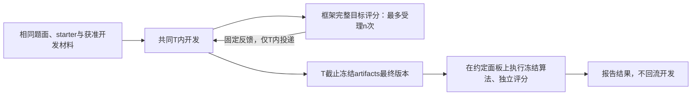

# PowerGrid Benchmark for Agent

面向能源领域优化与ML的算法演化Benchmark。**当前优先完成RTE任务：ABC45开放开发和官方checker自测，X15受保护评测；过程反馈每例15分钟、评测端15 CPU并行，截止冻结后每例90分钟终评，不回流开发。** n控制完整X面板的受理次数，ABC自测不计n。X同时用于反馈和终评，不声称独立未见测试。其他四任务暂沿用固定高难case的第一阶段设计。

**当前个人开发范围：直接复用 eval-in-loop 做小规模测试，只修阻断运行或导致错误结果的具体问题。** 原框架负责启动、Harbor、agent、反馈和既有记录；个人侧整理已有 task、原生配置和结果。独立基础包保留为参考，不要求迁移五任务、补齐49字段或完成生产故障矩阵才能小测。详见[精简设计决定](docs/decisions/0004-minimal-local-testing.md)。下文基础包与集群验收记录保留其原有适用范围。

**当前RTE以[决定0006](docs/decisions/0006-rte-abc-open-x15-protected.md)为准。** [新版配置与操作](docs/protocol/rte-abc-x15-configuration.md)、[原生任务包](task-packages/rte-maintenance-abc-x15-v1/README.md)说明数据、提交、分数、资源和冻结后工具。[决定0005](docs/decisions/0005-fixed-case-evolution-first.md)和[X04配置](docs/protocol/rte-x04-configuration.md)保留先前选择过程；其中RTE单例及禁止ABC本地评分条款已被覆盖。[公平比较清单](docs/framework/fair-ranking.md)已同步RTE例外，其他任务的设置继续逐项核实。

**UC/SCUC新增文献对齐配置：** [task card §13](docs/task-cards/unit-commitment.md#13-文献对齐的研究目标与配置2026-10-15)汇总四篇论文、参数与结论。主任务评价达到统一参考质量的求解加速，准备目标为gap 0.1%、RTS/CA 300秒与FERC 600秒端到端；成本质量另报。[参数JSON](configs/unit-commitment-speed.design.json)及[计时/Reward合同](docs/protocol/unit-commitment-speed.md)保留固定case、12小时、n=0/1/3/5/10、每档3次政策。具体case、同机基线/参考、执行接线与资源校准未完成，`executable=false / release_ready=false`。

原[n=0/1流程小测](configs/unit-commitment-speed.canary.json)已结束：n=0在截止收尾时失败、最终分数缺失；修复后重跑的n=1终评Reward为0.8594457102583126。框架现已修复为截止前冻结、只读发布及终评哈希核对。2026-10-17用户授权[n=0/1/3各三次全新开发](configs/unit-commitment-speed.n013-three-repeats.json)，覆盖此前不重跑n=0的限制；历史成绩保留且不计入新九次。新版本已通过同源码n=0/1/3完整UC与真实模型验收，九个作业已于13:20提交、13:21核验均进入模型开发；完整状态以[最新task card](docs/task-cards/unit-commitment.md)及新配置为准。仍使用完整RTS流程用例，UC多case主实验尚未发布。

2026-10-18新增[n=5/10各三次独立开发](configs/unit-commitment-speed.n510-three-repeats.json)：本版完整数值及真实模型验收通过后，16:29提交六个唯一Job；16:34启动核对均Running且已有真实模型响应。启动同时记录到失败模型请求，逐组计数和未证实的原因见[task card §19](docs/task-cards/unit-commitment.md#19-n510各三次全新重复2026-10-18)及[证据](docs/evidence/uc-speed-n510-three-repeats-20261018.json)。仍沿用12小时、无累计token cap与同一RTS流程用例，未发布多case主实验。

**本轮研究设计已定：五task × n=0／1／3／5／10 × 三次独立开发，共75次；每次开发上限12小时，累计token不限且无累计预留截断。L2RPN主线恢复原赛动作范围，包括redispatch，在统一条件下重跑基线；375动作版本单列。** 本次已完成RTE启动门禁并提交15个正式run；其余任务的模型、实际资源、逐例执行限额、case ID和成本校准仍需逐项确定。正式研究结果尚未完成。新主线先按task分别报告原始指标，不设置跨task总分。

**当前状态：Benchmark `v0.1-design`；已有独立参考实现版本为`0.2.0`。更新：2026-10-16。** 本阶段研究政策已整理，五任务运行包尚未全部适配。此前RTE在历史A4校准数据上通过Harbor／真实模型n=0、n=1配对canary，验证过旧公共选择、计数反馈／ACK、共同截止及独立终评；它不证明新ABC／X15模式、并行资源或新版网络限制已经验收。现有参考代码保留，不作为个人侧必迁路线；没有发布正式能源榜单。

**本地eval-in-loop已更新到`chufan_dev@c1fffbf`，保留原有改动及实验文件，完成必要兼容修复与本地测试／静态计划检查。** RTE X_04历史数据已独立核查；ABC／X15已完成v5完整面板资源验收及v6真实微型生命周期／网络验收，正式批次现已提交；最终研究评分尚未完成。详见[本轮完成说明](docs/completion-fixed-case-20261015.md)及[X_04配置草案](docs/protocol/rte-x04-configuration.md)。

三类模块已经整理为明确接口：**Configuration保留49字段的参考目录和待填模板，本轮已定设计以上文为准；Task adapters逐任务明确可执行提交、公平排行路线和缺少条件；Reliability extensions把历史故障归入共同生命周期，并区分已有本地实现与外部部署验收。**

本轮ABC／X15任务包、数据准备、测试与实际完成边界见[中文完成说明](docs/completion-rte-abc-x15-20261015.md)。

正式批次的15角色、固定客户端、启动前验收和提交状态见[运行配置](docs/experiments/rte-abc-x15-formal-20261015.md)与[最新中文工作说明](docs/completion-rte-formal-launch-20261015.md)。**RTE的15个正式run已于2026-10-16 16:10提交；16:13快照为6个Running、9个Pending排队，正式完成数仍为0。v6真实n=0／n=1微型验收均通过，已修复v5发现的直连旁路；完整X15资源凭据由v5经一致性核对复用。`release_ready=true`仅表示本次RTE启动门禁通过。** 设置为n=0／1／3／5／10各3次、开发12小时、反馈900秒／例和冻结后90分钟／例评分；候选地址空间16GiB，verifier15 CPU／256GiB，Pod21 CPU／296GiB。6个已运行Pod位于6个不同节点；16:19早期检查另从已回收的Claude记录片段确认这6组均有预期模型响应及Read／Bash等工具调用，未见API或生命周期错误。最终分数与研究结论仍待开发和截止后评分完成。

## 从哪里开始

| 需要了解的内容 | 文档 |
|---|---|
| 当前RTE如何开发、计n和做90分钟终评 | [决定0006](docs/decisions/0006-rte-abc-open-x15-protected.md)、[配置与操作](docs/protocol/rte-abc-x15-configuration.md)、[任务包](task-packages/rte-maintenance-abc-x15-v1/README.md) |
| 其他任务第一阶段固定case政策及历史选择 | [研究决定0005](docs/decisions/0005-fixed-case-evolution-first.md)、五张task-card §12；RTE最新见§13 |
| UC/SCUC的论文目标、精度/时间依据及实际配置 | [task card §13](docs/task-cards/unit-commitment.md#13-文献对齐的研究目标与配置2026-10-15)、[参数JSON](configs/unit-commitment-speed.design.json)、[逐篇原文核对](docs/evidence/uc-scuc-literature-parameters-20261015.md) |
| 后续个人侧具体做什么、哪些框架建设停止 | [复用eval-in-loop的小规模测试设计](docs/decisions/0004-minimal-local-testing.md) |
| 研究什么、为何选这五类任务、怎样组织比较 | [Benchmark 研究契约](docs/benchmark-spec.md) |
| 已做实验用了哪些设置、得到什么结果、哪些问题需要修复 | [98 个预实验槽位的中文统计](docs/evidence/preliminary-experiments-20261013.md) |
| 原始竞赛的排行榜、开发/测试集及其与本地划分的区别 | 五张任务卡第8节；PGLib-UC按公开实例库说明，不编造竞赛榜单 |
| 开发时间、计数反馈、数据权限与冻结复核如何定义 | [评测协议](docs/protocol/evaluation-protocol.md) |
| 如何提交算法、冻结产物、保存反馈与重放证据 | [产物与记录契约](docs/protocol/artifact-contract.md) |
| 后续先修什么、怎样证明框架与任务可以稳定批量运行 | [实施顺序与验收矩阵](docs/implementation-plan.md) |
| 当前有哪些明确决定、历史政策如何保留 | [当前决定0005](docs/decisions/0005-fixed-case-evolution-first.md)；旧[范围](docs/decisions/0001-benchmark-scope.md)、[反馈与留出](docs/decisions/0002-feedback-and-holdout.md)、[预算与产物](docs/decisions/0003-budget-and-artifact-policy.md)保留历史 |
| 公开原题与内部脱敏证据如何区分 | [证据与公开来源索引](docs/evidence/source-index.md) |
| 结构化设计声明及未来 release 所需字段 | [设计清单](manifests/benchmark-v0.1-design.json)、[清单使用说明](manifests/README.md) |
| 固定case政策、源码升级与本轮实际完成边界 | [本轮中文完成说明](docs/completion-fixed-case-20261015.md)；初版见[历史完成说明](docs/completion-20261014.md) |
| 第三步如何拆分、哪些来自底座、哪些属于新基础层 | [统一生命周期与模块边界](docs/framework/architecture.md) |
| 完整研究配置有哪些参考字段（个人小测沿用原生配置） | [Configuration字段与责任](docs/framework/configuration.md)、[待定模板](configs/experiment.template.json)、[机器字段目录](configs/configuration-catalog.json) |
| 公平比较有哪些设置要决定、如何决定每task的最小实现 | [公平设置与五任务路线](docs/framework/fair-ranking.md)、[Task Adapter参考合同](docs/framework/task-adapters.md)、五张任务卡§10 |
| 预实验偏离原题的地方如何处理、设置如何有依据地确定 | [逐题对齐与校准决定](docs/protocol/task-alignment-and-calibration.md)、[代码／数据／成本审计](docs/evidence/task-alignment-audit-20261015.md)、五张任务卡§11 |
| 本轮确定了什么、哪些代码修复和实测尚未完成 | [原题对齐中文完成说明](docs/completion-task-alignment-20261015.md) |
| 提交给eval-in-loop的task需要整理成什么目录与文件 | [原生task包、artifacts及评分入口](docs/framework/native-task-package.md) |
| 本轮公平设置与task提交格式完成了什么、发现哪些未决问题 | [中文完成说明](docs/completion-task-settings-20261015.md) |
| 过去的失败如何变成统一保障与验收 | [可靠性保障层](docs/framework/reliability-layer.md)、[分层验收](docs/framework/acceptance.md) |
| 最新真实集群实验：设置、结果、修复与剩余边界 | [中文集群验收完成说明](docs/completion-step3-cluster-20261015.md)、[脱敏机器证据](docs/evidence/harbor-cluster-acceptance-20261015.json) |
| RTE本地适配与Harbor部署合同 | [RTE适配](docs/framework/rte-integration-acceptance.md)、[Harbor验收](docs/framework/harbor-live-acceptance.md)、[relay恢复前历史说明](docs/completion-step3-live-20261015.md) |
| 第三步实际完成与测试证据 | [第三步中文完成说明](docs/completion-step3-20261015.md)、[本地验收摘要](docs/evidence/framework-validation-20261015.json) |

## 安装和核对基础层

以下用于检查已交付的独立参考实现；个人使用原生`eval-in-loop`运行现有task，无需先安装本包或执行这些夹具。**通用JSON模板、参考selector及下面的夹具保留旧四角色／免费public-selection设计，不是第一阶段严格计n的可启动配置或验收证据。** 运行方式按实际框架版本和已核对task入口填写。

需要Python3.11或以上；核心包只有Python标准库依赖。可按个人偏好使用`uv`：

```sh
uv venv .venv
uv pip install --python .venv/bin/python -e .
.venv/bin/powergrid-bench config-check configs/experiment.template.json
.venv/bin/powergrid-bench adapter-check manifests/task-adapters/unit-commitment.json
.venv/bin/powergrid-bench fixture-run --work-dir work/first-acceptance --trusted-local
```

也可在已有虚拟环境中用`python -m pip install .`。不安装即可核对：

```sh
PYTHONPATH=src python3 -m unittest discover -s tests -v
PYTHONPATH=src python3 -m powergrid_bench.cli config-check configs/experiment.template.json
PYTHONPATH=src python3 -m powergrid_bench.cli fixture-run --work-dir work/acceptance --trusted-local
```

`config-check`默认允许审阅draft并列出未定字段；`--require-complete`会拒绝draft／缺值。`adapter-check`只核对设计声明，`--require-certified`会拒绝全部七个尚未认证的task。`executable=true`只表示配置填实，仍不是task或部署认证。

夹具实际执行小算法、独立checker、反馈、恢复、冻结和新输入终评；开发时钟使用注入的逻辑时间，数值只用于功能测试。它不访问模型服务、集群或能源数据。`--trusted-local`仅用于可信代码，不能作为恶意代码隔离措施。每次使用新工作目录，既有记录不会覆盖；证据保存在`report.json`和`ledger.sqlite3`。详情见[验收边界](docs/framework/acceptance.md)。

GitHub Actions已配置Python3.11／3.12／3.13的测试、80%覆盖率门槛、格式检查、构建与夹具证据归档。具体运行状态以仓库Actions页面为准；本地通过记录不等于远端工作流已经通过。

## 五个核心任务族

| 任务族 | 演化对象与能力 | 预实验给出的首要建设需求 |
|---|---|---|
| [GOC SC-AC-OPF](docs/task-cards/goc-sc-ac-opf.md) | 非凸连续优化、故障分解、物理约束和数值工程 | 固定高难完整工况，执行基态及全部故障；移除开发完整评分旁路，重跑参考 |
| [UC / SCUC](docs/task-cards/unit-commitment.md) | 离散调度、MILP、约束建模、启发式与数学求解混合 | 固定完整原始UC实例；从静态排程评分改为执行冻结solver |
| [RTE 检修排程](docs/task-cards/rte-maintenance.md) | 组合搜索、资源约束、风险目标和排程 | ABC45开放开发，X15受保护反馈；15分钟过程、90分钟冻结后，评测15 CPU并行 |
| [L2RPN 电网控制](docs/task-cards/l2rpn-grid-control.md) | 序贯决策、仿真搜索、RL 和规则混合 | 固定高难完整episode，恢复原动作范围并统一计数评分和现代scorer |
| [HEFTCom 预测与交易](docs/task-cards/heftcom-forecast-trade.md) | 时间序列ML、预测到决策、收益与风险 | 固定完整市场日／时段，保留因果信息；执行冻结流水线并恢复原结算 |

GOC 的 500/793/2000/2312 等规模属于同一任务族；UC 为核心，受限 SCUC 适配为扩展。GOC30000 保留为压力测试，AHC024 保留为非能源框架测试，均不计入五个核心任务族。

## 两个新增配电网扩展任务

2026-10-15 按用户要求加入以下两题。**已交付卡片、设计声明、来源锁、基础合同代码、starter、小样例和原生 task 骨架；完整仿真运行器、正式难例及资源/基线校准仍待验收，均为 `release_ready=false`。** 它们尚未加入上面的五任务75-run计划。

| 扩展任务 | 用途与基础接入 |
|---|---|
| [MAPDN 局部协同电压控制](docs/task-cards/mapdn-voltage-control.md) | 局部PV无功、droop与协同规则；校验无功能力和动作，区分真实有功损耗与reward代理 |
| [PowerGym 混合设备 Volt/VAR 控制](docs/task-cards/powergym-volt-var-control.md) | 电容器、调压器与储能；校验混合动作和SOC，确定性打包负荷并隔离worker目录 |

完成范围与验证见[中文完成说明](docs/completion-distribution-20261015.md)。接入方法见[配电网基础适配说明](docs/framework/distribution-control-integration.md)、[原生task骨架](task-packages/README.md)和[来源锁](configs/distribution-sources.json)。`distribution-prepare`将固定上游版本复制到可信评测准备目录，核对源文件摘要；它不生成开发数据包或执行潮流。公开starter只提供人工合成的接口自检，不含完整目标评分器。

## 共同实验语义



- RTE采用ABC45开发、X15受保护反馈及冻结后评测；其他task暂按同一高难完整case。两种设计均不声称独立未见泛化。
- RTE允许ABC官方checker自测，限制的是X数据、旧结果及评测回流；其他task暂按决定0005限制完整目标评分。实际数据、工具及网络边界逐task验收。
- `n`是受保护完整面板评分作业的最多受理数；分别记录受理、完成和投递。RTE一次X15计一次，ABC自测不计；n=0没有X反馈。
- 开发T包含训练、编译、获准检查和反馈等待；累计token不限，无累计预留截断，实际用量未知时记unknown。
- 不设免费的public-selection／best-public-selection评分。agent依据已经计n的反馈在T内保留最终版本，截止冻结；无修改保留starter，不用终验再选优。
- 最终复核不占过程n，不向开发回流。同task报告原始指标、有效性、资源及三次独立开发结果；单case历史值按相同输入并列披露差异，本批不设跨task总分。

当前RTE新版允许开发端对ABC完整评分，X仅留在可信评测端。原生黑名单／搜索开关及实际联网通道仍需部署验证，不能把“有黑名单”当作“X不可取得”。详见[决定0005 §6](docs/decisions/0005-fixed-case-evolution-first.md#6-黑名单与评分隔离还缺什么)。

## 当前证据与完成边界

主快照截至 **2026-10-13 23:32（UTC+8）**，修复准备记录至 23:38。98 个去重槽位中：59 个已有评分有效（含 AHC024 两个按规则计零的结果）、15 个开发导出有效但未终评、14 个失败、3 个实际运行、7 个未启动或排队。它们是任务校准和框架诊断的依据，不是新协议下的正式横向比较。

第三步已增加可验证的基础软件与五任务提交合同。固定目标case、数据权限、资源和超时、允许依赖／求解器、基线参考值、反馈内容与reward映射仍需核对／实测后冻结；未定字段保持`null`。历史记录保留，新增实现和待接入工作见[第三步完成说明](docs/completion-step3-20261015.md)。

2026-10-15实际RTE canary两组严格通过：n=0成功调用模型5次、保护反馈0次；n=1成功调用模型8次、保护反馈受理／完成／ACK均1次。两组均在T=180秒共同截止前实际停止Docker，冻结已检查的公共checkpoint，A12原生独立终评均为AC。两组均选择未修改starter；实例属于历史已暴露的校准面板，不能据此报告算法提升、反馈效果或未见泛化。恢复证据覆盖完成后独立进程重开账本；开发中完整会话／Pod恢复和跨节点SQLite WAL仍需另验。详情见[最新中文报告](docs/completion-step3-cluster-20261015.md)。

## 后续建设顺序

**个人当前路线以[精简设计](docs/decisions/0004-minimal-local-testing.md)为准：复用五个既有task入口，检查本次需要的配置和评分，只处理实际阻断，随后小规模实验并记录结果。** 以下完整建设阶段保留为研究／release路线参考，不是要求个人逐项实现后端保障，也不是小测前置清单。

1. **研究契约与任务范围：文档完成。** 固定研究对象、五个任务族、主线与扩展边界、比较单位和主要研究问题。
2. **任务卡与统一评测契约：已同步第一阶段政策。** 五卡§12记录固定难例、严格计n、artifacts冻结与同case复核；旧四角色留作历史／第二阶段参考。
3. **基础框架统一：合同、本地参考实现和RTE真实Harbor／模型主链路验收完成。** 已验证共同计时、反馈账本、实际反馈／ACK、容器停止、冻结与独立终评；G1其余故障矩阵、开发中完整中断恢复及部署认证继续推进。
4. **当前优先：任务包实现与校准。** 先完成RTE ABC／X15包及其15路并行，落实数据权限、基线、资源和完整评分；其他四题按同原则推进。
5. **批量认证与 release 冻结。** 清洁环境、恶意/无效产物、故障注入、目标并发、重放和跨任务批次全部验收。
6. **正式研究。** 第一阶段在各task约定的评测面板上比较反馈预算与方法基线，再做智能体／演化结构消融；RTE使用ABC／X15协议，其他四task暂按同case设计。未见泛化另行设计。

## 仓库与来源政策

本仓库发布原创中文文档、设计JSON和独立编写的基础参考实现／测试。私有`eval-in-loop`框架底座、模型轨迹、凭据、机器配置、内部集群信息和大型原始能源数据不在发布包中。`task-packages/`发布本地task适配与构建／测试说明；官方checker按其Apache-2.0许可独立注明来源。历史统计采用脱敏摘要，公开来源在任务卡及来源索引中链接；内部历史成绩无法仅凭本仓库重新计算。

上游数据、checker、仿真环境和 solver 各自的许可证、版本与归属需要单独核验；当前没有把尚未审计的数据或代码赋予统一许可。新增实现、数据或正式结果时，应追加版本与归属记录，并采用可审查的提交/PR。
