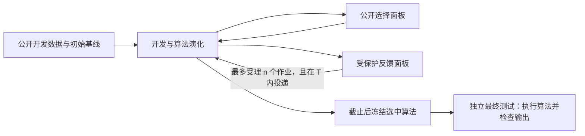

# PowerGrid Benchmark for Agent

面向能源领域优化与 ML 的算法演化 Benchmark：在共同的开发时限内，让智能体构造可执行算法，通过受控评测反馈改进，再在独立留出数据上测试冻结算法。

**当前状态：Benchmark `v0.1-design` + 基础框架 `0.2.0`。更新：2026-10-15。** 前两步的研究契约、任务卡与评测规范已完成。第三步新增统一实验生命周期的独立参考实现、配置校验、算法提交 ABI、持久账本、快照／冻结、恢复及可运行的低成本验收夹具。已增加 Unix socket broker 与 RTE 原生适配，并在真实题目上验收本地共同生命周期。五任务生产认证与实际 Harbor／模型闭环仍未通过；没有发布正式能源榜单。

三类模块已经整理为明确接口：**Configuration列出需决定的49个字段，数值保持待定；Task adapters逐任务明确可执行提交、公平排行路线和缺少条件；Reliability extensions把历史故障归入共同生命周期，并区分已有本地实现与外部部署验收。**

## 从哪里开始

| 需要了解的内容 | 文档 |
|---|---|
| 研究什么、为何选这五类任务、怎样组织比较 | [Benchmark 研究契约](docs/benchmark-spec.md) |
| 已做实验用了哪些设置、得到什么结果、哪些问题需要修复 | [98 个预实验槽位的中文统计](docs/evidence/preliminary-experiments-20261013.md) |
| 原始竞赛的排行榜、开发/测试集及其与本地划分的区别 | 五张任务卡第8节；PGLib-UC按公开实例库说明，不编造竞赛榜单 |
| 开发时间、反馈次数、数据隔离、选模和最终测试如何定义 | [评测协议](docs/protocol/evaluation-protocol.md) |
| 如何提交算法、冻结产物、保存反馈与重放证据 | [产物与记录契约](docs/protocol/artifact-contract.md) |
| 后续先修什么、怎样证明框架与任务可以稳定批量运行 | [实施顺序与验收矩阵](docs/implementation-plan.md) |
| 当前有哪些明确决定、还有什么必须通过校准确定 | [范围决定](docs/decisions/0001-benchmark-scope.md)、[反馈与留出决定](docs/decisions/0002-feedback-and-holdout.md)、[预算与产物决定](docs/decisions/0003-budget-and-artifact-policy.md) |
| 公开原题与内部脱敏证据如何区分 | [证据与公开来源索引](docs/evidence/source-index.md) |
| 结构化设计声明及未来 release 所需字段 | [设计清单](manifests/benchmark-v0.1-design.json)、[清单使用说明](manifests/README.md) |
| 这次完成了哪些工作、核查了什么 | [中文完成说明](docs/completion-20261014.md) |
| 第三步如何拆分、哪些来自底座、哪些属于新基础层 | [统一生命周期与模块边界](docs/framework/architecture.md) |
| 哪些配置值需要决定，缺值为什么不能运行 | [Configuration字段与责任](docs/framework/configuration.md)、[待定模板](configs/experiment.template.json)、[机器字段目录](configs/configuration-catalog.json) |
| 每个task怎么交算法，选择哪种排行、目前具备哪些条件 | [公平排行路线](docs/framework/fair-ranking.md)、[Task Adapter合同](docs/framework/task-adapters.md)、五张任务卡§10 |
| 过去的失败如何变成统一保障与验收 | [可靠性保障层](docs/framework/reliability-layer.md)、[分层验收](docs/framework/acceptance.md) |
| RTE真实题目、本地n=0/n=1生命周期和真实部署进度 | [本轮中文完成说明](docs/completion-step3-live-20261015.md)、[RTE适配](docs/framework/rte-integration-acceptance.md)、[Harbor验收](docs/framework/harbor-live-acceptance.md) |
| 第三步实际完成与测试证据 | [第三步中文完成说明](docs/completion-step3-20261015.md)、[本地验收摘要](docs/evidence/framework-validation-20261015.json) |

## 安装和核对基础层

需要Python3.11或以上；核心包只有Python标准库依赖。可按个人偏好使用`uv`：

```sh
uv venv .venv
uv pip install --python .venv/bin/python -e .
.venv/bin/powergrid-bench config-check configs/experiment.template.json
.venv/bin/powergrid-bench adapter-check manifests/task-adapters/unit-commitment.json
.venv/bin/powergrid-bench fixture-run --work-dir work/first-acceptance --trusted-local
```

也可在已有虚拟环境中用`python -m pip install .`。不安装即可核对：

```sh
PYTHONPATH=src python3 -m unittest discover -s tests -v
PYTHONPATH=src python3 -m powergrid_bench.cli config-check configs/experiment.template.json
PYTHONPATH=src python3 -m powergrid_bench.cli fixture-run --work-dir work/acceptance --trusted-local
```

`config-check`默认允许审阅draft并列出未定字段；`--require-complete`会拒绝draft／缺值。`adapter-check`只核对设计声明，`--require-certified`会拒绝五个尚未认证的task。`executable=true`只表示配置填实，仍不是task或部署认证。

夹具实际执行小算法、独立checker、反馈、恢复、冻结和新输入终评；开发时钟使用注入的逻辑时间，数值只用于功能测试。它不访问模型服务、集群或能源数据。`--trusted-local`仅用于可信代码，不能作为恶意代码隔离措施。每次使用新工作目录，既有记录不会覆盖；证据保存在`report.json`和`ledger.sqlite3`。详情见[验收边界](docs/framework/acceptance.md)。

GitHub Actions已配置Python3.11／3.12／3.13的测试、80%覆盖率门槛、格式检查、构建与夹具证据归档。具体运行状态以仓库Actions页面为准；本地通过记录不等于远端工作流已经通过。

## 五个核心任务族

| 任务族 | 演化对象与能力 | 预实验给出的首要建设需求 |
|---|---|---|
| [GOC SC-AC-OPF](docs/task-cards/goc-sc-ac-opf.md) | 非凸连续优化、故障分解、物理约束和数值工程 | 从固定场景优化升级到通用求解器留出评测；完善收尾、快照和恢复 |
| [UC / SCUC](docs/task-cards/unit-commitment.md) | 离散调度、MILP、约束建模、启发式与数学求解混合 | 从静态调度文件升级到执行冻结求解器；校准难度与数值下限 |
| [RTE 检修排程](docs/task-cards/rte-maintenance.md) | 组合搜索、资源约束、风险目标和排程 | 修复任务包完整性；执行新实例排程，分离反馈和终评 |
| [L2RPN 电网控制](docs/task-cards/l2rpn-grid-control.md) | 序贯决策、仿真搜索、RL 和规则混合 | 统一开发预算与场景切分；完成已导出策略的独立最终测试 |
| [HEFTCom 预测与交易](docs/task-cards/heftcom-forecast-trade.md) | 时间序列 ML、预测到决策、收益与风险 | 执行冻结预测/交易管线；独立时间留出与信息可用时间审计 |

GOC 的 500/793/2000/2312 等规模属于同一任务族；UC 为核心，受限 SCUC 适配为扩展。GOC30000 保留为压力测试，AHC024 保留为非能源框架测试，均不计入五个核心任务族。

## 共同实验语义



- 四种数据角色：`public-development`、`public-selection`、`protected-feedback`、`final-test`；旧的暴露面板标记为 calibration。
- 开发墙钟 `T` 在共同环境准备完成后启动，包含训练、编译、本地测试、公开选择和反馈等待。**不设累计 token cap**；记录实际 token，用量不可得时记 unknown。
- `n` 是受保护评测作业的受理上限。`n=0` 禁止受保护反馈，不等于不限次数；公开目标与 checker 可以使用。
- 默认按开发截止前完成的公开 selection 选候选；截止后冻结，终评执行算法处理留出输入，并由独立 checker 评分。
- 分开保存受理、完成和送达计数；原样重试、故障分类与恢复来源可以核对。
- 同一任务内报告原始指标、有效性和资源；跨任务汇总先做预注册归一化，按任务族聚合。

## 当前证据与完成边界

主快照截至 **2026-10-13 23:32（UTC+8）**，修复准备记录至 23:38。98 个去重槽位中：59 个已有评分有效（含 AHC024 两个按规则计零的结果）、15 个开发导出有效但未终评、14 个失败、3 个实际运行、7 个未启动或排队。它们是任务校准和框架诊断的依据，不是新协议下的正式横向比较。

第三步已增加可验证的基础软件与五任务提交合同。真实 split 成员、资源和超时、允许依赖／求解器、基线参考值、反馈内容与归一化映射仍需实测后冻结；未定字段保持`null`。历史记录保留，新增实现和待接入工作见[第三步完成说明](docs/completion-step3-20261015.md)。

## 后续建设顺序

1. **研究契约与任务范围：文档完成。** 固定研究对象、五个任务族、主线与扩展边界、比较单位和主要研究问题。
2. **任务卡与统一评测契约：文档完成。** 整理现有证据，明确算法接口、四角色数据、预算、评分、产物与验收要求。
3. **基础框架统一：合同、本地参考实现和RTE集成验收完成。** 已验证共同计时、反馈账本、产物冻结、打包校验、恢复及算法ABI；G1还需要真实Harbor／模型工具往返、硬停止和实际投递验收。
4. **任务包实现与校准。** 逐个任务构建真实切分、执行接口、基线、资源 profile 与固定评分。
5. **批量认证与 release 冻结。** 清洁环境、恶意/无效产物、故障注入、目标并发、重放和跨任务批次全部验收。
6. **正式研究。** 先做反馈预算与方法基线，再做智能体/演化结构消融及泛化分析；每次测试曝光有记录。

## 仓库与来源政策

本仓库发布原创中文文档、设计JSON和独立编写的基础参考实现／测试。私有`eval-in-loop`源码、模型轨迹、凭据、机器配置、内部集群信息和原始能源实验数据不在发布包中。历史统计采用脱敏摘要，公开来源在任务卡及来源索引中链接；内部历史成绩无法仅凭本仓库重新计算。

上游数据、checker、仿真环境和 solver 各自的许可证、版本与归属需要单独核验；当前没有把尚未审计的数据或代码赋予统一许可。新增实现、数据或正式结果时，应追加版本与归属记录，并采用可审查的提交/PR。
