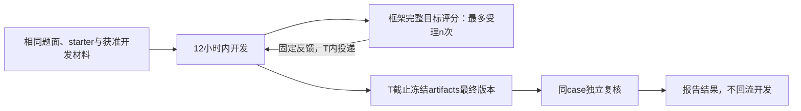

# 决定0005：第一阶段研究固定难例上的算法演化

**RTE后续决定（2026-10-15）：** 当前RTE采用ABC45开放开发、X15隔离反馈，900秒／例、评测端15 CPU并行；冻结后5400秒／例评测且不回流。ABC允许官方checker本地自测，n仅统计完整X面板受理次数。RTE以[决定0006](0006-rte-abc-open-x15-protected.md)和[新配置](../protocol/rte-abc-x15-configuration.md)为准；下文X04单例及禁止全部本地评分条款保留为被覆盖的历史设计，其他任务不受此例外影响。

**状态：按用户要求采纳。日期：2026-10-15。** 本决定是当前第一阶段的研究政策；优先于旧文档中四角色数据、免费完整checker和`best-public-selection`的默认要求。它不表示五个运行任务包已完成修改或验收。

## 1. 先研究什么

第一阶段研究：在同一完整能源问题上，给定相同开发时间、模型、初始材料和资源，改变框架评分预算n，会怎样影响agent构造算法的效果。

每个task固定一个case，开发面向这个case，计数评分评这个case，开发截止后也在这个case复核冻结算法。允许对该case自适应改进，因此结果解释为**固定case上的算法演化能力**。其他case上的泛化能力留到第二阶段，不作为本阶段成立的前提。

开发和最终复核可以使用同一个case，但开发agent不能免费运行完整目标评分。开发数据可见范围、评分权限、最终产物冻结是分别要落实的设置，不能因为case相同而忽略其中任何一项。

## 2. 已定与未定

| 设置 | 当前决定 |
|---|---|
| task | GOC、原始PGLib-UC、RTE检修排程、L2RPN、HEFTCom Trading，共五类 |
| case | 每task选一个尽可能困难、完整、可实际运行的case；RTE初选工业X_04，其他ID尚未冻结 |
| 研究规模 | n=0／1／3／5／10，各3次独立开发，共75个run |
| 开发T | 每run上限43200秒，即12小时；允许提前正常结束，记录实际时间 |
| token | 不设累计token cap，不采用累计token预留截断；单次响应／上下文限制另记 |
| 过程评分 | 只能通过框架计数评分器取得完整目标case的评分反馈 |
| 最终产物 | T内放入原生artifacts路径的最终版本；截止冻结后不能改动；无修改保留starter |
| 最终复核 | 执行冻结算法并独立评分；不回流开发，不占过程n，不择优重复终评 |
| 尚待确定 | case ID、可见数据、模型、资源、算法执行限额、seed、反馈字段／精度、依赖与基线版本 |

每个n的三次是独立的开发run，不用同一算法的三个仿真seed代替。研究n时，其他设置保持一致。各task允许有不同的算法执行成本，但同一task不能随n改变case、求解时间或反馈内容。

## 3. 怎样选难例

先选择case，再运行正式n比较，不能根据哪个case产生了更好看的n效果再挑选。

1. **完整性优先。** 原始目标、约束、完整时域、必需输入和权威评分可用；不通过裁剪风险情景、故障或时间范围让难例变容易。
2. **在可运行范围内追求高难度。** 用原赛逐case记录、完整参考算法的可行率／原始指标／时间，以及建模规模形成证据；统一预算下仍有改进空间是有用信号。
3. **先区分运行故障与求解难度。** 文件最大、目标数值最大、一次RE或OOM都不能单独证明case最难。缺数据、解析失败、错误资源配额先修复或记录为不可运行。
4. **固定选例理由。** 保存候选范围、版本、难度依据和成本测量；固定后各n及重复使用同一case。若最困难候选当前无法承载，说明限制并选最困难的完整可运行候选。

“一个case”按问题定义，不能为了字面上只留一行而破坏任务：

| task | 第一阶段case的单位与必须保留的内容 |
|---|---|
| GOC | 一个完整网络／工况，含Code1基态及全部指定故障的Code2响应；不能只评一个故障 |
| PGLib-UC | 一个原始完整实例，保留全时域、初态、备用和成本；SCUC另列扩展 |
| RTE | 初选工业X_04；一个完整排程实例，保留全部干预、时段、资源、风险情景及原Alpha／Quantile |
| L2RPN | 一个完整episode／chronic及固定环境、seed和合法信息；恢复原赛动作范围，含redispatch |
| HEFTCom | 一个预先固定的完整市场日或连续市场时段；按因果信息逐日决策，区间范围和难度证据待定 |

RTE初选X_04的依据已用本地官方归档独立核查：历史13队在15分钟6／13队AC、90分钟7／13队AC，自有旧候选两档均有效。低有效率提供选例证据，但不单独证明它在所有意义上最难；本轮实际成本继续测量。具体来源、旧结果与待定配置见[X_04配置草案](../protocol/rte-x04-configuration.md)。

其他case可以用于出题侧选例、固定参考测量或之后的泛化研究。它们是否向开发agent开放，及允许哪种非目标训练／检查，要逐task声明，不能据此再开放一个免费的完整目标评分通道。

## 4. n控制哪些反馈

**n是框架完整目标评分作业的最多受理次数。** 受理、完成和实际投递分别记录；受理n次不保证agent收到n次结果。候选错误／非法输出／算法超时仍消耗已经受理的作业；基础设施故障的原样重试保留同一逻辑作业，不重发T或n。

| 行为 | 第一阶段处理 |
|---|---|
| 框架评分器执行目标case，返回原始指标／reward／可行性和批准诊断 | 过程反馈统一计n；schema与精度在批次前固定 |
| 向开发agent提供完整checker或完整`public_eval`评分工具 | 禁止 |
| 本地运行完整目标case评分，或改写checker以绕开计数 | 禁止；不能把调用入口改个名字就变为免费反馈 |
| 搜索、下载原竞赛测评源码／checker | 禁止；需要配置搜索与网络限制并核对实际覆盖 |
| 语法、导入、格式、接口与小型示例检查 | 可以；计入T，不能携带完整目标case分数或等价诊断 |
| 求解器内部目标计算、搜索启发式、获准训练数据上的训练loss | 算法正常计算；不能据此把完整目标评分绕回开发agent |
| 免费完整public-selection或自动多候选评分选优 | 取消；agent只能依据已获得的计数反馈决定保留哪个版本 |
| 截止后对唯一冻结产物做完整复核 | 不占过程n；结果在开发结束后报告，不再触发开发或选优 |

`n=0`是没有任何完整目标过程评分反馈的开发，使用原生terminal模式；不是judge内部的“0表示无限”。最终仍执行冻结产物，才能知道零过程反馈条件下算法的表现。

## 5. 复用原生生命周期

agent在T内自行决定最终保留版本，可依据已经消耗n取得的反馈。框架到截止直接收集该版本；不另设免费的候选打分、排名选择或截止后训练。未修改时沿用starter；产物缺失、损坏、超时及不可行按task预先固定的规则处理，不能用终评结果回头找其他版本。

复用eval-in-loop的task目录、artifacts、judge、计数、超时和结果文件。必要改动放在task题面、镜像内容、评分执行及实际支持的配置，不新建broker、数据库或通用生命周期平台。75次正式启动前，先用短验确认本次入口确实执行这些规则。

## 6. 黑名单与评分隔离还缺什么

本地eval-in-loop已安全更新到较新上游分支`chufan_dev`的提交`c1fffbf839c449d7d35952da37664b5a67ea3df6`，保留原有改动及实验文件，并完成必要兼容修复与本地检查。该版本包含域名egress规则及agent搜索工具开关；**源码具有功能、配置启用和实际防住旁路是三个不同状态**，不能混称为已完成实验隔离。升级与测试范围见[本轮中文完成说明](../completion-fixed-case-20261015.md#4-本地源码升级与检查结果)。

域名规则并不理解“这份内容是不是竞赛checker”，也不自动删除本地评分文件或禁止agent自己实现目标函数。必须核对开发镜像、预装包、共享目录、可见日志、搜索工具及网络出口。限制是否覆盖shell直连等路径，须以所用后端的实际行为验收；不能只看到黑名单字段就宣布完整目标评分已无法绕过。

RTE现有开发包含完整官方评分支持代码和完整评分工具，是当前明确的任务内容缺口。须从开发侧移除完整checker／评分入口，并核对starter和数据路径是否提供等价完整反馈；可信评测侧保留原checker。历史canary不能证明新的n控制已成立。

**目标case数据的开发可见性仍待逐task确定。** 若完整输入和目标公式足以重算目标分数，仅隐藏checker不足以保证严格n。只在可信执行时注入完整目标输入、开发侧使用schema／toy数据，是可考虑的策略；它尚未被确定为所有任务的统一实现。优化算法在评分侧处理完整输入时仍须正常计算其内部目标，不能将本政策误解成禁止求解器优化。

这部分是执行本次研究变量所需的最小任务边界，不等于要求个人侧建设完整网络安全平台。现成能力不足的地方要明确标出，由task调整或已有后端能力解决，再报告已达到的实际保证。

## 7. 怎样和原排行榜比较

固定case后，优先找**完全相同输入版本的逐case原始成绩**。报告本方法与历史方法的原成本／风险／收益等数值，并列时间档、硬件、求解器／scorer、信息范围和动作能力差异。相同case简化了比较单位，但不消除这些条件差异。

只有同条件重跑的方法进入本地公平比较表。原赛逐case值可作历史参照；只拿到总榜、积分或不同聚合区间时，不能推导该case成绩。单case不能授予原赛多case总排名。PGLib-UC没有原竞赛排行榜，改报完整参考方法及可信下界；参考未证最优时不称optimality gap。

RTE首先比较选定工业实例的原始目标；15／90分钟是独立历史时间档，不是12小时开发T。无需为本阶段重建完整C+X积分榜，或将全部30例作为每次反馈面板。HEFTCom若缺少相同市场区间／合法信息下的历史逐期结果，先做本地同条件比较。

## 8. 本阶段完成标准

1. 每task固定case、完整语义、来源版本、选择理由及开发可见信息。
2. starter和完整参考方法在实际执行预算内运行，由可信原checker独立评分；记录原始指标与有效性。
3. 开发包不含完整checker和目标评分旁路；搜索／网络限制使用现有能力实际启用，并检查目标数据可见性。
4. 同一入口短验n=0无目标过程反馈、正n可反馈、超额拒绝、失败计数、截止停机及唯一artifacts冻结／同case复核。
5. 冻结模型、资源、限额、seed、反馈schema与75项run清单，再启动正式实验。

旧四角色、独立留出和完整参考内核保留为历史设计／第二阶段参考。相关旧说明和机器模板没有因此自动变成第一阶段可执行配置；发布新结果时必须标明使用本决定及实际验证范围。

相关入口：[公平设置](../framework/fair-ranking.md)、[逐题对齐与成本校准](../protocol/task-alignment-and-calibration.md)、[评测协议](../protocol/evaluation-protocol.md)、[原生task包](../framework/native-task-package.md)、[本轮中文完成说明](../completion-fixed-case-20261015.md)。
