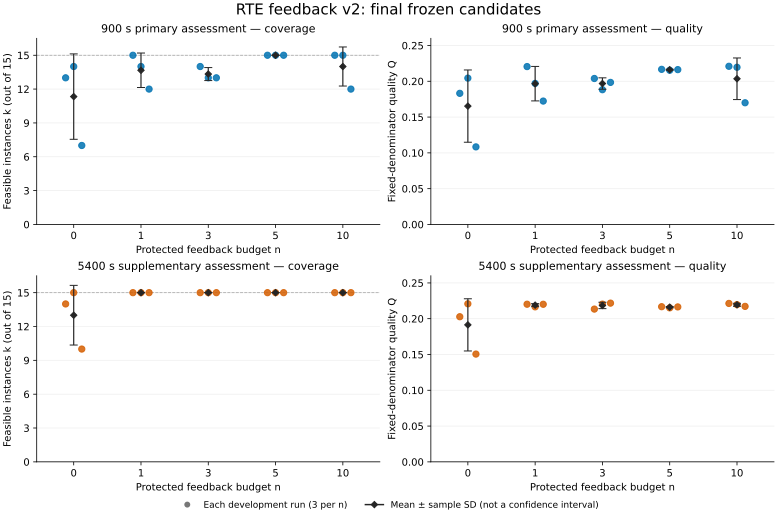

# RTE 检修排程反馈 v2：15 组实验结果报告

记录日期：2026 年 10 月 18 日。数据核对时间：**16:01:35，Asia/Shanghai**。本报告仅分析 `rte2020-abc-x15-feedback-v2-20261017-v1` 批次，包含 n=0／1／3／5／10、每档 3 次独立开发，共 15 次运行；不混入旧 v1、微型验收或资源校准样本。

## 1. 主要结果与完成状态

**15 组均完成开发、15 分钟主评测和 90 分钟补充评测，最终流程检查全部通过。** 最后一组于 10 月 18 日 15:55:32 完成。服务器记录显示 15 个作业均成功退出，作业失败数和容器重启数均为 0。

本批主要发现如下：

1. **15 分钟主评测中，n=5 的三次运行均在全部 15 例上取得可行解，是当前三次重复中覆盖最稳定的一档。** n=0 的平均可行例数最低，新批次没有重现旧批次“n=0 最好”的现象。
2. **反馈次数与成绩没有呈现严格单调关系。** n=1 的平均覆盖略高于 n=3，n=10 的一次运行只有 12/15 可行；不能据此确定全局最优反馈次数。
3. **90 分钟下的覆盖明显提高，但不能替代主成绩。** 全板可行的运行从 6/15 增至 13/15；n>0 的 12 次运行均达到 15/15。
4. **生命周期已批量跑通，评测重复性仍需核查。** 同一 starter 在 8 次首次反馈中得到 5–9 例可行的不同结果；另有一次开发阶段 OOM。完成本批流程不等于已经证明候选成绩确定可复现。

以下报告完整结果与差异，不进行显著性检验，也不将三次重复的观察写成反馈次数的确定因果效应。

## 2. 实验设置

| 项目 | 本批设置 |
|---|---|
| 问题 | RTE 检修排程，提交可执行的通用 `solver.py` |
| 开发材料 | ABC 三组共 45 例和官方 checker 开放，可自主自测，不计入 n |
| 受保护面板 | X 组全部 15 例；原始输入、原解及旧实验产物不进入开发端 |
| 研究变量 | X15 完整面板反馈预算 n=0／1／3／5／10，每档 3 次独立开发 |
| 开发上限 | 每次 43,200 秒，即 12 小时；累计 token 不设上限 |
| 模型 | `global.openai.gpt-5.6-sol`，全部运行的原生审计记录一致 |
| 过程反馈 | 每例 900 秒、15 路并行；受理一个完整面板扣一次 n |
| 反馈内容 | 面板 k／Q／reward、完整 15 例状态、有效例目标与风险分解、约束错误分类、退出码、耗时和子进程 RSS |
| 权威主评测 | 截止工作区冻结后，原生终验逐例 900 秒，不回流开发 |
| 补充评测 | 同一冻结源码逐例 5,400 秒独立启动；不计 n、不回流、不参与最终候选选择 |
| 最终候选 | 截止时工作区版本；框架不自动回退到历史最好反馈候选 |
| 开发资源 | 2 CPU／32 GiB，无 GPU |
| 评分资源 | 15 CPU／256 GiB；单例单核，候选地址空间限制 16 GiB |
| 外层额度 | 21 CPU／296 GiB，包含既有运行开销；CPU 配额不等于物理核心独占 |
| 求解 seed | 统一接口 seed=2020；不等于语言模型生成或墙钟搜索完全确定 |

正式机制限制的是**最多 n 次受理**。本批账本显示，各运行实际都用满并收齐了所分配的反馈：合计 `3×(0+1+3+5+10)=57` 次。n=0 仍可使用 ABC 的完整评分工具，因此不能称为“没有任何反馈”。

15 分钟与 90 分钟绑定同一最终候选 SHA256，但属于**两次独立求解**，不共享前一档的搜索状态。候选启动、导入、输入解析、求解和输出均占逐例墙钟预算；checker 与收尾另有运行开销。详细合同见[反馈 v2 协议](../protocol/rte-feedback-v2.md)与[任务包](../../task-packages/rte-maintenance-abc-x15-v2/README.md)。

### 排行与统计口径

每次运行先比较可行例数 k，再比较固定分母质量 Q，均越高越好：

```text
k = 15 例中得到官方 checker 有效解的例数
q_i = 0.5 - atan(F_i / s_i) / pi       （仅对有效例定义）
Q = sum(有效例的 q_i) / 15
reward = (k + Q) / 16
```

F 沿用官方逐例目标，越低越好；s_i 为仅由输入确定的固定尺度。无效例没有有效 F，反馈中的目标及 q 为 null，汇总质量贡献为 0。reward 只是本 benchmark 的排序编码，**不是官方竞赛积分，也不是求解成功百分比**。不能与旧 v1 的分数直接横比。

组间表格并列报告 k 和 Q 的均值、**样本标准差 SD，分母为 3−1**。独立重复单位是一次完整开发，组内只有 3 次；225 个“运行×实例”结果不作为 225 个独立样本。单运行 reward 编码覆盖优先，但跨重复的平均 reward 不自动保留这种优先关系，因此不据平均 reward 给 n 档排名。

## 3. 15 分钟主评测

| n | k（均值 ± SD，满分15例） | Q（均值 ± SD） | 全15例可行的运行 |
|---|---:|---:|---:|
| 0 | 11.33 ± 3.79 | 0.165301 ± 0.050474 | 0/3 |
| 1 | 13.67 ± 1.53 | 0.196631 ± 0.024089 | 1/3 |
| 3 | 13.33 ± 0.58 | 0.196857 ± 0.007944 | 0/3 |
| 5 | 15.00 ± 0.00 | 0.216108 ± 0.000674 | 3/3 |
| 10 | 14.00 ± 1.73 | 0.203497 ± 0.029041 | 2/3 |

当前样本中，n=5 的平均覆盖最高且三次均全板可行；n=0 的覆盖与质量波动最大。n=10 有两次全板可行，但第三次降至 12/15，说明更多反馈没有保证每次最终提交都更好。

**最佳单次主评测候选是 n10-r1：k=15，Q=0.220941270。** “最佳单次候选”和“某档三次运行的稳定性”是两个不同结论。n=5 虽覆盖稳定，三次 Q 均低于 n10-r1 与 n10-r2；还不能把它解释为质量最优或最优预算。



图中每个彩色点对应一次独立开发，黑色菱形和误差线为均值 ± 样本 SD，**不是置信区间**；包含有 OOM 标签的 n3-r3。上下两行分别是主评测与补充评测，所有坐标从 0 起。可下载[矢量 PDF](../figures/rte-feedback-v2-results-20261018.pdf)。

## 4. 90 分钟补充评测

| n | k（均值 ± SD，满分15例） | Q（均值 ± SD） | 全15例可行的运行 |
|---|---:|---:|---:|
| 0 | 13.00 ± 2.65 | 0.191373 ± 0.036471 | 1/3 |
| 1 | 15.00 ± 0.00 | 0.218972 ± 0.002103 | 3/3 |
| 3 | 15.00 ± 0.00 | 0.218501 ± 0.004457 | 3/3 |
| 5 | 15.00 ± 0.00 | 0.216114 ± 0.000858 | 3/3 |
| 10 | 15.00 ± 0.00 | 0.219384 ± 0.002073 | 3/3 |

延长单例求解时间后，9 次运行的覆盖提高，6 次保持原覆盖，没有运行的总可行例数下降。全板可行运行从 6 次增至 13 次；剩余未全板可行的两次均属于 n=0：n0-r1 为 14/15，n0-r3 为 10/15。

在保持相同覆盖的 6 次运行中，4 次 Q 提高、2 次微降：n1-r1 的 ΔQ 为 −0.000302265，n5-r2 为 −0.000226088。**同源码在更长时限下独立启动，不保证逐例目标或 Q 单调改善。** 目前不能仅由这些微降确定具体原因。

按补充评测的单次 `(k,Q)` 排序，最好的是 **n3-r3：k=15，Q=0.221740620**，但必须同时保留它的开发 OOM 标签。在覆盖相同的 n>0 四档中，n=10 的平均 Q 最高，n=5 最低；这与 15 分钟下的覆盖稳定性观察应分别报告。

| 状态汇总 | 15分钟 | 90分钟 |
|---|---:|---:|
| AC：官方验证有效 | 202 | 219 |
| RE：候选运行异常退出 | 12 | 5 |
| TLE：候选达到执行时限 | 11 | 1 |
| WA／INVALID_SUBMISSION | 0 | 0 |
| 合计评测单元 | 225 | 225 |

这里的 RE／TLE 是**算法执行结果**，不是整个实验作业失败。RE 退出码本身不能证明 OOM。AC 净增 17 个评测单元也不表示已经证明每一个实例都单调改善。

## 5. 全部 15 次运行

Q、reward 以下保留六位小数；完整精度见[JSON](../evidence/rte-feedback-v2-results-20261018.json)与[CSV](../evidence/rte-feedback-v2-results-20261018.csv)。k 表示满分 15 例中的可行例数。开发小时为 receipt 中 `stopped_at-started_at`。

| 运行 | 15分钟 k | Q | reward | 90分钟 k | Q | reward | 开发小时 |
|---|---:|---:|---:|---:|---:|---:|---:|
| n0-r1 | 13 | 0.183156 | 0.823947 | 14 | 0.202750 | 0.887672 | 11.965 |
| n0-r2 | 14 | 0.204420 | 0.887776 | 15 | 0.220799 | 0.951300 | 12.000 |
| n0-r3 | 7 | 0.108325 | 0.444270 | 10 | 0.150569 | 0.634411 | 12.000 |
| n1-r1 | 15 | 0.220527 | 0.951283 | 15 | 0.220224 | 0.951264 | 11.685 |
| n1-r2 | 14 | 0.197013 | 0.887313 | 15 | 0.216545 | 0.951034 | 11.508 |
| n1-r3 | 12 | 0.172352 | 0.760772 | 15 | 0.220148 | 0.951259 | 11.583 |
| n3-r1 | 14 | 0.203895 | 0.887743 | 15 | 0.213418 | 0.950839 | 11.728 |
| n3-r2 | 13 | 0.188243 | 0.824265 | 15 | 0.220344 | 0.951271 | 11.982 |
| n3-r3† | 13 | 0.198433 | 0.824902 | 15 | 0.221741 | 0.951359 | 11.646 |
| n5-r1 | 15 | 0.216681 | 0.951043 | 15 | 0.216757 | 0.951047 | 11.956 |
| n5-r2 | 15 | 0.215365 | 0.950960 | 15 | 0.215139 | 0.950946 | 11.922 |
| n5-r3 | 15 | 0.216277 | 0.951017 | 15 | 0.216445 | 0.951028 | 11.965 |
| n10-r1 | 15 | 0.220941 | 0.951309 | 15 | 0.221324 | 0.951333 | 12.000 |
| n10-r2 | 15 | 0.219576 | 0.951223 | 15 | 0.219628 | 0.951227 | 11.792 |
| n10-r3 | 12 | 0.169973 | 0.760623 | 15 | 0.217200 | 0.951075 | 11.597 |

† n3-r3 发生开发容器局部 OOM，按预先确定的审计政策保留；详见第 7 节。

## 6. 反馈是否被正确交付，以及最终版本如何变化

### 反馈链路

57 次受保护反馈全部受理、完成并被收取。账本逐条验证：900 秒、完整有序 X15、合法 v2 JSON、有效例目标和风险字段、逐例约束／耗时／RSS 诊断齐全；反馈基础设施错误为 0，截断为 0，均在 16 KiB 上限内。**本次不存在旧版“部分可行也整板归零、有效例质量被隐藏”的反馈语义问题。** 这证明新反馈已交付，不等于证明 agent 理解并有效利用了每个字段。

### 历史反馈与截止提交

| 运行 | 历史最好反馈 k | 最后反馈 k | 最终15分钟 k |
|---|---:|---:|---:|
| n1-r1 | 14 | 14 | 15 |
| n1-r2 | 13 | 13 | 14 |
| n1-r3 | 13 | 13 | 12 |
| n3-r1 | 12 | 12 | 14 |
| n3-r2 | 11 | 9 | 13 |
| n3-r3 | 15 | 15 | 13 |
| n5-r1 | 14 | 12 | 15 |
| n5-r2 | 13 | 13 | 15 |
| n5-r3 | 13 | 13 | 15 |
| n10-r1 | 13 | 13 | 15 |
| n10-r2 | 15 | 15 | 15 |
| n10-r3 | 12 | 12 | 12 |

“历史最好”按完整 `(k,Q)` 选择；表内仅展示其覆盖。12 个 n>0 运行的最终源码 SHA 都与末次反馈、历史最好反馈的源码 SHA 不同，说明最终提交均不是这些反馈候选的原样保留。

按完整 `(k,Q)`，最终主成绩相对末次反馈为 **9 次提高、3 次下降**，相对历史最好反馈也是同样数量。下降的是 n1-r3、n3-r3，以及覆盖仍为 12 但 Q 降低的 n10-r3。其余提高中，8 次覆盖提高，n10-r2 为同覆盖下 Q 提高。

这支持继续检查**末次反馈之后的改动和最终版本选择**。但因为候选代码已变且执行本身有波动，不能直接断言“最后修改导致退化”，也不能把历史最好反馈成绩替换为权威终评。下一轮可在现有 agent 工作流中保存受过反馈的版本、记录选择理由；不为某一组偷偷增加免费评测或自动回滚机制。

## 7. 运行可靠性与尚未解决的问题

### 已验证的流程事实

- 15 份主成绩和 15 份补充报告均完整。按逐例状态和质量重算 k／Q／reward，与摘要一致；两档均绑定相同最终候选 SHA、正确预算、固定顺序 15 例和受保护协议。
- 15 个作业成功退出、容器重启为 0。没有最终作业失败；这不等于开发过程中没有局部错误。
- 全部原生审计记录的模型一致、开发资源记录通过；可用模型日志段中 API error 计数为 0。该计数限于审计读取的日志段，不扩大声称所有网络历史绝无错误。
- n0-r2、n0-r3、n10-r1 记录 `AgentTimeoutError`，但均完成冻结和评测。这是开发截止下允许的终止记录，不是作业失败，也不是候选逐例 TLE。

### 开发 OOM：n3-r3

该运行的可信资源记录观察到开发容器局部 OOM，原始审计未通过；随后按预设的 `developer-oom-completed-native-v1` 政策核验非 OOM 门禁、开发时间、32 GiB 实际额度、最终产物、900 秒完整终验及反馈账本，通过后继续同源码补充评测。原始审计、OOM 事件和政策标签均保留，**没有提高该组内存、删掉事件或额外重启一轮开发**。内核计数不能单独确定被杀死的是哪个具体子进程。

主表保留全部三次，避免事后选择性删样本。若仅做排除 n3-r3 的敏感性观察，n=3 剩两次：主评测平均 k=13.5、全板可行 0/2；补充平均 k=15、全板可行 2/2。“n=5 当前主评测覆盖最稳定、n=0 平均覆盖最低”的描述不变，但两次样本不替代原定三次结果。

### 相同 starter 的评分波动

8 个运行的首次反馈提交了同一个 starter，源码 SHA256 为 `ed51f16524846e40ba7f6b51ef3158a2081e41fa1def51b2fd21fcbbf4b7f86d`，与任务包的 starter lock 一致。按证据中的运行顺序，其 k 分别为 **6、9、7、6、8、5、6、8**，Q 范围为 **0.082136–0.139144**。

这 8 次是开发过程里对同一初始代码的评分，不是 8 个独立演化候选，也不是另行设计的随机配对复现实验。它们揭示了**候选内容之外的执行变异**，足以提示小样本组间比较需要谨慎。

源码说明 starter 虽设置 seed，却依据实际剩余墙钟分配建模、MILP 和改进阶段时间；建模或求解耗尽可能导致异常／超时，成功返回后才写最终解。固定 seed 因而不保证固定成绩。现有证据尚不能区分 CPU 争用、解析耗时、底层求解器、内存等因素各自贡献，也不能量化它们解释最终组间差距的比例。**下一步应优先安排固定候选的受控重复评测，而非据本批小差异立即扩大 n 的搜索。**

## 8. 实际开发时长与模型用量

12 小时是共同上限。实测开发时长范围 **11.508–12.000 小时**；原生 agent 预留约 30 分钟终验余量，部分运行较早收尾属于正常行为。下表的时长只统计开发 receipt，不包含排队、镜像构建、主评测和补充评测。

| n | 平均开发小时 | 三次输出 token 合计 | 三次 Harbor `cost_usd` 合计 |
|---|---:|---:|---:|
| 0 | 11.988 | 882,827 | 161.10 |
| 1 | 11.592 | 1,684,963 | 556.22 |
| 3 | 11.785 | 1,406,275 | 346.20 |
| 5 | 11.947 | 1,749,350 | 460.26 |
| 10 | 11.796 | 1,100,756 | 263.97 |

全部输出 token 合计 **6,824,171**；Harbor `cost_usd` 原始记录合计 **1,787.76**。后者是框架的用量记账值，**未经实际账单核验，不能当作已确认支出**。JSON 保留原生 input／cache／output 计数，不把 input 与 cache 相加推导另一种总量，也不将会话续跑段重复累加。

用量、实际时长和反馈等待并未配平；同样的时间和资源上限不等于同样的有效计算量。本轮回答的是固定协议下不同反馈预算及 agent 自主使用方式的表现，不能隔离为“每增加一次反馈的纯效果”。

## 9. 结论边界与后续顺序

本批可用于确认：新任务包完成了一个平衡的 15 组生命周期；覆盖优先和完整诊断实际贯通；当前样本未重现 n=0 最优，n=5 在 15 分钟覆盖上最稳定。

目前还不能主张：n=5 是普遍最优预算、反馈越多越好、组间差异已统计显著、旧 v1→v2 的改进由某一个改动单独造成，或算法已具备未见数据泛化能力。X 同时参与自适应反馈和最终评测，**不是独立未见测试集**；三次开发没有配对固定语言模型采样，调度负载也不相同。本批沿用官方逐例目标，但使用本地面板、资源和排行规则，不能把这些 reward 直接换成原赛榜单名次。

后续工作按必要性排序：

1. **先核查重复性。** 固定 starter 和至少一个最终候选，在受控相同条件下重复评测，结合已有逐例状态／耗时与资源记录区分 AC↔TLE、AC↔RE 等变化。新增复测另编号，不改写本批历史。
2. **再检查版本选择与时限稳健性。** 查看 n1-r3、n3-r3、n10-r3 末次反馈后的修改；在现有提交接口下改善提前输出可行 incumbent、收尾和候选保存，保留统一计 n 与截止规则。
3. **重复性边界明确后，再增加研究重复。** 优先验证 15 分钟下的覆盖稳定性与同覆盖质量；需要研究泛化时另设未参与反馈的实例或划分。保留 90 分钟为补充结果，不据其重选主结论。

这些是基于本批结果的后续建议；本轮文档整理没有启动新实验，也没有修改已冻结任务或评分规则。

## 10. 证据与完成清单

本轮完成了 15 组终态采集、两档摘要重算与源码身份核对、57 次反馈账本完整性检查、分组描述统计、OOM／截止记录核对、同 starter 波动与最终版本选择分析，并交付本报告、矢量图、JSON 和 CSV。原始私有记录保持不变，旧 v1 仍独立保留。

| 证据 | 用途 |
|---|---|
| [完整精度 JSON](../evidence/rte-feedback-v2-results-20261018.json) | 15 组聚合指标、57 个反馈面板的聚合轨迹、审计标记、候选摘要、原记录摘要与派生统计 |
| [15 组 CSV](../evidence/rte-feedback-v2-results-20261018.csv) | 快速核对两档 k／Q／reward、时长、反馈消耗、OOM 和原生用量 |
| [SVG](../figures/rte-feedback-v2-results-20261018.svg)／[PDF](../figures/rte-feedback-v2-results-20261018.pdf) | 全部重复点与样本标准差 |
| [10月17日实现与启动记录](../completion-rte-feedback-v2-launch-20261017.md) | 历史设置、验收与提交来源，不替代本次最终结果 |
| [旧 v1 轨迹分析](rte-feedback-trajectory-analysis-20261017.md) | 原聚合门槛、反馈不足及历史 n=0 现象的上下文 |
| [RTE task-card](../task-cards/rte-maintenance.md) | 原竞赛、数据划分、排行榜及可比性边界 |

冻结源码锁 SHA256：`75d9b480cc2105b6831991a8fd65249af5f26f13f90dd8b20f4597bca59fcd1b`。

数据锁 SHA256：`574f9ca4d66f0c3d4edd7a73f003ea0dfa9f42342ac311e1bb256867d362f45b`。

主成绩取自各运行 `primary-900-summary.json`；补充 k／Q 取自 `reports/final.json`，不是只含标量的补充摘要。反馈以 `record/evals.jsonl` 中实际交付的 `feedback_shown` 为准；实际时长和原生用量分别来自开发 receipt 与 Harbor `result.json.agent_result`。公开证据仅发布聚合指标、摘要和审计标记，不分发 X 输入、逐例原始目标、解文件、模型轨迹、候选代码、凭据或内部主机信息。因此公开文件可复算本报告的统计，原始逐例评分仍需在获准的私有环境中核验。
