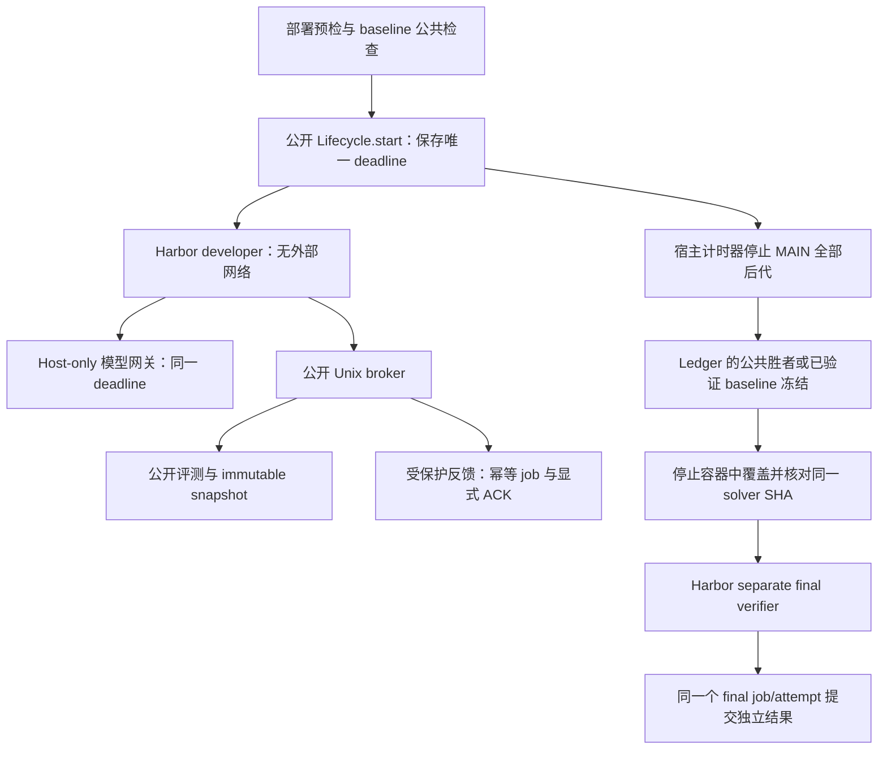

# Harbor 正式实验链路验收

这份说明规定如何把统一生命周期接入真实 coding-agent/Harbor 实验，以及什么证据足以证明接入成功。公开仓库的核心检查通过、真实 RTE solver 的本地运行通过、正式远程 Harbor 实验通过，分别是三个不同的状态。正式实验必须产生新的模型调用、Harbor 作业和验收回执，不能由历史结果替代。

## 验收对象

本轮采用 RTE maintenance 的小规模 canary，比较 `n=0` 和 `n=1` 两个新作业。两组 T、模型、资源、运行时镜像、数据角色和种子必须相同。T 和运行资源作为本轮验收配置显式记录，不作为后续研究的默认值；研究配置模板继续保留待定字段。

为了匹配已有原生 RTE checker，本轮候选格式限定为一个可执行 solver：

| 文件 | 角色 | 本轮能否修改 |
|---|---|---|
| `solver.py` | 演化算法；接收新的 instance，生成 schedule | 可以 |
| `candidate.json` | 固定原生 ABI、task ID、源码列表 | 不可以 |
| `requirements.lock` | 固定运行时依赖约定 | 不可以 |

原生 ABI 为 `python3 solver.py --instance INPUT --output OUTPUT`；`--time-limit` 和 `--seed` 由可信评测器注入。新增 helper、模型权重和额外源码必须使用后续能够执行完整依赖闭包的正式 adapter，不能通过这个单文件 canary 偷渡。冻结回执包含整个包的身份，Harbor 导出的唯一算法源码还要独立核对 SHA。

## 四类数据角色

| 角色 | 输入 | 使用阶段 |
|---|---|---|
| public development | A07 | developer 本地开发 |
| public selection | A09 | controller 独立评测 checkpoint；唯一的择优依据 |
| protected feedback | A08 | n 预算内的 broker 评测与显式 ACK |
| final test | A12 | 冻结之后的 separate verifier |

四个实例此前都出现在预实验资料中。这是数据角色隔离与运行链路的校准面板，不能称为从未接触的泛化测试，也不构成原赛排名复现。正式 benchmark 的新测试面板和公平排行条件仍按 [fair-ranking.md](fair-ranking.md) 与各 task card 的门槛验收。

## 同一个控制链

真实接入应复用本仓库的 `Lifecycle`、`Ledger`、`ArtifactStore` 和 broker。旧 judge 的账本不能继续并行掌握 n。Harbor agent 的恢复只能读取已经保存的 deadline；不能重新创建相对开发时钟。

developer 只能看到只读集成代码、socket 目录和被允许的 public development 输入。private Ledger、artifact store、protected/final inputs 和 provider key 均由 controller 保管。正式运行还要检查实际 Docker 挂载、网络和资源；仅阅读 compose 模板不能证明这些条件已经落实。

模型网关固定实际 provider model，并使用同一个绝对 deadline 和 Ledger 时间高水位。单次响应上限可以设置；累计 token cap 应为 `None`，没有 token 预留。使用量、重试、usage 不完整和进程中断必须保留，恢复不能清空历史。确定性请求错误不自动重试。

宿主计时器需要停止整个 developer 容器，再读取 Docker 的实际结束时间。控制器发出 KILL 的时间不能代替计算停止证据。晚于 deadline、OOM 或停止失败必须反映为验收失败。停止之后只能导出已经保存、独立公共评测完成的候选。

## 发布和启动门槛

| 门槛 | 必须保留的证据 | 缺少证据的处理 |
|---|---|---|
| 公开与私有源码固定 | 公开 commit、私有基线 commit、runtime manifest 与集成文件 SHA | 拒绝执行 |
| 数据角色独立 | 四个 manifest 与实例 SHA；无重复 instance | 拒绝执行 |
| 原生运行环境准备 | Harbor 版本、数值镜像 ID、client binary SHA、sandbox readiness | 拒绝执行 |
| developer 离线依赖齐备 | `ps`/`pgrep` 等 cleanup 依赖；派生镜像也要锁定 | 模型调用前停止 |
| 真实 provider 可用 | 现有私有 profile 注入的 host-only 凭据；真实调用 usage | 保留未运行状态 |
| 独立新作业 | 新 run/job ID、Harbor 结果目录、开始与停止记录 | 禁止用历史结果补齐 |

私有部署启动包包括可迁移私有归档、准备、只读 preflight、dry-run、create-only 集群提交、pod 内执行、收集等入口。归档和输入先放入原有个人 CFS 并核对 SHA，全部路径闭包通过后才能提交；本机路径不得直接传给远程作业。新的 FM Job envelope 显式复用既有 CLI、cluster、不可变 runner image 与资源 profile，采用新 UUID 前缀和独占提交 intent。提交结果不确定时禁止自动重复创建。准备和 dry-run 不算正式提交。

独立 evaluator 带有 run ID label；controller 进程重启后通过 Docker 扫描重新发现并确认清理旧容器，不能以空的 Python 进程内记录证明没有残留计算。未知执行状态、仍活跃的旧 socket、清理失败或无法查询 Docker 时停止恢复。完整 coding-agent 会话恢复还需要真实链路认证。

启动包保留在本地工作目录，使用已有私有源码和配置；GitHub 仅发布独立编写的基础框架、adapter/broker、协议和脱敏的验收结论。

## 成功条件与回执

| 条件 | 判定证据 |
|---|---|
| 模型确实开发算法 | 至少一次成功的真实 `/v1/messages` 调用；不是 count_tokens 或 fake provider |
| n=0 语义成立 | counted=0、delivered=0 |
| n=1 语义成立 | counted=1、completed=1、delivered=1；对应明确 job 和 ACK |
| T 没有被重置 | 恢复前后的 started/deadline 完全一致；Docker FinishedAt 不超过截止时间 |
| 公共择优后冻结 | public selection 的可信分数、snapshot digest 和 freeze receipt |
| 完整原生闭包 | 候选满足单 solver 契约；导出的 solver SHA 与冻结源一致 |
| 独立终评 | final manifest SHA 与 A12 panel 一致；独立 checker 核对 solver SHA |
| 同一 lifecycle 完结 | final job/attempt 在同一个 Ledger 中结束，没有第二套计数控制器 |

最终至少收集 `developer-runtime-audit.json`、`development-clock.json`、`development-cutoff.json`、`model-usage.json`、`baseline-public-selection.json`、`freeze-and-export.json`、`final-dispatch.json`、`live-acceptance.json` 和 Harbor 原始结果。公开证据只收集脱敏汇总与身份校验；provider key、私有 profile、实例原文和内部部署路径不上传。

只有真实新作业满足这些条件，才能写“Harbor 正式链路验收通过”。网络或运行环境阻塞时，应明确记录未提交或失败阶段。即使 canary 通过，五个 task 的正式 benchmark release、完整原赛 panel、硬件校准和研究重复实验仍分别验收。
