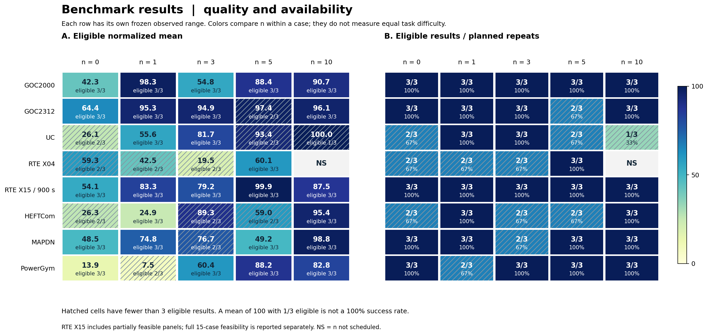
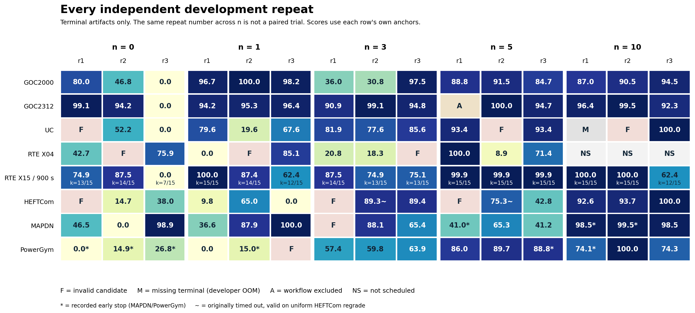

# Benchmark task cards v2

第一版整理日期：**2026-10-19（北京时间）**。本目录按实际实验设置重写六个任务族、八个子 case，保留任务定义、开发权限、执行预算、终态成绩和代表性演化算法。L2RPN 暂不纳入本轮重写，现有资料见[原卡片](../task-cards/l2rpn-grid-control.md)。

每张卡片绑定具体数据与运行协议。结果的证据时间、有效性定义和统计口径分别写在卡片中；本目录的整理日期不表示所有结果都在当天重新测量。旧卡片保留为历史资料。

## 1. 任务与子 case 索引

| 任务族 | 本轮子 case | 主要演化对象 | 开发上限 | Card |
|---|---|---|---|---|
| GOC SC-AC-OPF | GOC2000 / scenario_25；GOC2312 / scenario_21 | 基态优化与全部故障响应算法 | 48 h | [GOC](goc-sc-ac-opf.md) |
| Unit Commitment | RTS-GMLC 2020-07-06 完整实例 | 在规定质量门槛下尽早产出经独立验解的调度 | 12 h | [UC](unit-commitment.md) |
| RTE maintenance | 公开 X_04 单实例；ABC45 开发 / X15 受保护面板 | 检修排程求解器 | 12 h | [RTE](rte-maintenance.md) |
| HEFTCom Trading | 2024-02-20—2024-05-19 完整 90 市场日 | 冻结训练、逐日预测与报价流水线 | 12 h | [HEFTCom](heftcom-forecast-trade.md) |
| MAPDN | 33 节点、2012-02-03、完整 480 个间隔 | 局部信息下的逆变器无功控制 | 12 h | [MAPDN](mapdn-voltage-control.md) |
| PowerGym | 123Bus、profile 0、2.5 倍负荷、完整 24 h | 电容器、调压器和储能的混合控制 | 12 h | [PowerGym](powergym-volt-var-control.md) |

表中的开发上限是配置值。实际提前停止、OOM 或终态冻结失败仍占据其原有重复位置，具体影响在相应结果表中披露。GOC 两个子 case 与 RTE 两个子 case 各自有独立参数和结果，不合并成一个总分。

当前结果覆盖如下。“终态记录齐全”与“全部算法有效”分别陈述，细节以各卡片的逐次表为准。

| 子 case / 批次 | 独立开发槽位 | 本版已核实的结果 |
|---|---:|---|
| GOC2000 | 15 | 15 份数值有效且硬可行；15 次流程完成 |
| GOC2312 | 15 | 15 份数值有效且硬可行；14 次流程完成，另 1 次响应审计失败 |
| UC v6 + v8 | 15 | 14 份终评成绩，其中 11 个有效、8 个在全部 seed 达到质量门槛；另 1 次开发 OOM 导致终评资格不成立 |
| RTE X04 | 12 | 12 份终态记录，9 个有效候选 |
| RTE ABC/X15 v2 | 15 | 15 份主终评与补充终评记录；900 秒主终评 6 份全 X15 可行，共 202/225 个子实例可行 |
| HEFTCom | 15 | 原产物统一按修正规则终评：12 有效、3 个算法进程失败 |
| MAPDN | 15 | 14 有效、1 个候选失败；3 次开发提前结束 |
| PowerGym | 15 | 14 有效、1 个候选失败；6 次开发提前结束 |

本次材料核对补充了 UC v8 的终态及 RTE ABC/X15 的后续 feedback-v2 批次；旧启动快照和旧评分合同不作为它们的当前结果。其他批次采用各卡注明的已保存终态快照，没有重跑算法或重新评分。

## 2. 每张卡片如何组织

1. **任务概览与来源**：应用背景、原题来源、主要能力及本地改编。
2. **具体 case 与选择依据**：数据版本、规模、完整时域、选例依据。
3. **问题定义**：决策变量、目标、约束与可行性。
4. **智能体开发与提交合同**：starter、可修改范围、接口、最终执行内容。
5. **信息权限与反馈**：合法开发材料、本地测试、受保护内容、一次 `n` 的单位。
6. **演化与执行预算**：模型、开发时钟、资源、独立重复、执行限额与 seed。
7. **评分与终态规则**：原始指标、reward、失败、聚合和冻结规则。
8. **基线、结果与代表性算法**：逐次终态成绩、有效率、反馈使用和有证据的算法分析。
9. **结论边界与复现入口**：版本、来源摘要、可公开材料、限制与缺失证据。

## 3. 共同实验语义

### 开发与算法执行

`T` 是智能体开发的墙钟上限，包含模型调用、获准的编译/训练/测试和开发期间反馈等待。准备阶段与冻结后的终评分别记录。所有新批次不设置累计 token allowance、累计 token reservation 或 token 触发终止；实际 provider 用量可得时记录，不可得时为 unknown。

算法本身的执行限额、线程、CPU、内存和终评 seed 由每个子 case 单独规定。三次独立开发与同一冻结算法的多个执行 seed 是两个层级；不能将后者算作额外独立开发样本。

### 受保护反馈预算

`n` 控制受保护评分接口的最多受理次数。它不自动等于演化代数、模型请求数、候选数、成功返回的反馈数，或开发者能够获得的全部任务信息。

本地自测和代理估分的权限必须逐题阅读：公开 X04 可以本地自测；ABC/X15 对开发面板和受保护面板作不同规定；GOC 对模型自写估分与官方实现访问有不同规定。其余任务也以各自实际冻结的开发包为准，不能套用一条统一的“允许完整自测”或“禁止所有目标计算”规则。

结果记录分别保留受理、完成与领取；反馈未在截止前返回不代表开发上限会顺延。计数接口的幂等、重试和失败扣次规则以具体运行版本为准。

### 冻结与最终成绩

正式成绩来自截止时保留的冻结产物和对应终评合同。过程最好成绩可以解释搜索进展，不能事后替换冻结产物。HEFTCom 的统一终评规则修正单独标出版本、原结果与修正结果；它没有新增开发重复或过程反馈。

## 4. 结果表的阅读方法

每档 `n` 首先展示每次重复的终态值和有效数/总数。均值、标准差、最好值的计算范围紧邻结果表说明；保留各历史批次已经采用的统计政策，不因整理卡片而事后改变失败处理。

<!-- normalized-overview-v1:start -->

### 4.1 归一化可视化：每次重复与横向比较

使用**本 case 观测范围归一化**：对每个固定子 case，把全部 `n` 的合格终态成绩共同映射到 0–100。低值更优的目标取反方向，高值更优的目标保持方向。所有原始结果和正式统计均保留。

设本 case 纳入结果的原始最小／最大值为 `L / U`：高值更优时 `z = 100 × (x − L) / (U − L)`；低值更优时 `z = 100 × (U − x) / (U − L)`。0 是本批最弱合格结果，100 是本批最好合格结果；它既不是百分位，也不是最优性百分比。同分时记“同分”，不任意赋分。

两个视角同时阅读：左图为**有效样本归一化均值**，右图为纳入数／计划数。均值只描述纳入结果的质量，未纳入记录不填零；条件均值不替代各 card 的原始主统计。斜线标出不足 3 次纳入的组。RTE X15 的纳入是完整面板终评有定义成绩，不要求 15/15 例均可行。

下表每格为 `均值 · 纳入/计划`；八行分别使用自己的锚点，只比较各行内不同 `n` 的表现，不进行跨 case 总分、难度排名或显著性判断。

| 子 case | n=0 | n=1 | n=3 | n=5 | n=10 |
|---|---|---|---|---|---|
| [GOC2000](goc-sc-ac-opf.md) | 42.29 · **3/3** | 98.32 · **3/3** | 54.76 · **3/3** | 88.36 · **3/3** | 90.66 · **3/3** |
| [GOC2312](goc-sc-ac-opf.md) | 64.43 · **3/3** | 95.27 · **3/3** | 94.92 · **3/3** | 97.37 · **2/3** | 96.07 · **3/3** |
| [UC](unit-commitment.md) | 26.08 · **2/3** | 55.61 · **3/3** | 81.70 · **3/3** | 93.39 · **2/3** | 100.00 · **1/3** |
| [RTE X04](rte-maintenance.md) | 59.30 · **2/3** | 42.54 · **2/3** | 19.52 · **2/3** | 60.10 · **3/3** | NS（未设置） |
| [RTE X15 / 900 s](rte-maintenance.md) | 54.12 · **3/3** | 83.27 · **3/3** | 79.16 · **3/3** | 99.94 · **3/3** | 87.46 · **3/3** |
| [HEFTCom](heftcom-forecast-trade.md) | 26.34 · **2/3** | 24.93 · **3/3** | 89.34 · **2/3** | 59.03 · **2/3** | 95.44 · **3/3** |
| [MAPDN](mapdn-voltage-control.md) | 48.48 · **3/3** | 74.82 · **3/3** | 76.73 · **2/3** | 49.18 · **3/3** | 98.80 · **3/3** |
| [PowerGym](powergym-volt-var-control.md) | 13.88 · **3/3** | 7.51 · **2/3** | 60.37 · **3/3** | 88.19 · **3/3** | 82.81 · **3/3** |

例如 UC n10 为 `100 · 1/3`：只有一个有效算法达到本批最好，另两次分别为无效候选和缺失终评；不能据此认为 n10 整体达到 100 分。RTE X15 的完整终评均有定义成绩，但全 15 例可行数在 n0/1/3/5/10 分别为 0/1/0/3/2（每档 3 次），应结合该 card 的 `k` 与 `Q` 阅读。

#### 每次独立开发结果

图中 `r1/r2/r3` 对应独立开发重复；不同 `n` 的同编号重复不构成配对实验。`F`＝候选无效，`M`＝缺失终评，`A`＝流程收尾审计失败，`NS`＝未设置。0 分是最弱合格结果，不等于失败；`*`＝MAPDN/PowerGym 已记录的提前结束，`~`＝HEFTCom 原超时、本次统一补评有效。

#### v1 固定锚点与主指标

| 子 case | 归一化主指标 | 方向 | 原始最小 L | 原始最大 U | 纳入数 |
|---|---|---|---:|---:|---:|
| GOC2000 | objective J | ↓ | 988263.4564 | 989631.618142 | 15/15 |
| GOC2312 | objective J | ↓ | 373710.570995 | 377108.145892 | 14/15 |
| UC | terminal reward | ↑ | 0 | 0.927731941856 | 11/15 |
| RTE X04 | F900 | ↓ | 11326.856 | 11557.078 | 9/12 |
| RTE X15 / 900 s | reward900 | ↑ | 0.444270342686 | 0.951308829357 | 15/15 |
| HEFTCom | amended revenue / GBP | ↑ | 83644907.4901 | 88060765.8206 | 12/15 |
| MAPDN | terminal quality | ↑ | 0.676303190885 | 0.715260919438 | 14/15 |
| PowerGym | terminal quality | ↑ | 0.00578379453854 | 0.104470296662 | 14/15 |

锚点只取本批纳入的截止冻结产物，不使用 starter、过程最好值或 5400 秒补充成绩。GOC 的合格条件仅指流程完成且数值有效／硬可行，访问审计仍待复核；其他异常和权限边界见对应 card。MAPDN/PowerGym 提前结束仍保留其可用终态，归一化不消除时长差异。

版本 `normalized-v1` 固定于 2026-10-19。完整精度锚点、全部逐次值、状态、组统计和六份来源 JSON 的 SHA256 见 [normalized-v1.json](evidence/normalized-v1.json)；新增结果须另建版本，不能静默改变本版锚点或色阶。[总览矢量图](assets/normalized-v1/overview.svg) · [逐次矢量图](assets/normalized-v1/repeats.svg)。

<!-- normalized-overview-v1:end -->

以下几种状态单独报告：

| 状态 | 含义 |
|---|---|
| 流程/证据验收通过 | 运行、产物冻结和审计记录满足该批次要求 |
| 候选有效 | 冻结算法完成约定执行，并满足该任务的有效性规则 |
| 子实例可行数 | 面板内通过验解的实例数，例如 RTE X15 的 `k/15` |
| 质量门槛达标 | 在有效候选中进一步达到指定阈值，例如 UC 的参考下界质量门槛 |
| reward / 原始目标 | 按实际公式计算的数值，不能单凭其是否为零推断上述状态 |

缺失终评记录记为缺失；有明确定义的算法失败分保留其规定值。原始成本、收益或运行时间不存在时，不将缺失擅自填成零。部分可行面板的正 reward 也不能解释为整面板全部可行。

同任务内比较固定 case、评分器、信息权限与资源；历史竞赛值和额外信息参考解分别标注条件。不同 case 的原始指标不直接相加，本版不设置跨任务综合榜单。每档仅三次开发，结果用于描述当前设置下的表现，统计与机制推断都保留其样本和证据边界。

## 5. 代表性算法分析的证据标准

每个子 case 尽量选择最好有效方案、低反馈强方案或有解释价值的失败方案，说明：

- **初始方案与改动**：相对实际 starter，模型、搜索、初始化、预测或控制结构发生了什么变化。
- **机制与观测**：改动针对什么瓶颈，哪些数值、日志或源码特征支持这一解释。
- **证据等级**：终态源码能证明实现结构；完整轨迹才能还原先后顺序；配对实验或消融才能进一步判断某项改动的独立效果。
- **适用范围**：明确实例定制、预计算解、特权信息或额外内部仿真等行为的权限与适用条件。

仅有终态源码时，“starter → 最终算法”表示结构对照，不声称重建了每一步演化。没有实际消融时，将效果机制写为基于实现的解释或待验证假设。

## 6. 证据与复现状态

本目录的 `evidence/*.json` 保存可移植的精简结果、版本、来源标识和文件摘要，由保留的原始报告/日志提取。它们便于核对卡片和重算汇总统计；精简摘要本身不替代完整原始轨迹、运行回执或独立复现实验。

| 证据摘要 | 对应任务 |
|---|---|
| [goc.json](evidence/goc.json) | 两个 GOC 子 case |
| [uc.json](evidence/uc.json) | UC v6 n0/1/3 与 v8 n5/10 |
| [rte.json](evidence/rte.json) | X04 与当前 ABC/X15 版本 |
| [heftcom.json](evidence/heftcom.json) | 原开发批次与 V3 终评修正 |
| [mapdn.json](evidence/mapdn.json) | MAPDN 正式固定 case |
| [powergym.json](evidence/powergym.json) | PowerGym 正式固定 case |

任务设置已有实跑记录、一次批次已有终态结果、公开仓库可以独立复现，是不同的完成状态。每张卡片分别说明实际可用的数据、运行包、依赖、评分入口及尚需补齐的内容。私有模型凭据、服务器路径与集群运维记录不进入这些公开摘要。
