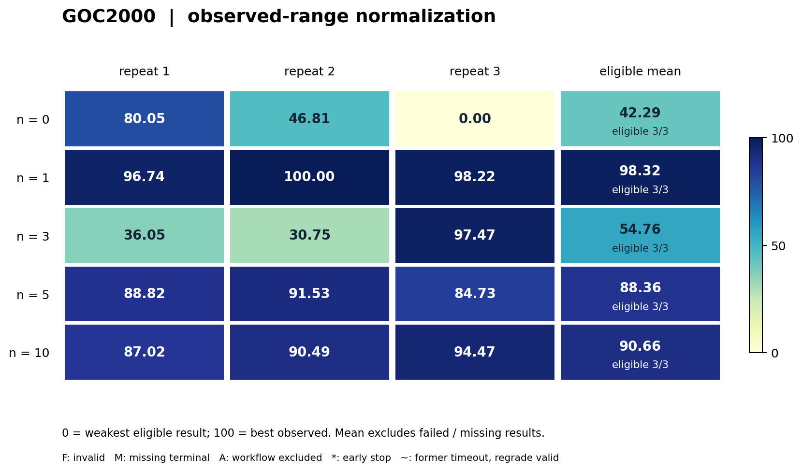
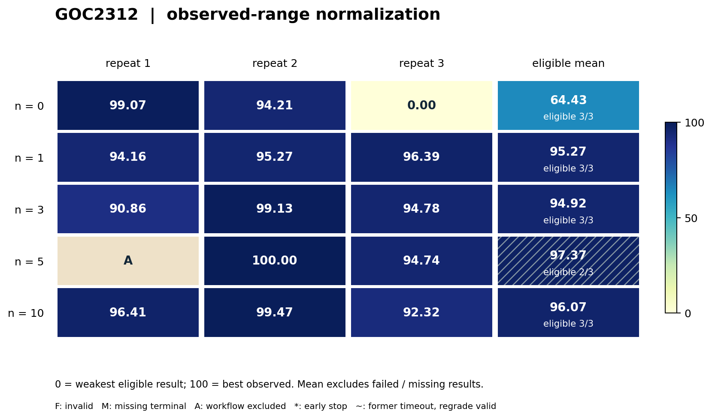

# GOC：完整两阶段安全约束交流最优潮流

> 第一版整理：2026-10-19，北京时间。结果快照：2026-10-18 21:55。两个子 case 共 30 次数值有效且硬可行，29 次完成流程；另 1 次响应审计失败。访问行为审计仍待复核。

## 1. 任务概览与来源

**任务族 ID：`goc-sc-ac-opf`；子 case：GOC2000、GOC2312。**
任务来自 ARPA-E Grid Optimization Competition Challenge 1。
智能体开发基态调度与全故障响应算法，在固定电网场景上减少发电成本和故障代价。
能力包括非凸交流优化、机组响应逻辑、批量故障分解、数值稳定性及可执行程序工程。

本阶段研究同一 case 上的算法演化：开发、计数反馈、冻结后的独立终评使用同一目标场景。
独立终评指重新执行冻结源码，不意味着未见数据测试。
两个 case 是同一任务族内不同网络，不合并原始目标值求均值。

[官方问题与数据归档](https://data.openei.org/submissions/6153)提供原始输入、问题公式和评分说明。
本轮保留原始 SC-AC-OPF、完整两阶段能力及全部故障；采用本项目实测通过的执行限额。
因此结果可用于本轮同条件比较，不直接对应原赛 division 排名。

## 2. 具体 case 与选择依据

| 项目 | GOC2000 | GOC2312 |
|---|---|---|
| 网络 / 场景 | `Network_06R-124 / scenario_25` | `Network_70R-422 / scenario_21` |
| 节点数 | 2000 | 2312 |
| 输入机组记录数 | 384 | 444 |
| 全量故障数 K | 2421 | 982 |
| 原生输入 | RAW / ROP / INL / CON | RAW / ROP / INL / CON |
| 场景用途 | 固定目标开发与复核 | 固定目标开发与复核 |

两者来自已公开的原赛 Final 合成数据，且已有实验使用记录，不能称为本研究未触碰的测试集。
选择依据是中等规模场景能完成全故障数值运行，同时保留非凸基态和故障处理难度。
本轮资源校准分别在 24 / 12 / 8 CPU 下完整运行，每个 case 的三档目标值一致。
24 CPU 下参考 Code2 分别约 596.5 秒和 288.8 秒，支持开展重复矩阵。
这些运行证明可执行性，不构成“已在全部候选中选出最难实例”的证据。
GOC30000 的历史规模实验不并入本卡。

## 3. 问题定义与约束

基态变量包括机组有功 / 无功、母线电压幅值 / 相角、可控并联电纳等。
每个原始故障需要相应交流状态与机组响应，Code2 必须基于同次 Code1 的冻结基态。
机组跳闸、线路断开及原始分区响应规则按输入保留。

权威目标为：

$$
\min J = C_{\mathrm{base}} + P_{\mathrm{official}}(x_0,x_1,\ldots,x_K).
$$

`C_base` 是原始机组成本，`P_official` 按官方权重和分段规则计算基态及故障状态的功率失配与支路越限等代价。
本卡不以“可行”替代“零惩罚”：软残差可以非零，仍可能通过硬可行性检查。

| 约束或校验 | 实际处理 |
|---|---|
| 交流网络方程、功率失配、支路负载 | 保留官方物理模型与原软惩罚语义 |
| 电压、机组出力与控制边界 | 由官方 evaluator 检查硬约束 |
| 故障有功参与、饱和、区域响应 | 按原始 INL、故障与基态关系验证 |
| 无功限制和 PV/PQ 响应关系 | 保留官方互补 / 响应语义 |
| 输出记录与故障覆盖 | 所有母线、所有机组记录及全部 K 个故障，缺失即不合格 |

权威结果分别记录 `valid`、`feasible`、运行成本、软惩罚和原始 `J`。
独立本地估分只能用于开发选择，不能取代终评。

## 4. 智能体任务、starter 与产物接口

初始 Code1 将原始运行控制量裁剪到合法盒边界；它不是保证低惩罚的完整优化解。
初始 Code2 提供完整故障响应路径，并允许使用已安装的 PMSC 工具。
智能体可替换基态优化、故障求解、并行调度、初始化、诊断及候选选择程序。

| 阶段 | 冻结源码的职责 | 评测端产物 |
|---|---|---|
| Code1 | 读原始输入，计算完整基态 | `solution1.txt` |
| Code2 | 读同次冻结基态与全部原故障 | `solution2.txt` |
| 权威评分 | 独立校验格式、覆盖、硬约束与原目标 | 原始 J / cost / penalty / validity |

提交的是可执行源码及其依赖文件；终评重新运行两阶段。
不能通过删故障、修改问题、跨候选拼接基态与响应来降低表面分数。
可针对固定实例优化算法，结果解释也限定在该实例。
本轮可用 Python、Julia 及预装 PowerModelsSecurityConstrained、PowerModels、JuMP、Ipopt 等工具。

## 5. 信息权限、本地测试与反馈 n

开发端可见目标 case 原始输入、公开公式、输出格式、派生问题表示和基态工具。
**允许自行编写代理评估器、全量本地估分器和物理诊断程序；这些计算不消耗 n。**
受保护的是官方 evaluator 的源码与实现、私有评分路径、缓存结果和其他重复的产物。
禁止下载、复制、导入或借替代通道获取官方实现。

`n ∈ {0,1,3,5,10}` 限制框架接受的官方过程评测请求。
n=0 没有开发期官方反馈，但仍有允许的自主本地数值信号。
n 不限制内部优化迭代、故障数、模型请求量或独立本地测试次数。
官方过程反馈和终评使用完整同一 case；最终复核不占 n，也不返还给开发。

因此本卡研究“允许的官方反馈预算”，不能把 n 写成全部评测信息量。
实际用量也可能小于上限，逐次结果保留该列。
所有来源访问行为仍需轨迹复核；模型自行实现本地估分本身是合法行为。

## 6. 演化预算与执行预算

| 项目 | 本轮设置 |
|---|---|
| 开发模型 | `bedrock/gpt-5.6-sol` |
| Agent | 原生持续开发流程；任务固定模型，允许工具调用与恢复 |
| 开发墙钟 | **172800 秒，即 48 小时**，可提前结束，等待反馈计入 |
| 每档独立开发重复 | 3 次；两个 case 合计 30 次逻辑重复 |
| 累计 token cap | 无；记录实际用量，不以 token 终止开发 |
| 开发容器 | 8 CPU / 32 GiB |
| 数值求解容器 | 24 CPU / 56 GiB |
| GPU | 无 |
| Code1 上限 | 两个 case 均 4800 秒 |
| Code2 全故障合计上限 | GOC2000：38736 秒；GOC2312：15712 秒 |
| 截止后终评 | 独立重新执行 Code1 + Code2；不延长开发时间 |

开发使用共享调度资源；声明的 CPU 上限不能解释为任何时刻都有同等吞吐。
执行限额与原赛 Real-Time 10 分钟等设置不同；不能仅凭更低 J 推导原赛排名。
开发 OOM 与终评可行性分别报告，参考程序约 10 GiB 的采样峰值不能作为模型算法的内存上界。

## 7. 评分、冻结与失败规则

开发结束后先停止容器并收集冻结源码；数值作业只运行经哈希绑定的候选。
retry2 将权威快照、截止和模型审计证据置于不会被试验日志清理改写的位置。
Code2 与 Code1 的产物身份、完整故障覆盖和签名收据必须一致。
终评原始 J 越低越好；UI 中的映射分数不替代 J。

失败按三个层次保留：源码 / 冻结与流程完整性、数值输出有效性、硬约束可行性。
数值成功而流程失败的结果仍归档，但不进入主要成功样本统计。
GOC2312 n5/r1 的 J=373876.012628 单独列出：982 个故障齐全、有效且硬可行，收尾响应审计为 0 条而失败。
较早实时轨迹曾看到真实模型响应，故不能解释为模型从未执行；根因仍未确定。

当前身份按原批次替代映射解析：23 次原 v4、1 次 retry1、6 次 retry2。
历史失败不额外计为重复；替代版本保持任务、n、48 小时和资源，恢复及证据保存机制有差异。
29 次流程完成的记录仍标有 `source_access_audit=review_required`，不等于完整行为审计通过。

## 8. 基线、最新结果与代表性算法

### 8.1 起点与比较口径

| 同配置 starter 资源验收 | J | 成本 | 软惩罚 | 全故障有效 / 硬可行 |
|---|---:|---:|---:|---|
| GOC2000 | 1003485.357522 | 1001896.065130 | 1589.292392 | 是 / 是 |
| GOC2312 | 7278497.380231 | 462412.735908 | 6816084.644322 | 是 / 是 |

这是最小 starter 的完整运行起点，不是同平台认证的竞赛强基线。
尤其 GOC2312 起点有巨大软惩罚，不能把相对它的降幅直接当作超越强优化器的幅度。
公开强求解器如 gollnlp 尚无本轮同资源完整重放证据。

#### 传统方法、原赛结果与论文复现锚点

以下区分已在本合同测量的程序、原赛相同场景的历史成绩，以及尚待执行的强方法。数值均为原始 `J`，越低越好；历史表不参与后面的 0–100 可视化锚点计算。

| 方法 / 证据状态 | GOC2000：06R-124 / 25 | GOC2312：70R-422 / 21 | 能支持的比较 |
|---|---:|---:|---|
| 本轮裁剪基态 + 完整故障响应 starter；**同合同实测** | 1003485.357522 | 7278497.380231 | 衡量从共同起点的改进；24 CPU / 56 GiB、全故障和第 6 节限额 |
| 原赛 `ARPA-E Benchmark`；**官方历史记录** | 1368300.766640 | 506802.001865 | 原始竞赛参考程序在同网络 / 场景的目标量级；本轮未重放 |
| LLNL / gollnlp；**官方历史记录，且为该场景 Division 1 最低值** | 988356.792003 | 374222.320075 | 可定位接近强竞赛方法的程度；本轮未重放，不是本轮同资源排名 |
| 冻结版完整 PMSC / Julia 数值参考；**待同合同独立复跑** | — | — | 传统 AC NLP、故障筛选与全故障响应的独立强参考，不能用 starter 验收代替 |
| gollnlp 原赛源码 / 论文方法；**源码已公开，本轮未构建及重放认证** | — | — | 竞赛优胜程序与论文方法复现目标；不能用上两行历史数值填入新运行结果 |

历史数值来自[官方 Final Event 工作簿](https://data.openei.org/files/6153/C1_E4_scenario_results_20200106.xlsx)的 `Division 1`：第 52 行对应 GOC2000，第 72 行对应 GOC2312，C 列为 LLNL，I 列为 `ARPA-E Benchmark`。本次核对已归档工作簿中的原值，保留六位小数；上述历史最低值按各场景独立确定。Division 1 的 Code1 为 600 秒、Code2 另给每故障 2 秒，原平台为 6 节点、合计 144 CPU cores、每节点 64 GB；本轮 Code1 为 4800 秒、Code2 为每故障 16 秒，资源也不同。[组织者与参赛者综述 §4.2](https://arxiv.org/html/2206.07843v1#S4.SS2)

当前最好流程完成终态相对**同合同 starter**：GOC2000 降低 15221.901122（1.5169%），GOC2312 降低 6904786.809236（94.8656%）。相对 **LLNL 历史值**则仅分别低 93.335603（0.0094%）和 511.749080（0.1368%）。前一组是起点改进，后一组只说明原始目标值的位置；大幅消除弱 starter 的惩罚，与在更宽时限下略低于历史强方法，是两种不同证据，不能推出赢得原赛或优于同预算 gollnlp。

传统强基线应保留 AC 而非以 DC OPF 分数代替：先运行完整 PMSC / Julia 基态优化与故障求解，再独立校验全部 2421 / 982 个故障；DC 或忽略故障的 AC OPF 可作初始化 / 消融，不能单独成为本任务的有效完整解。[PMSC 上游实现](https://github.com/lanl-ansi/PowerModelsSecurityConstrained.jl)

论文复现优先目标为 Petra 与 Aravena，*A Surrogate-Based Asynchronous Decomposition Technique for Realistic Security-Constrained Optimal Power Flow Problems*，Operations Research 71(6):2015–2030（2023）。其方法结合基态 / 故障分解、稀疏 recourse 近似、故障筛选、非凸互补松弛和异步并行；[论文原文入口](https://pubsonline.informs.org/doi/abs/10.1287/opre.2022.0229)与[LLNL 方法说明](https://computing.llnl.gov/projects/gollnlp)可对应到本卡的两阶段任务。[作者仓库](https://github.com/gollnlp/gollnlp)明确提供原赛提交，采用 BSD-3-Clause，曾使用静态 Ipopt 3.12.13；代码可得不等于已复现其新环境结果。

补齐上述两项待复跑时，需锁定源码 commit、依赖和构建参数，在本卡两份原始输入、同次 Code1 基态、全部故障、24 CPU / 56 GiB 与第 6 节时限下执行，公开 `valid / feasible / cost / penalty / J`、两阶段墙钟及峰值内存。若另跑原赛 600 秒 / 2K 秒档，应单列为历史合同重放；任何移植或替换求解器均须披露。基线作为冻结数值程序执行，不领取 agent 的开发反馈、不读取其余重复产物。本次只补充证据和复现状态，没有启动这些实验。

组均值、样本标准差使用流程完成的有效结果；不将两网络混合。
GOC2312 n5 只有 2 次进入主统计，明确标为不完整组；其均值不能与完整 3 次组等同解释。

### 8.2 GOC2000：各 n 汇总与逐次结果

| n | 流程完成 | 数值有效 / 计划 | J 均值 ± 样本标准差 | 最好有效 J |
|---:|---:|---:|---:|---:|
| 0 | 3/3 | 3/3 | 989053.065 ± 550.210 | 988536.439184 |
| 1 | 3/3 | 3/3 | 988286.426 ± 22.340 | 988263.456400 |
| 3 | 3/3 | 3/3 | 988882.459 ± 507.409 | 988298.048872 |
| 5 | 3/3 | 3/3 | 988422.722 ± 46.874 | 988379.322058 |
| 10 | 3/3 | 3/3 | 988391.231 ± 51.027 | 988339.082377 |

| n | r1 最终 J（实际反馈） | r2 最终 J（实际反馈） | r3 最终 J（实际反馈） |
|---:|---:|---:|---:|
| 0 | 988536.439184（0） | 988991.136866（0） | 989631.618142（0） |
| 1 | 988308.076991（1） | 988263.456400（1） | 988287.745819（1） |
| 3 | 989138.444907（3） | 989210.884714（3） | 988298.048872（3） |
| 5 | 988416.412142（5） | 988379.322058（5） | 988472.430660（4） |
| 10 | 988441.056946（10） | 988393.553778（10） | 988339.082377（10） |

### 8.3 GOC2312：各 n 汇总与逐次结果

| n | 流程完成 | 数值有效 / 计划 | J 均值 ± 样本标准差 | 最好有效 J |
|---:|---:|---:|---:|---:|
| 0 | 3/3 | 3/3 | 374919.257 ± 1897.434 | 373742.174190 |
| 1 | 3/3 | 3/3 | 373871.238 ± 37.924 | 373833.223426 |
| 3 | 3/3 | 3/3 | 373883.010 ± 140.465 | 373740.200543 |
| 5 | 2/3 | 3/3 | 373800.011 ± 126.487 | 373710.570995 |
| 10 | 3/3 | 3/3 | 373844.203 ± 121.961 | 373728.490414 |

| n | r1 最终 J（实际反馈） | r2 最终 J（实际反馈） | r3 最终 J（实际反馈） |
|---:|---:|---:|---:|
| 0 | 373742.174190（0） | 373907.450767（0） | 377108.145892（0） |
| 1 | 373909.071571（1） | 373871.420080（0） | 373833.223426（1） |
| 3 | 374021.006986（3） | 373740.200543（2） | 373887.823075（3） |
| 5 | 373876.012628†（5） | 373710.570995（5） | 373889.450026（4） |
| 10 | 373832.544419（10） | 373728.490414（4） | 373971.574637（10） |

† GOC2312 n5/r1 数值有效，但流程失败；上方汇总排除该项。其余 29 次 J 均有效且硬可行。
GOC2000 n3/r3、n10/r3 有开发 OOM 标记，仍完成终评并保留于统计。

GOC2000 的 n1 均值最低；GOC2312 的 n5 两样本均值最低。
两者均未呈现预算增加后成绩单调改善；GOC2312 n0/r3 的较差结果明显影响组均值。
每组仅 2–3 次，不进行显著性或普遍最优 n 的结论。

### 8.4 代表性算法：从起点到终态

**GOC2000 n1/r2：基态 AC OPF + 严格故障响应。**
起点仅裁剪原始控制边界；终态 Code1 改为矩形坐标 AC OPF，显式求平衡、优化燃料成本，并控制电纳。
Code2 为每个故障计算区域限定的有功响应、机组饱和以及迭代 PV/PQ 切换；对难例使用有界 AC 恢复，按公开分段惩罚比较硬可行响应。
程序先发布完整 fallback，再原子替换已验证的结果，降低超时后产物缺失风险。
终态 J=988263.456400，其中成本 988141.140710、惩罚 122.315690，覆盖全部 2421 故障。
该描述已对照冻结源码 `code1.py`（`102a5e59…`）、`solve_base.jl`（`51b8b57d…`）、`solve_contingencies.jl`（`5ebc05fc…`）和终评记录。
完成说明中的本地 proxy 估分接近官方终评；这支持估分一致性，不构成每个改动的消融证据。

**GOC2312 n5/r2：故障筛选、母线自适应电压裕度与基态 / 关键故障联合优化。**
起点同样是裁剪初态；终态先筛选故障潮流，做经济与安全 polish，再用全故障严格响应识别各母线所需电压裕度。
随后把主导走廊故障 `LINE-1541-1542-1` 与第二个故障 `LINE-1688-1739-1` 纳入联合 AC 优化，同时调整基态与响应。
Code2 仍执行全部 982 个故障，对少数难例做带硬约束门控的活跃集重分类和残差修正，并保留完整 fallback。
与 GOC2000 的通用基态 + 逐故障优化相比，这个方案把关键故障显式反馈到基态，并包含固定场景的故障标签定制。

完成说明记录的 5 次官方过程 J 依次为：7278497.380231 → 381423.195821 → 373853.529082 → 373743.382736 → 373710.570995。
最终独立终评重现最后一个值，成本 373636.122778、惩罚 74.448217。
这些成绩与冻结 `code1.py`（`82780da1…`）、`code2.py`（`f7dcc24f…`）及 joint / hard-safe 模块相互对应。
第一步大幅下降主要伴随高惩罚起点被有效 AC 优化替代；后续进一步改善同时包含成本、惩罚与运行时间取舍。
具体模块的独立增益仍需消融，不能把逐次整套版本变化当作单模块因果证明。

**两种方案的共同工程机制**是先发布完整可运行答案，再原子替换改进；区别在于故障信息如何参与基态优化。
实际终评 Code1 / Code2 耗时约为 22.7 / 1387.7 秒（GOC2000）与 1651.0 / 813.6 秒（GOC2312）。
目标更低与计算更省是不同维度，card 同时保留二者。

<!-- normalized-v1:start -->
### 8.5 归一化可视化对照

按本子 case 全部 `n` 的有效终态范围映射到 0–100，越高越好；0 是本批最弱有效结果，100 是本批最好有效结果。每档 `n` 使用相同锚点。该分数用于显示相对位置，不代表理论最优或跨任务同等能力。详见[统一方法和横向总览](README.md#normalized-results)。

本表均值／样本标准差只对纳入的有效结果计算，是新增的**可视化条件统计**，不替代上文的原始主统计。必须结合“纳入 / 计划”阅读；仅 1 次纳入时不估计标准差。图中斜线表示该组存在未纳入结果。

`F`＝候选无效；`M`＝缺失终评（开发 OOM）；`A`＝流程收尾审计失败；`NS`＝该档未设置。`†`＝已记录的开发提前结束（图中 `*`）；`§`＝原超时、本次统一补评有效（图中 `~`）。这些符号与数值 0 不同，均保留原始结果表。

GOC 的纳入要求是流程完成、数值有效且硬可行；访问审计仍均为 `review_required`。GOC2312 n5/r1 的数值结果保留在原表，但收尾审计失败，故标 `A`，不用于锚点或条件均值。

#### GOC2000

| n | r1 | r2 | r3 | 有效样本归一化均值 ± 样本标准差 | 纳入 / 计划 | 补充状态 |
|---|---|---|---|---|---|---|
| 0 | 80.05 | 46.81 | 0.00 | 42.29 ± 40.22 | 3/3 | — |
| 1 | 96.74 | 100.00 | 98.22 | 98.32 ± 1.63 | 3/3 | — |
| 3 | 36.05 | 30.75 | 97.47 | 54.76 ± 37.09 | 3/3 | — |
| 5 | 88.82 | 91.53 | 84.73 | 88.36 ± 3.43 | 3/3 | — |
| 10 | 87.02 | 90.49 | 94.47 | 90.66 ± 3.73 | 3/3 | — |

[矢量图](assets/normalized-v1/goc2000.svg)。

#### GOC2312

| n | r1 | r2 | r3 | 有效样本归一化均值 ± 样本标准差 | 纳入 / 计划 | 补充状态 |
|---|---|---|---|---|---|---|
| 0 | 99.07 | 94.21 | 0.00 | 64.43 ± 55.85 | 3/3 | — |
| 1 | 94.16 | 95.27 | 96.39 | 95.27 ± 1.12 | 3/3 | — |
| 3 | 90.86 | 99.13 | 94.78 | 94.92 ± 4.13 | 3/3 | — |
| 5 | A | 100.00 | 94.74 | 97.37 ± 3.72 | 2/3 | — |
| 10 | 96.41 | 99.47 | 92.32 | 96.07 ± 3.59 | 3/3 | — |

[矢量图](assets/normalized-v1/goc2312.svg)。
<!-- normalized-v1:end -->

## 9. 结论边界、复现与证据

当前证据支持两个固定中等规模 case 的完整数值演化矩阵，不支持跨网络泛化、原赛排名或严格反馈次数因果效应。
访问审计待复核、替代版本和 OOM 记录限制进一步解释；过程最好值不能替代本卡最终冻结成绩。

便携 [GOC 证据摘要](evidence/goc.json)保留 30 次身份、原始 J、成本 / 惩罚、执行耗时、实际反馈和冻结文件 SHA256，以及原始汇总的来源标识和哈希。
该摘要不是完整轨迹或可执行重现包；公开复现仍需要匹配输入许可、运行镜像、冻结求解器、官方 evaluator 与完整依赖。

| 来源版本 | 标识 / SHA256 前缀 | 本卡用途 |
|---|---|---|
| 拆分原批次 v4 / retry1 | `e110d0f2cbcb4bf8…` | 两个 case 的任务与预算绑定 |
| 六次替代 retry2 | `3f3b418525a1c040…` | 恢复与证据保存机制变更 |
| 终态原始汇总 | `status-summary-20261018-2155.json` | 30 次最终结果及状态 |
| 完成报告 | `GOC2000与GOC2312已完成实验结果报告_20261018.md` | 统计口径、异常、限制 |

原始资料：[问题定义与数据格式](https://data.openei.org/files/6153/Challenge_1_Dataset_Format.pdf)、[官方评分规则](https://data.openei.org/files/6153/Challenge_1_Scoring.pdf)、[gollnlp 公开实现](https://github.com/gollnlp/gollnlp)。
旧版 [任务卡](../task-cards/goc-sc-ac-opf.md)保留历史设计；本卡描述的是已经执行的当前固定 case 设置。
