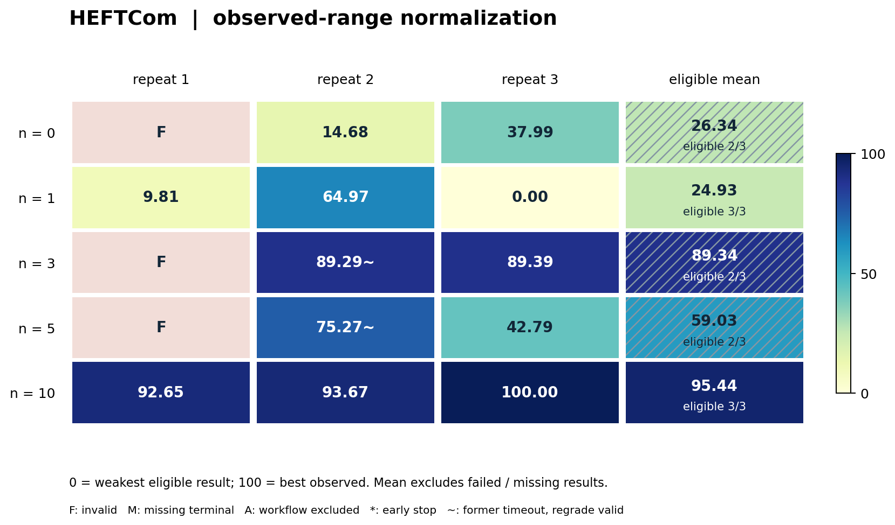

# HEFTCom：固定历史交易期的预测与报价算法演化

> V2 首稿，证据截止：2026-10-19 12:23:37（北京时间）。15 次独立开发均已结束；15 份原截止产物统一按缓存修正规则终评，12 份有效、3 份算法进程失败。原开发 V6 与终评修正 V3 是两个版本，不是两批开发实验。可移植的逐次结果、哈希与证据边界见 [证据摘要](evidence/heftcom.json)。

## 1. 任务概览与来源

**任务族 ID：`heftcom-forecast-trade`。当前子 case：`full-90-market-days / frozen-training Trading`。**

任务源自 Hybrid Renewable Energy Forecasting and Trading Competition 2024（HEFTCom24）。智能体开发可再生能源发电预测与日前报价程序，在天气和历史能源信息约束下，为每个半小时提交电量报价，最大化结算收益。

它同时考察特征设计、非平稳发电建模、日前与偏差价格关系建模，以及把统计预测转换为经济决策的能力。优化对象是收益，发电误差只是影响收益的中间因素。

本 benchmark 保留原 Trading 赛道完整目标期、报价边界与结算语义，采用固定训练历史、DWD 聚合天气和冻结模型。原赛实时滚动开发、额外数据、GFS 格点、Forecasting 九分位数任务与 Combined 排名不属于当前合同。

原始来源：[官方数据归档](https://zenodo.org/records/13950764)、[Competition Documentation v4.0](https://zenodo.org/records/13950764/files/Competition%20Documentation%20v4.0.pdf?download=1)、[组织方回顾论文](https://arxiv.org/html/2507.01579v2)。

## 2. 具体 case 与选择依据

| 项目 | 当前设置 |
|---|---|
| 目标市场日 | 2024-02-20 至 2024-05-19，完整 90 日 |
| 评分规模 | 4318 个半小时，保留 DST 引起的 46-period 日 |
| UTC 首末 period | 2024-02-19 23:00 至 2024-05-19 21:30 |
| 市场日边界 | Europe/London 前一日 23:00 至当日 23:00 |
| 每日决策截止 | D−1 09:20 UTC |
| 训练标签截止 | 2024-02-17 23:30 UTC，排除全部目标交易期标签 |
| 开发输入 | 给定历史训练特征／标签、DWD 聚合天气与日历 |
| 目标输入 | 按市场日提供截止前可用的天气／日历，不提供目标标签或价格真值 |
| 缺天气 | 19 个 period 保留；仅以训练历史 climatology 填补，并给出缺失标记 |

选择完整原赛期的依据是覆盖海缆故障、负电价、日历和 DST 变化，以及拥有可核验的逐期原赛记录。没有按本轮不同 `n` 的结果挑选时间段，也未证明它在所有可构造历史时段中最难。

2026-10-18 的来源对账覆盖官方交易文件 66 队、284,988 行。每队均有 4318 条合法报价；跨队真实发电、DA 与 SS 价格一致。重算结算的最大逐行差小于 9×10⁻¹⁰ GBP，Benchmark 与 SVK 总收益对官方榜误差小于 10⁻⁶ GBP。

当前标签采用归档修订值；没有原赛每个字段首次发布的完整日志。天气 `available_at = issue + 4 小时` 是本地公布滞后假设。训练截止和该滞后假设用于可复现的因果输入构造，不能称为原赛真实信息到达过程的完整复原。

## 3. 问题定义、目标与约束

每个 period 的决策为报价电量 `b`（MWh），需满足 `0 ≤ b ≤ 1800`。全部目标 period 必须恰好覆盖一次；缺行、重复、非有限数及越界均拒绝，评分器不静默裁剪。

真实结算电量按最终官方交易记录构造：

```text
actual_mwh = (Wind_MW + Solar_MW) / 2 + boa_MWh
```

MW 需按半小时转换为 MWh；BOA 已经是 MWh。官方入门 notebook 的减 BOA 示例与最终记录在非零 BOA 时不一致，本 case 采用经完整交易记录对账的加 BOA 语义。[官方分析仓库](https://github.com/jbrowell/HEFTcom24-Analysis)

逐 period 收益和主指标为：

```text
revenue(b) = b × DA + (actual − b) × [SS − 0.07 × (actual − b)]
R = Σ revenue(b)                         单位 GBP，越高越好
```

`DA` 为日前价，`SS` 为偏差结算价。二次惩罚意味着报价既取决于发电预测，也取决于价格差。配方得到未裁剪的逐期事后最优报价 `actual + (DA−SS)/0.14`；它只用于解释目标或在合法训练历史上构造学习目标，不能向开发者暴露目标期的事后最优值。

模型只在给定历史上训练一次，随后权重冻结；逐日预测时不加入目标期真值，不滚动重训。预测阶段产生完整当日报价。

## 4. 智能体开发任务、starter 与提交执行

共同 starter 是可实际训练的非线性 ridge：使用天气／日历原始特征，以及风速、辐射的二次和三次项；分别拟合发电与截尾价格调整，再以保守权重组合报价。

演化对象是特征构造、训练方法、预测、经济目标与报价策略。候选可以修改完整算法源码，但必须使用合法输入，并在统一时间和资源内执行。

提交入口是冻结的 `solution.py` 及允许的元数据／声明产物。执行合同含两个阶段：

1. `train`：读取统一历史特征和标签，生成模型产物。
2. `predict`：读取冻结模型和一个合法市场日请求，输出该日 `bids.json`。

可信评分端在干净环境实际训练和逐日调用程序，重新得到 4318 条报价；不能用预计算目标期报价代替算法执行。初始源码相同，三次独立开发会话分别演化。

源码归档最多 16 MiB／128 文件；模型产物最多 64 MiB。原始、规范化执行副本和实际评分源码各有清单及摘要。

## 5. 信息权限、本地检查与 `n` 的含义

| 信息或操作 | 开发权限 |
|---|---|
| 公开训练特征和历史标签 | 可读、可做历史内训练／验证 |
| 目标市场日合法天气／日历 | 按固定输入策略提供 |
| 语法、导入、I/O、小型格式示例 | 可本地检查，计入开发时间 |
| 完整目标期结算成绩 | 仅经受计数反馈接口获取 |
| 目标发电／DA／SS 真值、参赛报价、完整 checker | 不进入开发环境，不得自行检索或重写评分绕过计数 |
| 外部数据与在线更新 | 当前合同不开放 |

**一次 `n` 对应一次完整目标 case 的受保护过程评分。** 返回有效性、累计收益、每 period 平均收益和 period 数；不是一个市场日、一个 seed 或一条模型请求。

`n=0` 表示零次完整目标过程反馈。开发者仍有合法训练数据及历史内验证能力，因而零反馈不等于无信息开发。终态评分不占 `n`，也不向开发过程回流。

本轮 12 个正 `n` 角色分别用尽各自额度：提交、完成与领取均为 `n`，总计 57 次；3 个 `n=0` 角色无过程评分账本。

开发容器默认无外网，仅能经受控固定模型通路与计数评分桥通信。目标标签、评分器、其他实验及宿主凭证不在开发挂载中；provider 侧 web、远程代码执行和 MCP 等旁路也在网关拒绝。

## 6. 演化与算法执行预算

| 层次 | 本轮固定设置 |
|---|---|
| 模型 | `bedrock/gpt-5.6-sol`，所有 `n`／重复一致 |
| 开发墙钟 | 43200 秒，含末 15 秒冻结预留 |
| token | 无累计额度、累计预留或 token 触发终止；只记录实际用量 |
| 实验矩阵 | `n=0/1/3/5/10`，每档 3 次独立开发，共 15 次 |
| 开发资源 | 3 CPU、8 GiB、无 GPU |
| 每候选评分资源 | 1 CPU、8 GiB |
| 算法分项限额 | 训练 ≤300 秒；每日预测 ≤10 秒 |
| 算法完整执行限额 | 训练与 90 日预测合计 ≤600 秒 |
| 执行 seed | 0；它不等于三次独立开发重复 |

外层作业 4 CPU／20 GiB；48 小时 watchdog 只提供排队、初始化及终评余量，不增加开发时间。开发预算与每候选训练／回放预算必须分别理解。

初始 2026-10-18 正式批次在提交前完成源一致 native 验收、真实模型／工具验收、独立审查及 97 项本地测试。基础设施验收的完整数值结果不传入正式开发上下文，也不按目标分数挑选 starter。

## 7. 评分、截止冻结、失败与缓存修正

主结果报告累计 GBP，越高越好；有效性单列。框架 reward 是基于平均事后最优收益差的有界变换：

```text
mean_regret = max(0, Σ[revenue(oracle_clipped) − revenue(candidate)] / 4318)
reward = 1 / (1 + mean_regret / 100000)
```

无效候选 reward 为 0，累计收益不存在；不能把它当作零 GBP 纳入收益均值。按本轮已记录统计政策，仅在同一 `n` 三次均有效时报告组均值／标准差，所有重复与失败均保留。

截止时收集开发工作区最终版本并冻结，未修改时保留 starter；不根据过程最好成绩自动回滚，也不使用终评重新选优。评分端验证收到的源码与截止产物摘要相同。

**2026-10-19 缓存修正适用于全部 15 份原截止源码。** 经过校验的普通 Python 缓存只从独立执行副本排除；原包、缓存和源码证据保留。链接、特殊文件、未知格式、缓存目录中不允许的成员仍拒绝，原始与执行大小限制保持不变。

修正 V3 的 Linux 76 项测试、49 项真实安全探针、自动截止、只读产物转移和干净／缓存副本数值等价验收均通过；后者收益差为 0 GBP。统一补评于 2026-10-19 12:23:37 完成，实际 Job 和唯一 Pod 成功、退出码 0、无重启。

补评未新增开发重复、模型请求或过程反馈，未修改算法、标签、资源、seed 或时间限额。它只修正历史终评；未来批次须在新的冻结版本中把同样缓存政策同时用于过程评分和终评。

## 8. 基线、最新结果与代表性算法

### 8.1 基线及历史参照

共同 starter 的源码合同和真实数值验收有记录，但本轮公开证据未发布其同合同独立基线成绩，因此本卡不补写数值，也不据此计算相对 starter 收益提升。

| 同一目标期的原赛历史参照 | 累计收益 GBP | 比较用途 |
|---|---:|---|
| 原赛 Benchmark | 82,234,089.27 | 原始收益指标参照 |
| 原赛 Trading 冠军 SVK | 88,882,213.67 | 原始收益指标参照 |

这两项来自原实时参赛记录，使用的数据、滚动更新和开发条件与当前合同不同；不是在本轮受限输入与冻结训练条件下重跑的算法。当前最好成绩与 SVK 的差值约为 821,447.85 GBP，但不能换算为原赛名次。[官方最终榜](https://zenodo.org/records/13950764/files/overall_leaderboard.csv?download=1)

### 8.2 全部 15 次终态结果

下表是统一补评后累计收益，保留到 0.01 GBP；完整精度、原评分与修正评分见 [JSON](evidence/heftcom.json)。三次重复对应原独立开发，不是补评次数。

| `n` | r1 GBP | r2 GBP | r3 GBP | 有效数／总数 | 组均值 ± 样本标准差 GBP | 最好有效 GBP |
|---:|---:|---:|---:|---:|---:|---:|
| 0 | 无效 | 84,293,270.55 | 85,322,539.63 | 2/3 | — | 85,322,539.63 |
| 1 | 84,077,908.27 | 86,514,060.07 | 83,644,907.49 | 3/3 | 84,745,625.28 ± 1,546,736.45 | 86,514,060.07 |
| 3 | 无效 | 87,587,628.67 | 87,592,102.60 | 2/3 | — | 87,592,102.60 |
| 5 | 无效 | 86,968,812.93 | 85,534,440.47 | 2/3 | — | 86,968,812.93 |
| 10 | 87,736,164.60 | 87,781,258.81 | **88,060,765.82** | 3/3 | **87,859,396.41 ± 175,842.55** | **88,060,765.82** |

有效数合计 12/15。`n=10` 的三个结果均有效，且本批组内波动较小；`n=1` 也为 3/3 有效。其余档各有一次失效，不能仅看最好有效值比较整组可靠性。

每档只有三次重复，候选算法又不同，不能将组间差异单独归因于反馈次数，也不能据此证明单调收益或显著性。

### 8.3 修正前后与失败归因

| 原结果类别 | 角色 | 统一补评结果 | 应如何解释 |
|---|---|---|---|
| 原 9 份有效 | 见证据逐项表 | 9/9 收益精确复现，差为 0 | 数值一致性 |
| 原缓存拒绝 | n0-r2 | 变为有效 | 缓存政策修正恢复执行 |
| 原缓存拒绝 | n0-r1、n3-r1、n5-r1 | 已实际执行，仍为 `Algorithm process failed` | 不再是缓存拒绝；具体异常未保留 |
| 原训练超时 | n3-r2、n5-r2 | 同源码、原限额下变为有效，均未排除缓存 | 运行可行性波动，不能归因于缓存修正 |

原超时分别约 300.127 和 300.134 秒；补评完整训练与回放耗时为 385.812 和 304.681 秒。完整回放耗时不同于训练耗时，训练 300 秒限额未放宽；速度变化来源未测量。原失败和超时记录继续保留，不以新成绩抹去。

### 8.4 代表性算法：从共同起点到终态结构

以下依据已归档终态源码与 n10-r3 的 provenance 说明。它们是共同 starter 与终态的结构对照；尚未完整重建每次编辑的时间线，也没有消融实验，不能把代码注释中的验证结论当成独立复测证据。

**n10-r3：物理分解、近期校准与价格差 ridge，88,060,765.82 GBP。**

- 初始：starter 用统一多项式 ridge 拟合总发电与价格调整，价格调整仅取保守权重。
- 关键变化：风电使用风速 hinge、风向谐波和高低空风速差；太阳能使用辐射 hinge 与时段／季节交互。风电长期曲线另以最近 30 天干净夜间样本拟合仿射比例和上限；加入预报提前量及日内残差校准。
- 终态：结合通用发电 ridge 与风／光物理分解，价格差部分融合普通特征 ridge 和最近 730 日的高阶日内／季节交互 ridge，再裁剪到合法报价边界。
- 机制解释：近期容量校准可能适应发电机制变化；发电和价格差分开拟合与二次结算结构一致。源码中的部分旧组合系数使用合法聚合反馈，扩展价格模型和风电校准的选择据 provenance 来自训练历史验证；本卡未独立验证每个组成的收益贡献。
- 源码 SHA256：`138c19a36d0a712bb1e995b4a4d340918055a1063e680fb7a5b1a27a4e94d85c`；全部模型数值由训练输入生成，没有捆绑目标期报价。

**n3-r3：自适应模型与稳定 starter 的组合，87,592,102.60 GBP。**

- 初始：共同静态 ridge 起点。
- 关键变化：加入 HistGradientBoosting、近期风电容量适应、独立太阳能建模和按时段／日型／辐射分组的价格差统计；保留 starter ridge 作为有差异的稳定分量。
- 终态：白天稳定与自适应报价各半，夜间稳定权重约 0.45；价格差分量另缩放，缺天气时使用独立回退。
- 机制解释：不同模型的组合可能减少单一非平稳模型的误差；日夜分开处理和缺天气回退匹配任务结构。当前没有单独去掉这些分量的同合同测试，不能给出贡献百分比。
- 源码 SHA256：`badc64a41b62cceacbdd8866b5a67cac9b8537d0a7804bccd67f5c7da2db7f4a`。

**n0-r3：无需受保护反馈的树模型方案，85,322,539.63 GBP。**

- 初始：共同 ridge 起点；开发期间没有完整目标期评分反馈。
- 关键变化：以 GradientBoosting 预测发电，ExtraTrees 预测截尾 DA−SS，另以 HistGradientBoosting 学习结算配方后的直接报价目标；增加训练历史季节权重、异常残差截尾与缺天气专用模型。
- 终态：90% 的分解报价与 10% 的直接目标预测组合，并进行发电平滑和合法边界裁剪。
- 机制解释：它展示了从训练历史与结算公式出发获得有效策略的能力。没有受保护反馈不妨碍本地历史验证；这份结果不能被解释为随机或无数据基线。
- 源码 SHA256 保存在 [证据摘要](evidence/heftcom.json)。

<!-- normalized-v1:start -->
### 8.5 归一化可视化对照

按本子 case 全部 `n` 的有效终态范围映射到 0–100，越高越好；0 是本批最弱有效结果，100 是本批最好有效结果。每档 `n` 使用相同锚点。该分数用于显示相对位置，不代表理论最优或跨任务同等能力。详见[统一方法和横向总览](README.md#normalized-results)。

本表均值／样本标准差只对纳入的有效结果计算，是新增的**可视化条件统计**，不替代上文的原始主统计。必须结合“纳入 / 计划”阅读；仅 1 次纳入时不估计标准差。图中斜线表示该组存在未纳入结果。

`F`＝候选无效；`M`＝缺失终评（开发 OOM）；`A`＝流程收尾审计失败；`NS`＝该档未设置。`†`＝已记录的开发提前结束（图中 `*`）；`§`＝原超时、本次统一补评有效（图中 `~`）。这些符号与数值 0 不同，均保留原始结果表。

采用 V3 修正后的收益，三次均有效才计算原始组均值的政策不变；这里对不足三次的有效收益做条件归一化展示。n3/r2 与 n5/r2 标 `§`，其变化不能归因为缓存修正。

#### HEFTCom



| n | r1 | r2 | r3 | 有效样本归一化均值 ± 样本标准差 | 纳入 / 计划 | 补充状态 |
|---|---|---|---|---|---|---|
| 0 | F | 14.68 | 37.99 | 26.34 ± 16.48 | 2/3 | — |
| 1 | 9.81 | 64.97 | 0.00 | 24.93 ± 35.03 | 3/3 | — |
| 3 | F | 89.29§ | 89.39 | 89.34 ± 0.07 | 2/3 | — |
| 5 | F | 75.27§ | 42.79 | 59.03 ± 22.97 | 2/3 | — |
| 10 | 92.65 | 93.67 | 100.00 | 95.44 ± 3.98 | 3/3 | — |

[矢量图](assets/normalized-v1/heftcom.svg)。
<!-- normalized-v1:end -->

## 9. 结论边界、复现与来源

当前证据支持：在完整历史交易期、受限输入和统一执行合同下，智能体能演化出不同的预测／报价算法；高反馈档出现本批最好且较稳定的终态结果。它尚不支持未见时间段泛化、原赛同条件胜负，或反馈次数的独立因果效应。

复现需同时锁定训练／目标数据、天气可用性策略、BOA 语义、源码、镜像和依赖、执行资源、截止产物及终评规则。只复制公开任务说明，无法复现私有评分闭包。

| 版本或证据 | 固定标识 |
|---|---|
| 原开发 V6，130 文件 | `94f37506d0d59b8dae82f122b68824e814735cba17991a3a5c0782794d4c6116` |
| 终评修正 V3，11 文件 | `7638ea48a252e3a1fb25ca623dd16a755778c0586c36f4c07496f00f862c30e6` |
| 权威原始结果 | 15 份截止产物、原评分、统一补评及实际完成回执 |
| 本卡可移植记录 | [evidence/heftcom.json](evidence/heftcom.json) |

反馈次数与完成证书逐项对齐；有效账本 SHA 首次采样在补评开始后，完成时与该样本一致。缺少有效的补评前账本字节基线，因此不宣称已经证明开始前后账本逐字不变。

公开仓库目前没有这一源码执行版 HEFTCom 的完整可运行绑定。下一版正式开发前，需要将缓存政策同时应用于过程和终评并重新验收；不能直接复制未修正的历史 V6。待补材料包括完整编辑／反馈时间线、同合同 starter 与强基线数值，以及对代表性算法机制的独立消融。
