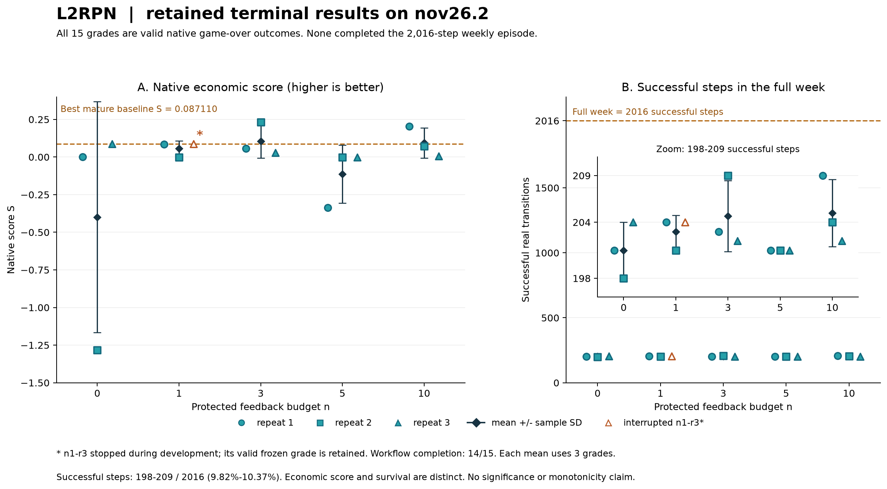

# L2RPN：固定原生场景下的电网控制算法演化

> 第一版整理：2026-10-20，北京时间。Job 状态核对至 10:42:07，终态产物核对至 10:50:22。15 次独立开发槽位均有有效原生终评；14 次开发流程完成，n1/r3 在约 7 小时后因模型请求超时提前结束，但保留有效终态成绩。15 个控制器均提前 game over，没有完整存活一周。[机器可读证据](evidence/l2rpn.json)。

## 1. 任务概览与来源

**任务族 ID：l2rpn-grid-control；当前 case：nov26.2 完整一周。**
任务来自 L2RPN NeurIPS 2020 Track 1 / Robustness 的电网序贯控制问题。
控制器根据当前电网观测和允许的预测，选择线路操作、变电站拓扑调整与再调度，降低运行成本并避免连锁故障。
本轮演化对象是可执行控制器，而非预先保存的动作轨迹；冻结后的控制器逐步运行，不在线调用 LLM。

本轮在锁定的现代 Grid2Op / LightSim2Grid 上实施原赛动作范围的固定 case 实验。
开发期间的受保护反馈与截止后的终评使用同一周、相同环境及控制器 seed，研究的是固定场景上的算法演化。
它不构成未见场景泛化测试，也不恢复 2020 年隐藏测试榜单。
原题背景见[组织方回顾论文](https://proceedings.mlr.press/v133/marot21a/marot21a.pdf)；历史划分与旧受限动作实验见[原卡片](../task-cards/l2rpn-grid-control.md)。

## 2. 具体 case 与选择依据

| 项目 | 当前设置 |
|---|---|
| 目标场景 | nov26.2，固定完整周；不按反馈预算裁短 |
| 时域 | 2017 行输入、2016 次转移，5 分钟一步 |
| 实际电网规模 | 36 个变电站、59 条线路、22 台发电机、37 个负荷；拓扑向量维数 177 |
| 环境 / backend | Grid2Op 1.12.5 / LightSim2Grid 1.1.0 |
| 原生兼容设置 | competition difficulty，兼容版本 1.2.2；保留数据集实际静态规则 |
| 环境 / 控制器 seed | 175113936 / 2132602992；所有 n 和三次开发重复相同 |
| 私有输入闭包 | 16 个文件、531122 字节；规范 manifest SHA256：9b200e153643364e9f6a1d1f1861ead60bb1d224ededbb1b3ed739714ef3bd49 |
| 开发与终评关系 | 同一固定 case 的受保护过程评分及冻结后重新执行，无免费完整目标评分 |

case 在正式演化前选定：对 24 个候选周，统一运行 rl_agent、binbinchen 与 lujixiang 三个成熟控制器，共 72 个共同接口结果。
按每周“三方法中最好原生经济分数”升序排序，以 alias 升序破同分，选择基线表现最弱的 nov26.2，其最好分为 0.0871096621；后两例为 feb11（0.1474470137）和 mar40（0.1487142405）。
这是相对于已选基线和当前执行合同的难度排序，不能解释为所有算法意义上的最难周，也没有根据正式实验中哪个 case 的 n 效应最大来选例。

72 个共同接口结果与匹配的 native 结果在分数、生存步数、执行步数、模拟次数及合法性字段上完全一致。
三个成熟方法还分别通过所选 case 自然终止轨迹的动作与模拟请求序列一致性（parity）检查。
这些是适配与结果一致性证据，不表示基线存活了完整一周。

## 3. 问题定义、目标与约束

在每个真实环境步，控制器接收当前观测，输出一个由以下原赛动作族组成的合法动作：
`set_line_status`、`change_line_status`、`set_bus`、`change_bus` 和 `redispatch`。
本轮没有使用旧先导中固定 375 动作的受限动作库，也没有自动加入储能、curtailment 等其他现代动作族。

目标是提高原生经济分数，同时报告真实存活情况。
潮流、线路热限、维护、对手、冷却、拓扑及机组约束由锁定环境执行，不能用简化代理代替权威环境。
实际冻结规则包括 `MAX_SUB_CHANGED=1`、`MAX_LINE_STATUS_CHANGED=1`、线路／变电站冷却均为 3 步，以及数据集的 `HARD_OVERFLOW_THRESHOLD=200.0`；不将其替换成另一个版本的默认值。

控制器可以通过可信 RPC 模拟当前真实状态的一步后果。
模拟只允许 `time_step=1`，不能把模拟后的观测继续展开未来轨迹；无效动作或无效 horizon 的请求也计入模拟次数。
合法 forecast 属于任务信息，但未来真实负荷、发电、故障及评分端 reference 轨迹不提供给控制器。

## 4. 智能体任务、starter 与产物接口

提交接口为 `Controller(metadata).act(observation, simulate)`。
智能体可以修改控制逻辑、搜索和规则参数，并在允许的依赖与产物合同内提交源码、配置及权重。
权威执行器构造控制器、逐步传入序列化当前观测，再将返回动作交给原生环境。
原生 backend、目标 chronics（负荷、发电、预测与维护等时序输入）及经济评分器运行在独立评分端。

共同 starter 是最小重连控制器，配套静态电网 metadata、接口 schema 和合成观测示例。
三个成熟方法的代码／checkpoint 是组织方校准基线，不是正式开发者的共同 starter。
完整 case 不作为可在开发端任意重放的本地环境发放。

到开发截止时，直接认证并收集当前 artifacts，不额外评分挑选候选。
执行产物上限为 64 MiB、1024 个普通文件；通过校验的缓存按冻结规则处理，不混入接受的执行源码。
截止冻结版本是最终候选，过程最高分不能事后替换它。

## 5. 信息权限、本地测试与反馈 n

| 信息或操作 | 当前权限 |
|---|---|
| case 名称、静态电网、动作与执行规则 | 可见；case 身份公开不等于目标输入已提供 |
| 合成 fixture、语法／导入／格式检查 | 允许本地使用，不产生真实完整目标分数 |
| 运行时当前观测与合法一步 forecast | 由可信执行器逐步提供 |
| 一步 simulate | 仅通过计数 RPC，受逐步及总量上限约束 |
| 完整目标 chronics、真实观测轨迹、reference、checker | 评分端保留，开发端不提供 |
| 完整目标 case 的经济评分 | 开发中只能调用受保护接口并消耗 n；不允许复制或重写 checker 绕过计数 |
| 截止后终评 | 同 case 重新执行冻结算法，不回传开发过程，也不占过程 n |

`n` 是最多受理的逻辑反馈次数，不是模型请求数、源码修改次数或 simulate 次数。
同一 key、相同内容哈希的重取是幂等操作；新 key 即使内容相同也消耗一次，旧 key 绑定不同内容则拒绝。
同一时刻最多一个受保护反馈处于活动状态。
已分类的基础设施失败最多在同一 credit 下尝试三次，仍受原始开发时钟约束；逾期反馈不再交付。

本批实际受理、完成、领取均为 **57** 次，正 n 全部用满。
物理尝试共 58 次：n3/r2 的一个基础设施失败尝试在同一 credit 下恢复，未增加反馈额度。
n=0 没有开发期完整目标评分。

## 6. 演化预算与执行预算

| 项目 | 当前设置 |
|---|---|
| 固定模型 | bedrock/gpt-5.6-sol；已返回响应的身份为 global.openai.gpt-5.6-sol |
| 开发墙钟 | 43200 秒，即 12 小时，包含模型、开发操作与反馈等待 |
| 冻结预留 | 15 秒，包含在开发上限内 |
| 反馈预算与独立开发 | n=0/1/3/5/10，每档 3 次，共 15 个新身份 |
| 累计 token cap | 无；不设累计 reservation 或 token 触发终止 |
| 开发资源 | 3 CPU / 8 GiB，无 GPU |
| 评分资源 | 共享 scorer 1 CPU / 8 GiB；控制器虚拟地址空间上限 8 GiB，不是额外 8 GiB 内存 |
| 初始化 / 单步决策 | 300 秒 / 60 秒 |
| 候选完整 episode | 1800 秒，包含初始化、逐步决策与同步 RPC／模拟等待 |
| 控制器 CPU 时间 | soft 1800 秒、hard 1801 秒 |
| reference / cleanup | 300 秒 / 30 秒，分别记录 |
| simulate 上限 | 每真实步 4096 次、每 episode 262144 次；仅一步模拟 |
| 反馈 transport | 每个基础设施尝试 2160 秒；不增加候选 episode 的 1800 秒 |

限额经完整动作路径校准。成熟方法池观测到最多 1459 次模拟／步、25525 次／episode，最长决策 11.7902 秒。
Greedy4096 在三个决策中实际用到 4096 次上限，最长决策 24.86645 秒；最终 60 秒决策限额留有监督余量。
这些观测支持已测控制器的可运行性，不保证任意新算法均可在限额内完成。

本批保留记录含 38790 次完成模型请求、49 次失败与 1 条未结算 pending 记录，无观察到的模型身份不匹配。
实际已记录 token 为 2838541655，包含按冻结政策计入的 provider cache token；50 次请求用量 unknown，不能据此计算完整费用。
pending 记录属于已终止的 n1/r3，不表示仍有活动实验。

## 7. 评分、冻结与失败规则

主指标是锁定 `ScoreL2RPN2020` 的原生经济分数 S，范围为 [-100,100]、越大越好。
评分端在相同输入、seed、backend 和规则下生成 reference；经济分数不是存活百分比。
框架同时保留归一化 reward：

$$
R=\frac{S+100}{200}.
$$

该变换不改变同合同排序，也不意味着 R≈0.5 的控制器存活了约一半时域。
另报 `successful_steps`、`executed_steps`、`survival_fraction=successful_steps/2016`、`complete`、模拟次数及非法／歧义动作数。
导致最终失败的转移可能被执行但不计成功，因此成功步数与执行步数分别保留。
原生评分实现见[固定 v1.12.5 代码](https://github.com/Grid2op/grid2op/blob/v1.12.5/grid2op/utils/l2rpn_2020_scores.py)。

| 终态 | 数值与有效性处理 |
|---|---|
| 原生 game over，评分正常完成 | 保留原生分数；可以 valid=true、complete=false，不视为评分基础设施失败 |
| 控制器合同错误、算法超时等候选失败 | S=-100、R=0、valid=false、evaluation_completed=true |
| 环境／reference 等基础设施评估未完成 | 原始分数缺失，不以占位 reward 伪造算法 0 分 |
| 开发流程失败，但冻结合格且完成终评 | 保留终态原生分数，同时独立标出流程失败及实际开发时长 |

冻结资格、源码哈希、只读传输、终评实际读取的产物清单与签名回执分别核对。
本次 15 份保留产物的来源绑定和运行时签名校验均通过；签名通过本身不等于候选有效或完整存活。
签名使用保留在运行端的密钥就地验证，公开摘要不构成导出密钥后的独立密码学复验。

## 8. 基线、最新结果与代表性算法

### 8.1 传统方法、成熟控制器与原赛参照

以下数值来自正式开发前的所选 case 校准；均按完整动作、统一信息／模拟／评分接口运行。
校准的外部决策 watchdog 为 30 秒，正式版为 60 秒；全部已测决策均低于 30 秒，该监督限额差异不改变已记录结果，但本次没有据此重新执行一套 60 秒基线。
三个成熟控制器的原始训练与 checkpoint 获取成本发生在本批 12 小时开发之外，因此执行合同一致不等于总方法开发成本一致。

| 方法 | 原生经济分数 S ↑ | 成功步数 / 2016 | simulate 次数 | 证据状态 |
|---|---:|---:|---:|---|
| rl_agent | 0.057881600 | 203 | 743 | 保留成熟 checkpoint 的共同接口重放 |
| binbinchen | 0.087022392 | 204 | 4155 | 同上 |
| lujixiang | 0.087109662 | 204 | 2677 | 同上 |
| Greedy128 | -0.000539224 | 201 | 384 | 固定搜索预算的同 case 校准 |
| Greedy512 | -0.000215689 | 201 | 1536 | 同上 |
| Greedy2048 | 0.087102390 | 204 | 8040 | 同上 |
| Greedy4096 | 0.087109662 | 204 | 16411 | 完整逐步模拟上限校准 |

七个基线均为有效原生 game over，没有完整一周存活。
Greedy2048 相比 Greedy512 改善分数和成功步数；4096 进一步小幅改善分数，但成功步数仍为 204。
这些是经验基线，不是最优解、性能上界或已经确认的搜索平台期。

| 外部参照或待补方法 | 当前证据与可比性 |
|---|---|
| 2020 年原赛 Robustness 最终榜 | 组织方报告 rl_agent / binbinchen / lujixiang 为 59.26 / 46.89 / 44.62，属于 24 个隐藏测试周聚合；不是本例 nov26.2 的逐周分数 |
| 成熟原赛方法的现代适配 | 已完成上表共同接口重放及所选 case parity；不宣称复制原服务器版本、全部隐藏场景或原榜名次 |
| 独立训练 PPO / ES / PPO+Search | 旧受限动作及多周先导另有记录；本轮未提供原动作范围、当前单 case 下新训练的同合同结果，不移用旧分数补齐 |

原赛信息来自[组织方论文表 1](https://proceedings.mlr.press/v133/marot21a/marot21a.pdf)。
单周新分数不能插入原赛多周总榜，也不能将经济分数解释为百分比存活。

### 8.2 逐次最终成绩

下表全部使用截止时保留产物的终评，不选取过程最高分。
15 份均 `valid=true`、`evaluation_completed=true`，均为 `native_game_over`、`complete=false`，且非法动作与歧义动作均为 0。
“流程完成”与上述候选有效性分别报告。

| n | 重复 | 原生分数 S ↑ | reward ↑ | 成功步数 | simulate 次数 | 实际反馈 | 开发流程 |
|---:|---|---:|---:|---:|---:|---:|---|
| 0 | r1 | -0.000215689 | 0.499998922 | 201 | 3712 | 0 | 完成 |
| 0 | r2 | -1.282813108 | 0.493585934 | 198 | 13302 | 0 | 完成 |
| 0 | r3 | 0.086418777 | 0.500432094 | 204 | 1221 | 0 | 完成 |
| 1 | r1 | 0.084702474 | 0.500423512 | 204 | 23073 | 1 | 完成 |
| 1 | r2 | -0.002588274 | 0.499987059 | 201 | 5498 | 1 | 完成 |
| 1 | r3 | 0.086782401 | 0.500433912 | 204 | 16180 | 1 | **提前失败，保留终评** |
| 3 | r1 | 0.056347108 | 0.500281736 | 203 | 42019 | 3 | 完成 |
| 3 | r2 | **0.232733629** | **0.501163668** | **209** | 103659 | 3 | 完成 |
| 3 | r3 | 0.027715388 | 0.500138577 | 202 | 25848 | 3 | 完成 |
| 5 | r1 | -0.335289277 | 0.498323554 | 201 | 22617 | 5 | 完成 |
| 5 | r2 | -0.001617671 | 0.499991912 | 201 | 7850 | 5 | 完成 |
| 5 | r3 | -0.001941205 | 0.499990294 | 201 | 115388 | 5 | 完成 |
| 10 | r1 | 0.203789193 | 0.501018946 | 209 | 107408 | 10 | 完成 |
| 10 | r2 | 0.072971978 | 0.500364860 | 204 | 73126 | 10 | 完成 |
| 10 | r3 | 0.005577986 | 0.500027890 | 202 | 64814 | 10 | 完成 |

n1/r3 在约 **7.10 小时**结束开发，Harbor 记录恢复模型请求时发生 `NetworkConnectionError`，返回 `Request timed out`。
异常时间为 2026-10-20 03:10:09，Pod 于 03:12:26 结束；其合格冻结产物仍完成有效终评，且未记录开发容器 OOM。
这不是缺失分数，也不是已完成 12 小时的开发重复。
其余 14 次约在 43185 秒（11.996 小时）认证源码冻结，停止／收尾约在 11.996–11.999 小时完成；15 秒预留包含在原时钟内。
本次没有重跑该槽位，也不根据 retained pending 记录推断还有活动实验。

### 8.3 组统计与结果解释

下表描述**全部三份保留终态候选**的原生分数均值与样本标准差（ddof=1），包含被标记为提前失败的 n1/r3；没有将它填零、删除或替换成新重复。
该口径回答“原计划槽位最终保留了什么算法”，不等于每组都有三份完成开发流程的结果。

| n | 有效终评 / 计划 | 开发流程完成 / 计划 | 保留终态 S 均值 ± 样本标准差 | 最好保留 S | 成功步数范围 |
|---:|---:|---:|---:|---:|---|
| 0 | 3/3 | 3/3 | -0.398870 ± 0.766742 | 0.086419 | 198–204 |
| 1 | 3/3 | **2/3** | 0.056299 ± 0.051008* | 0.086782* | 201–204 |
| 3 | 3/3 | 3/3 | **0.105599 ± 0.111029** | **0.232734** | 202–209 |
| 5 | 3/3 | 3/3 | -0.112949 ± 0.192552 | -0.001618 | 201–201 |
| 10 | 3/3 | 3/3 | 0.094113 ± 0.100783 | 0.203789 | 202–209 |

\* n1 包含中断开发的有效终态。单列仅两次流程完成的结果时，S 均值为 0.041057、样本标准差 0.061724；这是条件统计，不补足第三次，也不替代上表的槽位统计。

全部候选只存活 **9.82%–10.37%** 的完整时域。
n3/r2 的最好经济分数高于已测成熟基线最好值，成功步数由基线最多 204 增至 209，但绝对存活提升有限。
当前组均值不随 n 单调增长，且每档仅三次开发、n1 有一次提前失败；不作反馈预算的普适优劣、统计显著性或完整周稳定控制结论。

### 8.4 原生分数、存活步数与归一化图

左图展示全部重复的原生经济分数及均值／样本标准差，并标出已测成熟基线的最好分数；它不是 0–100 的观测范围归一化分数。
右图保留 2016 步完整时域，并单独放大 198–209 步的局部差异，避免把局部改善画成接近完整存活。
n1/r3 的中断状态单独标记，其有效终态仍纳入本卡已声明的三槽位统计。
图中均值、标准差和基线不表示置信区间、理论上界或组件消融结果。
[矢量图](assets/normalized-v2/l2rpn.svg) · [九子 case 归一化总览](README.md#normalized-results) · [v2 图表证据](evidence/normalized-v2.json)。

### 8.5 代表性算法的证据范围

本节核对了三份终态 `controller.py`，并逐文件匹配已评分产物的字节数和哈希；三者的配置与依赖均和实际 starter 相同。
starter 的 `Controller.act` 仅依次尝试冷却已结束的断线，选择一步预测中不终止且合法的首个重连，否则返回 no-op。
下列“starter → 最终算法”是结构对照，不是完整开发轨迹，也没有新增执行或组件消融。
完整源码哈希、函数及行号范围见 [algorithm_sources](evidence/l2rpn.json)。

**n3/r2：故障筛查与拓扑、线路、再调度组合搜索。**
相对重连 starter，终态生成双母线划分，按简单切分、局部功率平衡及带 seed 的采样组织候选。
`_measure` / `_safer` 先比较终止、越限与热安全等级，较安全时再考虑网损和再调度成本。
`_redispatch_actions` 生成平衡机组对及多机组合，并与拓扑、线路操作构成复合候选；`act` 还筛查维护和单线路故障情形。
源码包含针对第 201 步及指定走廊的显式准备规则，这是固定 case 定制，不能描述为对任意未见故障的通用预测。
其终态 S=0.232733629、209 成功步、103659 次模拟，是本批最好结果。
这些实现针对故障前准备和故障后纠正，但没有独立消融证明各部分贡献。
`controller.py` SHA256：`d91a79fcdbb549acd69011f1921341250f99c64b075e72fb0cff3db088c5a640`。

**n0/r3：自适应一步搜索、拓扑记忆与连通性筛查。**
`act` 先模拟 no-op，再以安全等级和局部经济代理比较重连、拓扑与再调度候选。
终态对母线划分做一／二元素变动，保留有价值的划分供后续真实步重新模拟，并以母线级 union-find 预筛连通性；后者不是 N−1 安全保证。
搜索还包括爬坡／出力裕度约束下的再调度、复合动作及维护断线代理，根据紧迫度、剩余模拟额度和延迟调整搜索量，且显式优先处理线路 2 的部分重连。
局部网损／再调度代理用于动作排序，不是在开发端计算完整目标周的原生总分。
其终态 S=0.086418777、204 成功步、1221 次模拟。
**n=0 表示没有受保护过程完整评分，不表示运行控制器时没有 simulate 权限。**
`controller.py` SHA256：`efbc65d349f59a76e5aa7a86b294a399b714892d76388ad4f6b97710ed4a7280`。

**n10/r1：安全优先排序与分阶段断线准备。**
终态以词典序安全指标比较提前终止、严重／即将越限、新断线、负载、拓扑及成本，并组合双母线划分与平衡再调度。
`_proactive_n1` 周期性筛查单线路故障、记忆危险目标，再在未断线的真实当前状态下复验准备动作。
`act` 另含 `190 <= current_step <= 200`、线路 56 尚连通时的专门准备分支，并优先考察线路 41／40 的相关端点；这些明确属于固定场景启发式。
其终态 S=0.203789193、209 成功步、107408 次模拟。
增加搜索与预防规则没有使本例完整存活，也不能单凭源码断言该分支实际在何步触发或贡献了多少分数。
`controller.py` SHA256：`095a7b5a149ce8196dce3091980e42aae8f85d6a9aa94e1b0843997b51264ea1`。

三份所查实现都是模拟引导的规则／搜索控制器，不因任务属于 RL 环境而自动称为新训练的 RL 策略。
源码能确认实现结构；反馈如何导致具体改动、每个分支的实际使用及独立因果效果，仍需要完整轨迹或配对消融证据。

## 9. 结论边界、复现与证据

- **版本与可移植证据。** 本批为 l2rpn-fixed-episode-12h-20261019-v4，216 文件及模式的源 manifest SHA256 为 `5e61e01f3d90a2dee8178f640447135e70a0a07a8d31f815b9574a004a314603`。case contract SHA256 为 `6e84ad8943bcda57f947a53fe812ff29e55fc76faa1e25b3b7b2c9c39bd62ccf`。精简合同、校准数值、15 份完整精度结果、组统计、异常和来源摘要见 [l2rpn.json](evidence/l2rpn.json)。
- **实际执行与公开复现分开。** 私有固定 case 包已通过原生、真实模型 n0／正 n、并发评分等验收并完成本批运行；公开仓库的更广义 adapter binding 仍未实现，不能由私有验收推断公开仓库已经可以直接运行。参见[公开 adapter 声明](../../manifests/task-adapters/l2rpn-grid-control.json)。
- **信息与材料边界。** 本卡与精简证据不公开完整目标 chronics、reference、真实观测轨迹、评分私有实现或签名密钥，也不复制模型凭据、服务器路径和集群运维记录。公开任务说明不等于发放无计数的目标评分入口。
- **固定 case 与历史结果分开。** 同一 seed 下重放不构成新的独立开发样本或跨 case 泛化。旧 375 动作、多周选择实验及原赛 24 周榜单均单列；本卡不补写其尚缺的终评或训练证据。
- **图表版本分开。** 本 case 于 2026-10-20 纳入新增的九子 case `normalized-v2` 总览；八子 case `normalized-v1` 的数据与资产保留不变。观测范围归一化、原生经济分数和完整周存活是三个不同量，分别保留。

本卡的主要公开来源为 [Grid2Op](https://github.com/Grid2op/grid2op)、[固定原生 scorer](https://github.com/Grid2op/grid2op/blob/v1.12.5/grid2op/utils/l2rpn_2020_scores.py)与[组织方比赛回顾](https://proceedings.mlr.press/v133/marot21a/marot21a.pdf)。这些公开来源说明任务及评分背景，实际本轮成绩以绑定冻结产物的运行记录为准。
