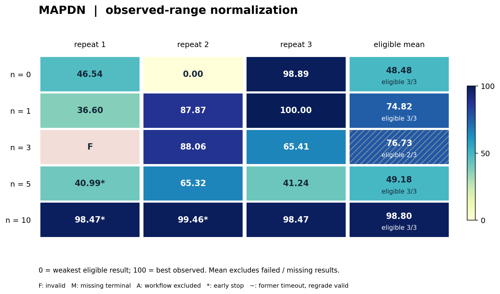

# MAPDN 局部信息下的安全与实际降损

> V2 首稿。Task：`mapdn-voltage-control`；固定案例：`mapdn33-2012-02-03`。
> 结果版本：`distribution-formal-20261016-v4`，15次独立开发、15次终评、14个有效候选。
> 证据快照：北京时间2026-10-17 12:12:14；本卡整理日期：2026-10-19。
> 本批3次开发提前结束，因此结果用于固定案例诊断，尚不能确认严格等时12小时条件下的 n 效应。

## 1. 任务概述与来源

MAPDN在配电网中控制光伏逆变器无功，研究局部信息下的电压安全与实际有功降损。
本轮每台逆变器独立读取所在区域的当前观测，并保留自己的历史状态。
演化对象是实际执行的控制器程序；推理阶段不调用在线LLM。

上游为[MAPDN固定源码](https://github.com/Future-Power-Networks/MAPDN/tree/6895f1f0630b112745a3f681d7685d454407f9cb)，数据来自锁定的HF快照。
本任务使用因果时序的直接Pandapower运行器，调整了上游Env的观测与外生输入推进顺序。
因此本轮quality、轨迹和运行合同属于本benchmark，不能称为原论文奖励或分数的复现。

MAPDN与PowerGym分别提供不同控制问题：本题侧重局部信息、连续无功和安全下的降损。
本例没有电池SOC、无功爬坡或设备动作次数成本，不能仅凭它属于多智能体环境就认定需要MARL或长期规划。
完整原始代码、数据版本与适配边界见[源码锁](../../task-packages/mapdn-voltage-control-formal-v1/source-lock.json)。

## 2. 固定案例与选例依据

| 项目 | 本轮冻结内容 |
|---|---|
| Case ID | `mapdn33-2012-02-03` |
| 网络与控制单元 | 33母线，6台PV逆变器，6个相互隔离的局部actor |
| 完整时域 | 2012-02-03完整480个3分钟间隔，每间隔0.05小时 |
| 外生输入 | 冻结的有功/无功负荷、PV有功及索引映射；不加噪声 |
| 初始无功动作 | 全部为0 |
| 逆变器容量 | 完整原始PV CSV各列最大值的1.2倍，不从目标日重估 |
| 动作范围 | 每actor一个归一化实数，范围[-0.8, 0.8] |
| 电压窗口 | [0.95, 1.05] p.u.，容差10⁻⁹ p.u. |
| 受评点 | 480×33=15,840个母线时间点 |

案例来自正式实验之前的多日选例与强基线资格实验。
强局部方法已实现全日电压合规，本例保留的价值是同等局部信息下继续降低真实有功损耗。
先前由弱droop所得的电压缺口已被撤回，不能继续把此日描述为未解决的电压可行性难题。
选例没有根据本批n组差异更换日期；规模大或运行失败也没有被直接当作数学困难的证据。

同一冻结案例用于开发面向的目标、过程反馈和截止后的独立重放。
“独立终评”指评分端重新执行，不表示未见日期或留出网络。
选例理由与传统参照的信息权限见[固定案例决定](../decisions/0008-distribution-formal-fixed-cases.md)和[强基线资格实验](../experiments/distribution-baseline-qualification-20261016.md)。

## 3. 优化目标与约束

控制器输出归一化动作a，可信侧按当前PV有功及额定容量映射无功：

`Q = a × sqrt(S_max² − P_now²)`。

先检查动作数量、有限数、类型和范围；布尔值、越界动作及错误长度均非法。
全部480步动作合法、控制器正常响应且潮流收敛，才构成完整有效候选。
有效候选还需区分是否所有母线时间点电压都合规。

当全日安全时，目标是降低实际有功损耗电量L，单位MWh。
损耗按每个真实3分钟间隔积分，并用全网有功平衡核验；无功努力项只作诊断。
本例采用的33母线网络不把无功绝对值代理reward解释为真实线路损耗。

完整运行每间隔包括形成合法观测的潮流和动作后的评分潮流，共960次。
控制器本身无额外仿真查询权，不能通过反复测量实现同一时刻的迭代控制。
若引入通信、额外潮流或集中全网信息，须另设权限轨道并统一重跑。

## 4. Agent起点、提交与接口

所有n档和重复共享同一[初始控制器](../../task-packages/mapdn-voltage-control-formal-v1/environment/app/submission/controller.py)。
它是单步局部松弛droop：先计算`20×(1−v)`并截至[-1,1]，再截到动作界，
与从本机当前Q/容量推得的上一动作按0.1/0.9混合。
它只使用本机PV电压、有功、无功和额定容量，不调用目标仿真器。

Agent修改并交付一个`controller.py`，源码上限1 MiB，只允许Python标准库。
参数和状态逻辑均写入此文件，不接受未收集依赖、外部权重或预存目标动作轨迹替代控制算法。
每次评测重新创建六个`Controller(metadata)`实例，各自调用`act(observation)`。
返回值为长度1的列表，内部历史保存在本actor实例中。

metadata只提供actor ID、本设备和区域索引、容量、动作界、步长和电压界。
observation包含当前步/时标、本PV的V/P/Q、区域母线需求P/Q、电压幅值和角度。
区域观测不是全网观测；六个actor不能共享内存、文件、状态或彼此的观测。
详细字段、单位和示例见[参与者接口](../../task-packages/mapdn-voltage-control-formal-v1/instruction.md)。

## 5. 信息权限、本地测试与反馈

每间隔先写入当前外生输入，使用上一归一化动作与当前容量求解观测潮流。
六个actor分别读取一次合法当前观测并输出动作，随后统一求解与计分。
当步观测与动作都不包含未来轨迹；历史仅随实际物理步前进。

开发镜像提供公共starter、schema和合成局部观测检查。
允许语法、导入、格式、合成toy检查；完整目标轨迹、网络模型、评分器及参照成绩不挂载给开发agent。
公开物理知识可以用于设计控制器，但不能取得目标完整轨迹或免费目标评分。
开发容器外网默认拒绝，只保留受控模型通道和声明的计数反馈桥。

一次n是受理一次完整480步案例过程评测，不是一次actor动作、一次潮流或一次模型请求。
已受理候选若崩溃、非法、超时或不完整，仍计次并返回0分。
基础设施原样重试保留原评价身份；超额申请在执行前拒绝。
未用满额度合法，受理、完成和领取分别记录；n=0不提供过程judge。

过程反馈是冻结评分器给出的完整日聚合quality、损耗、合规率和诊断汇总，不提供逐步轨迹。
本批本题受理、完成并领取57次反馈，全部为有效过程候选；不包含15次独立终评。
各重复实际计数见第8节及[机器摘要](evidence/mapdn.json)。

## 6. 模型、时间与资源

| 项目 | 本轮合同与实际情况 |
|---|---|
| 固定模型 | `global.openai.gpt-5.6-sol`；launcher别名`bedrock/gpt-5.6-sol` |
| Agent客户端 / Harbor | 2.1.280 / 0.20.0 |
| 设计矩阵 | n=0/1/3/5/10，每档3个独立开发进程 |
| 计划开发上限 | 43,200秒；无累计token cap、预留额度或token触发终止 |
| Provider采样 | sampling seed不可控，独立进程不等于已控制模型随机种子 |
| 外层作业资源 | 8 CPU、16 GiB、0 GPU，覆盖开发、评分和运行开销 |
| 开发容器 | 2 CPU、4 GiB；存储8 GiB |
| Verifier | 2 CPU、4 GiB；外层评分限360秒 |
| 完整仿真运行器 | 240秒 |
| 每actor | 初始化15秒、每次响应1秒、累计CPU60秒、地址空间384 MiB |
| Actor合计 | 6×384=2,304 MiB地址空间，与可信仿真共用4 GiB verifier限额 |

开发T、一次算法执行限额和物理日长是三个不同量。
反馈等待受同一开发墙钟约束，终评发生在冻结后且不再给开发者提供信息。
实际开发时长取可信冻结记录elapsed_seconds，而非某次续跑开始时的旧剩余时间字段。

本题3次触及`max_resumes=1000`提前返回，分别为n5/r1、n10/r1、n10/r2。
其开发时长为9.774、6.862、10.569小时，冻结后仍可得到有效最终候选。
其余12次在11.906至12.000小时收尾；近截止预留收尾不被统一当作异常早停。
实际完整provider token及费用尚未核实；日志中的零填充usage不能解释为零成本。

## 7. 评分、冻结与失败处理

冻结评分名为`mapdn33_formal_quality_v1`，方向越大越好：

- 无效或不完整：`quality = 0`。
- 完整有效但存在电压越限：`quality = 0.5 × CR_bus_time`。
- 全部15,840点安全：`quality = 0.5 + 0.5/(1 + L_MWh)`。

CR_bus_time是母线×时间点合规比例，全网同时合规率则以完整间隔为分母。
二者分别记录；不能将任一CR值、无功努力或中途损耗误写为完整日主成绩。
quality是冻结的benchmark奖励，实际MWh损耗是物理原始指标，不是同一单位。

截止时冻结唯一最终`controller.py`；未改动时保留starter，缺失/损坏按失败处理。
可信源快照、收集产物与终评实际执行源的SHA256必须一致。
终评在同一case独立执行，分数不回流、不占n，也不从历史反馈选最好版本。

MAPDN n3/r1最终仅完成1/480步，错误为`controller closed its response channel`。
其0.002078 MWh只是残缺轨迹累计量，不作为完整日低损耗结果。
该重复三次过程反馈曾有效，不能用过程最好0.707299替换最终0分。
作业Succeeded与生命周期审计通过说明流程收尾成立，不意味着算法候选有效。

## 8. 基线与最新实验结果

### 8.1 共同起点与额外权限参照

| 参照 | Quality | 实际损耗MWh | 信息与计算权限 |
|---|---:|---:|---|
| 共同单步松弛局部droop | 0.676351227 | 1.835251038 | 与正式候选同信息，每步一次动作 |
| 源码机制对齐迭代droop | — | 约1.842346 | 同一快照内额外物理反馈，单列参照 |
| 全信息AC OPF | — | 约1.298685 | 全网拓扑与测量；没有全局最优证书 |

主表starter取目标Linux环境实测；资格实验最后几位差异保留在各自证据中。
额外权限参照用于量级和潜在空间分析，不进入同信息局部策略排名。

### 8.2 全部15个截止候选

表中F为受理/领取完整反馈数；E表示续跑上限早停，I表示候选无效。
全部有效候选均完成480步，母线时间点与全网同时合规率均为100%。
下表仅对完整有效候选显示网损，未舍入原值和全部诊断见JSON。

| n/r | 最终quality | 网损MWh | 开发小时 | F | 状态 |
|---|---:|---:|---:|---:|---|
| 0/1 | 0.694433491 | 1.571573 | 12.000 | 0/0 | 有效 |
| 0/2 | 0.676303191 | 1.836024 | 11.943 | 0/0 | 有效 |
| 0/3 | 0.714828789 | 1.327435 | 12.000 | 0/0 | 有效 |
| 1/1 | 0.690560210 | 1.623843 | 12.000 | 1/1 | 有效 |
| 1/2 | 0.710534110 | 1.374912 | 11.939 | 1/1 | 有效 |
| 1/3 | 0.715260919 | 1.322763 | 11.908 | 1/1 | 有效 |
| 3/1 | 0.000000000 | — | 12.000 | 3/3 | I：响应中断 |
| 3/2 | 0.710608120 | 1.374078 | 11.906 | 3/3 | 有效 |
| 3/3 | 0.701783765 | 1.477900 | 12.000 | 3/3 | 有效 |
| 5/1 | 0.692272300 | 1.600479 | 9.774 | 5/5 | E：续跑上限 |
| 5/2 | 0.701750188 | 1.478312 | 11.914 | 5/5 | 有效 |
| 5/3 | 0.692368235 | 1.599182 | 11.912 | 5/5 | 有效 |
| 10/1 | 0.714665227 | 1.329208 | 6.862 | 10/10 | E：续跑上限 |
| 10/2 | 0.715049436 | 1.325047 | 10.569 | 10/10 | E：续跑上限 |
| 10/3 | 0.714665227 | 1.329208 | 11.939 | 10/10 | 有效 |

### 8.3 按n描述统计

本批沿用冻结合同：零分与早停均保留在每档3次quality均值中；SD为样本标准差。
物理损耗只在完整有效候选内汇总，不给残缺轨迹补造完整物理成绩。

| n | Quality均值 | 样本SD | 有效数 | 早停数 |
|---:|---:|---:|---:|---:|
| 0 | 0.695188490 | 0.019273893 | 3/3 | 0/3 |
| 1 | 0.705451747 | 0.013111219 | 3/3 | 0/3 |
| 3 | 0.470797295 | 0.407746290 | 2/3 | 0/3 |
| 5 | 0.695463575 | 0.005444579 | 3/3 | 1/3 |
| 10 | 0.714793296 | 0.000221823 | 3/3 | 2/3 |

13/15最终quality严格优于starter；最佳为n1/r3，quality=0.715260919，损耗1.322762540 MWh。
相对共同起点，最佳候选实际损耗下降27.92%，两者均全日电压安全。
n10组均值最高，但其两次早停；n3均值受一次最终崩溃影响。
每档仅3次重复，实际时长不均，本表不支持显著性、单调性或n的因果效应结论。

### 8.4 代表候选与演化机制证据

以下两例均从共同松弛droop出发，最终源码已于北京时间2026-10-19 13:40:31按终评哈希核对。
这里比较起点与最终实现，不把未完整重建的中间开发过程写成逐步因果链；片段及行号见JSON。

**n0/r3：区域无功需求前馈与电压灵敏度选择。**
最终程序不再只根据本PV电压追踪droop，而是在文件内编码标准33母线径向支路阻抗。
它用共同电阻路径加权区域无功需求，形成随本机PV负载调整的Q偏好；
用共同电抗路径估计dV/dQ，将偏好投影到观测电压对应的安全区间。
若安全区间冲突，枚举有限候选，按硬越限点数、最坏越限、平方和、软边界及经济偏好排序。
最后结合当前Q、能力圆、阻尼和变化幅度限制输出动作，没有增加框架外潮流查询。
该重复没有过程目标反馈，最终全日安全、损耗1.327434799 MWh、quality=0.714828789，开发12.000小时。
源SHA256为`1afe49fefa79dff62a32644c1fd23febefb7852609918927b04898c85ff3c95c`。

**n1/r3：LinDistFlow损耗前馈、相量修正与方向余量保护。**
最终程序按标准支路共同电阻构建PV耦合矩阵，计算负荷到逆变器Q的LinDistFlow损耗系数。
区域外负荷由名义空间分布和当前区域负荷水平估计；这不是读取其他actor的实时观测。
它再从可见区域电压幅值/角度重建路径无功流，对不可见多边间隔使用线性压降近似，
为前馈目标加入有界相量梯度修正；跟踪速度随电压余量变化，并保留单侧droop保护。
物理Q变化额外受估计灵敏度、1.25安全裕量及0.35余量份额约束；这些是算法近似，未给全局安全证明。
该重复领取1次过程quality=0.715056651，最终为0.715260919、损耗1.322762540 MWh，开发11.908小时。
源SHA256为`663b3769ca5626419ab8ff9e84f8b71369b9f9820958f6af0a587c4159ded5c8`。

这两份最终源包含公共标准网络常数。代码核对证明了最终实现和成绩的对应，
不能单凭最终文件反推出常数在开发中的取得路径，也不能把单个组件认定为降损的已证因果来源。

<!-- normalized-v1:start -->
### 8.5 归一化可视化对照

按本子 case 全部 `n` 的有效终态范围映射到 0–100，越高越好；0 是本批最弱有效结果，100 是本批最好有效结果。每档 `n` 使用相同锚点。该分数用于显示相对位置，不代表理论最优或跨任务同等能力。详见[统一方法和横向总览](README.md#normalized-results)。

本表均值／样本标准差只对纳入的有效结果计算，是新增的**可视化条件统计**，不替代上文的原始主统计。必须结合“纳入 / 计划”阅读；仅 1 次纳入时不估计标准差。图中斜线表示该组存在未纳入结果。

`F`＝候选无效；`M`＝缺失终评（开发 OOM）；`A`＝流程收尾审计失败；`NS`＝该档未设置。`†`＝已记录的开发提前结束（图中 `*`）；`§`＝原超时、本次统一补评有效（图中 `~`）。这些符号与数值 0 不同，均保留原始结果表。

#### MAPDN

| n | r1 | r2 | r3 | 有效样本归一化均值 ± 样本标准差 | 纳入 / 计划 | 补充状态 |
|---|---|---|---|---|---|---|
| 0 | 46.54 | 0.00 | 98.89 | 48.48 ± 49.47 | 3/3 | 提前结束 0/3 |
| 1 | 36.60 | 87.87 | 100.00 | 74.82 ± 33.65 | 3/3 | 提前结束 0/3 |
| 3 | F | 88.06 | 65.41 | 76.73 ± 16.02 | 2/3 | 提前结束 0/3 |
| 5 | 40.99† | 65.32 | 41.24 | 49.18 ± 13.98 | 3/3 | 提前结束 1/3 |
| 10 | 98.47† | 99.46† | 98.47 | 98.80 ± 0.57 | 3/3 | 提前结束 2/3 |

[矢量图](assets/normalized-v1/mapdn.svg)。
<!-- normalized-v1:end -->

## 9. 适用边界、复现与证据

本卡覆盖正式v4的15次开发，不混入600秒canary、60秒模型门禁或选例/基线资格实验。
当前结论是：局部控制器可在此完整固定日维持电压安全，并使最佳候选的实际有功损耗下降27.92%。
它不证明跨日、跨网络泛化，也不代表整个MAPDN家族都是相同难度。

本轮30个配电作业全部终评、28个候选有效；其中MAPDN3次、PowerGym6次提前结束。
下一轮若用于等时n比较，应先冻结续跑上限移除和流中断恢复规则，再重新构造统一纳入批次。
本批历史及失败继续保留，不能只删除早停、补挑更优替代或把候选失败改为基础设施故障。

公开包包含接口、运行与评分源码、锁和准备工具；真实目标数据仅在可信侧准备。
可移植证据摘要包含逐run原值、反馈计数、冻结源哈希及统计政策，不发布凭证或私有服务地址。
真实后端、安全、原生生命周期验收完成与“任意读者拿到公开数据即可一键复现”是不同状态。
数据许可、完整目标材料取得与镜像重建仍须按包的准备流程核验。

| 复现材料 | 用途 |
|---|---|
| [正式协议](../../configs/distribution-formal-20261016.json) | n、T、资源、反馈与两题统一政策 |
| [正式任务包](../../task-packages/mapdn-voltage-control-formal-v1/README.md) | 可信数据准备、后端和隔离验收入口 |
| [任务锁](../../task-packages/mapdn-voltage-control-formal-v1/formal-lock.json) | case、starter与评分版本 |
| [本卡机器证据](evidence/mapdn.json) | 原始精度结果、逐run哈希、时间与反馈账目 |
| [选例和基线](../experiments/distribution-baseline-qualification-20261016.md) | 正式实验前的选择证据与权限区别 |

正式包提交为`4ff98fe174da3dfb0b0df589bc5cecf2d830ba27`。
私有运行源清单SHA256为`fa3937726662b7aa1fd862796c7b8f4bda7600ec7385a0617d819dc676c1ef15`。
原始终态快照SHA256为`1bd4c579c2d22f28661a4c94241791879ed85d44ada03328bb924492cada8d78`。
两题终评完成范围为北京时间2026-10-17 04:52:03至11:47:58；状态更新与终评分数时间分别保留。
