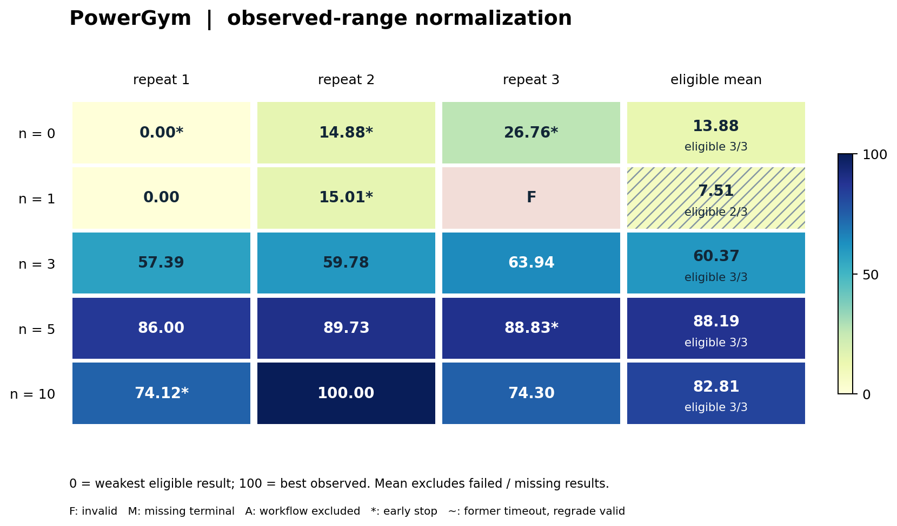

# PowerGym 混合设备电压与实际网损控制

> V2 首稿。Task：`powergym-volt-var-control`；固定案例：`123Bus-stress-p000-s2.5`。
> 结果版本：`distribution-formal-20261016-v4`，15次独立开发、15次终评、14个有效候选。
> 正式开发证据快照：北京时间2026-10-17 12:12:14；补充基线核对：2026-10-20 14:48；本卡整理日期：2026-10-20。
> 本批6次开发提前结束，14个有效候选的电池均闲置；本卡不据此宣称储能调度收益或严格等时n效应。

## 1. 任务概述与来源

PowerGym在配电网内联合控制电容器、调压器和电池，研究电压、真实有功网损与设备操作的权衡。
本轮使用集中式因果设备观测，演化对象是逐小时执行的控制器程序。
它与MAPDN的局部连续无功任务分开：本题含离散设备、操作代价和跨时段电池能量约束。
推理阶段默认不调用在线LLM；开发阶段LLM负责修改可执行算法。

上游锁定为[siemens/powergym固定提交](https://github.com/siemens/powergym/tree/c9fc6d8357308a1f2bd2389474b56089c2a6bd78)，
正式论文为[PMLR 168:21–33](https://proceedings.mlr.press/v168/fan22a.html)。
本任务使用真实OpenDSS snapshot后端、显式逐小时负荷和关闭自动设备控制的物理适配合同。
评分、时序和硬末能量条件不同于原Gym环境，因此不是原论文reward或PPO/SAC曲线的复现。

## 2. 固定案例与选例依据

| 项目 | 本轮冻结内容 |
|---|---|
| Case ID | `123Bus-stress-p000-s2.5` |
| Feeder / profile / scale | 123Bus、确定性打包profile0、负荷倍数2.5 |
| 完整时域 | 24个一小时间隔，不裁切或挑选部分小时 |
| 受控设备 | 4组电容器、7组调压器、4块电池，共15维整数动作 |
| 初态 | 电容器均为1，tap均32；4块电池均1000 kWh、SOC=1 |
| 电池额定值 | 每台100 kW、容量1000 kWh |
| 电压窗口 | [0.95, 1.05] p.u.，作为软代价界 |
| 末能量 | 每台账面与真实积分两项误差分别≤1 kWh |
| 数据关系 | 同一完整case用于过程反馈及冻结后重放 |

案例在正式n实验之前，依据候选扫描和强基线资格实验冻结。
标准123Bus日可由静态设备实现全程合规；2.5倍压力日保留了更明显的软成本控制空间。
此选择没有证明它是所有可能构造的PowerGym案例中最难，也未认证强储能调度挑战。
“有效候选”允许存在电压越限；这与把全天电压安全当作硬准入条件不同。

profile0是按明确文件顺序打包的源负荷块，不是已验证独立的自然日实测数据。
原输入缺少足以恢复真实采集日期/地域的时间标识，不能声称跨日独立性。
case、源DSS及打包来源哈希见[源码锁](../../task-packages/powergym-volt-var-control-formal-v1/source-lock.json)。
完整选择与权限分轨见[固定案例决定](../decisions/0008-distribution-formal-fixed-cases.md)。

## 3. 优化目标与约束

动作为4个电容器0/1、7个调压器0..32、4个电池0..32，依此顺序返回。
每台电池16为空闲，0请求充电100 kW，32请求放电100 kW，每档6.25 kW。
全零向量不是“保持现状”；电池请求先按剩余能量投影至合法离散功率档位。

硬有效性条件包括有限且范围内的Python int动作、完整24步潮流收敛与有限物理量。
每台电池还须同时满足：初末账面能量差绝对值≤1 kWh，以及真实端口净有功积分绝对值≤1 kWh。
不能把4块电池的正负误差相互抵消，也不能只验总能量。

电压越限、实际网损、电容器切换次数和tap移动档数共同形成软代价。
电压项V按每个bus的最高相超过1.05、最低相低于0.95的幅值积分，单位pu·h。
实际L是whole-circuit有功损耗积分，单位kWh；不能用原生损耗比例和代替电量。

上游电池仍由OpenDSS Generator加Python账本实现，不是Storage物理模型。
本轮保留`Q=P/0.95`的原Generator约定；账本clip到容量后用Python round舍入到整数kWh。
本轮未引入独立充放电效率模型，不能把这项实现描述为已校正的真实固定功率因数储能模型。
动作与物理规则见[参与者合同](../../task-packages/powergym-volt-var-control-formal-v1/instruction.md)。

## 4. Agent起点、提交与接口

各n与重复使用同一个[coordinated_voltage初始控制器](../../task-packages/powergym-volt-var-control-formal-v1/environment/app/submission/controller.py)。
它用合法可见电压包络决定共同tap平移，幅度截在[-4,4]。
电压已处于内部死区时保持tap；极端电压条件下每步至多切换一组电容器。
4块电池始终返回16保持闲置。它是未训练的同信息启发式，不是全局最优参照。

Agent提交唯一`controller.py`，标准库单文件，最多1,000,000 bytes。
参数写在文件内；不接受外部服务、未收集文件或固定目标动作轨迹替代算法。
运行入口为`Controller(metadata).act(observation) -> list[int]`，每次重放创建新实例。
输出必须为15个真正的Python int，不接受bool；stdout是协议通道。

metadata提供设备数量、有序名称、动作上界、电池容量/功率、时域和初末SOC。
observation包含step、cap状态、tap、当前账面SOC、实际电池功率和bus各相电压。
第0步电压是首时段空闲初态测量，之后电压和实际功率来自上一已完成小时，SOC为更新后的账本值。
可以保留自身历史，但不能把下一小时负荷或环境对象读入控制器。

## 5. 信息权限、本地测试与反馈

本轮是全网电压集中观测，不应称为MAPDN式局部信息任务。
合法因果观测不含当前/未来负荷矩阵、forecast、DSS模型或仿真查询。
原生Env对象内部含完整负荷序列，因此可信运行器只通过声明的字段传送观测。

开发镜像提供schema、共同starter和合成接口检查。
允许语法、导入、动作格式和toy自检；目标轨迹、源电路、完整checker和参考动作计划留在评分端。
完整目标成绩只能经框架计数取得；开发网络默认拒绝，模型与计数桥是声明的通路。

一次n是受理一次完整24步案例过程评测，不是一次小时动作或一次LLM调用。
已受理候选错误、超时、非法动作或末能量失败计次并返回0。
基础设施原样重试保持原逻辑身份；超额申请先拒绝后执行，n=0不提供过程judge。
反馈只给完整日汇总质量、V/L/合规率/操作/吞吐及初末能量，不给完整逐步轨迹。

本题共受理、完成并领取57次过程评测，其中54次候选有效，3次因电池末能量条件失败计0分。
三个失败均发生在n10过程，不能退回n或排除出额度统计。
15次独立终评另计，不占这57次过程n。

## 6. 模型、时间与资源

| 项目 | 本轮合同与实际情况 |
|---|---|
| 固定模型 | `global.openai.gpt-5.6-sol`；launcher别名`bedrock/gpt-5.6-sol` |
| Agent客户端 / Harbor | 2.1.280 / 0.20.0 |
| 设计矩阵 | n=0/1/3/5/10，各3个独立开发进程 |
| 计划开发上限 | 43,200秒；无累计token cap、reservation或token触发终止 |
| Provider随机性 | sampling seed不可控，不能把重复编号写成受控采样seed |
| 外层作业 | 6 CPU、12 GiB、0 GPU |
| 开发容器 | 1 CPU、2 GiB，存储4 GiB |
| Verifier | 1 CPU、2 GiB，外层评分限120秒 |
| 候选运行 | 全episode30秒、每步响应1秒、初始化5秒 |
| 候选计算 | 累计CPU10秒、地址空间512 MiB |
| 数值设置 | OpenDSS tolerance=10⁻¹⁰；每步BuildYMatrix(2,True)，SolutionInitialized=False |

12小时是算法开发上限；一次候选执行30秒和物理日24小时分别记录。
反馈等待使用同一开发墙钟，冻结后终评不增加开发信息。
实际耗时以可信deadline-freeze的elapsed_seconds为准，不以最后一段剩余时间字段替代。

本题6次异常早停，其中n0/r1、n5/r3、n10/r1触及1000次续跑上限。
n0/r2、n0/r3、n1/r2遇provider流中断后退出，外层随即冻结并进入终评。
这些运行实际开发6.578至10.681小时，6个最终候选均有效。
作业Succeeded和审计通过不证明每个开发进程实际享有相同12小时。
完整token总量和费用尚未核实，零填充usage不代表零token。

## 7. 评分、冻结与失败处理

完整有效轨迹的冻结评分为：

`quality = 1 / [1 + V_pu·h + L_kWh/1000 + (C+R)/33]`。

C为电容器切换次数，R为调压器移动档数之和。
1000和33是正式实验前冻结的归一尺度；33不代表本网络的设备数量。
quality越大越好，不与MAPDN的quality跨任务比较或合并平均。

硬约束违反、动作错误、异常、超时或不完整，统一quality=0。
完整但有电压越限的候选仍可有效，其越限由V惩罚并单独报告合规率。
相位×时间合规率与全网同时合规率的分母不同，不能互相换算。

开发结束时只冻结当前唯一`controller.py`，用SHA256核对快照、收集和终评实际执行源。
无修改时沿用starter，缺失或损坏按失败记录；终评在同case重新执行，不反馈、不占n。
最终不从历史反馈挑最优源，未评价过的最后修改也必须承担最终失败风险。

n1/r3完成24步但第3/4块电池账面末能量偏差为10/16 kWh，实际积分约10.0500/16.6739 kWh。
它违反逐块双能量条件，因此最终0分；其较低V和L只作无效诊断，不进入可行物理解比较。
这不是基础设施故障，也不能因三个过程评分曾有效就用旧分替换最后候选。
本题n1的三次最终分均低于各自最好过程反馈，主结果仍保留最终版本。

## 8. 基线与最新实验结果

**2026-10-19 补充的12个数值Job已全部完成，3/12符合本卡硬有效性条件。** 2026-10-20 14:48北京时间核对全部终态回执，逐seed成绩及9个失败见下文；实际 Job／UID、最终权重和完整诊断见[本轮基线复现记录](baseline-reproductions-20261019.md)及[机器可读证据](evidence/baseline-reproductions-20261019.json)。这些额外训练参考与原15次独立开发分开报告。

### 8.1 传统方法、论文方法与复现锚点

| 指标 | 共同starter | 最佳最终n10/r2 |
|---|---:|---:|
| Quality | 0.057844022 | 0.104470297 |
| 实际网损kWh | 5854.903549 | 5205.399485 |
| 越限积分pu·h | 5.675392 | 0.184881 |
| 相位时间合规率 | 90.2578% | 98.6960% |
| 电容器切换次数 | 3 | 0 |
| Tap移动档数 | 154 | 105 |
| 电池吞吐kWh | 0 | 0 |

最佳候选质量比起点高80.61%，网损下降11.09%，V下降96.74%，但仍有电压越限。
当前负荷优化器、全日设备oracle及含电池oracle使用更多信息，单独标记为特权参照。
已有全日含电池oracle的V约0.010344、quality约0.077339；它是有限启发式而非全局最优证书。
最佳agent综合分更高，同时V仍大于该oracle，不能声称在全部物理指标上占优。
Oracle的79.17%为全网同时合规率，不能与上表98.6960%的相位时间比例直接比。

#### 同一压力案例的传统方法实测

下列传统方法均来自正式开发之前的
[资格实验与逐方法证据](../experiments/verification/distribution-baseline-qualification-20261016-powergym.json)，
使用同一`123Bus-stress-p000-s2.5`、24小时、设备初态及冷启动数值设置，
全部通过逐电池账面/实际净能量双门槛。证据字段名`canary_quality`的公式与本卡quality相同，
这里保留已有实测数，不表示另行重评或完成了与LLM等12小时/等n的开发比较。

| 同信息方法 | Quality | 越限V pu·h | 网损L kWh | C / R操作数 | 信息与复现状态 |
|---|---:|---:|---:|---|---|
| 保持初态，`hold_idle` | 0.005783795 | 166.153809 | 5743.066 | 0 / 0 | 合法滞后观测，无仿真查询；完整实测 |
| 电压滞环，`canary_hysteresis` | 0.024798367 | 31.491188 | 5288.594 | 0 / 84 | 同正式观测权限，无仿真查询；完整实测 |
| 协调电压规则，`coordinated_voltage` / 共同starter | 0.057844022 | 5.675392 | 5854.904 | 3 / 154 | 同上；最强已测同信息传统锚点，正式Linux复核一致 |
| 演化最佳n10/r2，供定位 | 0.104470297 | 0.184881 | 5205.399 | 0 / 105 | 正式截止候选，详见下一表 |

四行电池吞吐均为0。最佳演化候选相对最强已测同信息传统锚点quality提高80.61%，
同时网损下降11.09%、越限积分下降96.74%；这不是相对原论文SAC的提升。

| 额外权限数值参照 | Quality | 越限V pu·h | 网损L kWh | C / R操作数 | 信息与复现状态 |
|---|---:|---:|---:|---|---|
| 快照搜索，`full_information_snapshot` | 0.068146575 | 7.206642 | 5497.913 | 4 / 28 | 当前完整电路与负荷；无未来负荷；完整实测 |
| 当前强搜索，`strong_current_idle` | 0.077581293 | 0.013096 | 5452.367 | 10 / 202 | 同上，增加多起点/全档设备搜索；完整实测 |
| 全日静态设备，`static_day_idle` | 0.094699618 | 0.803341 | 5726.060 | 2 / 98 | 预知完整日负荷，选择全天固定tap/cap；完整实测 |
| 全日变动设备，`oracle_day_idle` | 0.077310410 | 0.013011 | 5437.009 | 10 / 204 | 预知完整日负荷，优化随时间设备计划；完整实测 |
| 全日设备加储能，`oracle_day_storage` | 0.077338898 | 0.010344 | 5434.912 | 10 / 204 | 全日先知及成对充放电搜索；实际吞吐413.808 kWh；完整实测 |

证据中的`best_active_storage`在本case与`oracle_day_storage`相同，不重复计作独立方法。
前三种同信息方法每小时只输出一次动作；这些优化器可查询真实模型，
资格实验每case的全部9条方法记录共享200,000次显式潮流/1,800秒上限，不能把搜索成本隐藏为actor推理。
额外权限表的最高综合quality为静态设备参照0.094699618；最佳演化候选在该综合指标上更高，
但其V仍高于当前强搜索与储能参照。这些都是有限启发式，没有全局最优证书，
也不能把“oracle”一词解释为已求得最优上界。

#### 论文公开分数、已做复现与当前缺口

[PowerGym原论文Figure 2 / §6.1](https://proceedings.mlr.press/v168/fan22a/fan22a.pdf#page=8)
给出以下**标准123Bus**测试profile累计reward，数值为原文标签的跨10 seeds均值±标准差。
它们不是本卡2.5倍压力固定日的quality，不能换算为本表得分或用于计算演化提升率。

| 原论文方法 | 标准123Bus原生累计reward | 原文动作设置 | 本卡精确case复现状态 |
|---|---:|---|---|
| Random | −167.54 ± 5.74 | 全部设备随机合法动作 | 本卡3seeds已完整重放；0/3符合双硬能量条件，上面的保持初态不是Random |
| PPO | −81.22 ± 8.76 | MultiDiscrete | 本卡独立重建训练／终评完成；0/3符合双硬能量条件 |
| 整数SAC | −7.91 ± 0.57 | MultiDiscrete | 本卡独立重建训练／终评完成；0/3符合双硬能量条件 |
| cbat_SAC | −7.53 ± 0.27 | 电池连续，其余设备离散 | 独立适配cbat-SAC-projected完成；3/3有效，但均未实现全网同时电压合规 |

原协议随机平分训练/测试profiles、H=24、每5 episodes评测；Figure 2标题写40k steps，
横轴到20k，真实训练计数尚未由原作者代码消除歧义。
[原文§6.2 / Figure 3](https://proceedings.mlr.press/v168/fan22a/fan22a.pdf#page=9)
另有123Bus连续电池的`s2.5`与`soc_s2.5`实验；它们采用原生reward和可选软SOC罚项，
不等于本卡离散电池、双硬末能量和实际kWh目标。

[官方维护者issue #4](https://github.com/siemens/powergym/issues/4#issuecomment-1128028790)
说明论文PPO/SAC训练实现未包含在当时公开仓库；
[本项目固定源码审计](../experiments/powergym-rl-paper-audit-20261016.md)
也未在锁定官方版本发现训练器或作者权重。因此此前34Bus实验和本轮123Bus方法均为独立重建，不能声称复现原作者trainer或权重。此前pilot如下：

| 本项目已完成的论文方法pilot | 精确运行条件 | 40k最终原生reward诊断 / 当前合同有效性 | 与本卡的关系 |
|---|---|---|---|
| PPO重实现 | 34Bus标准负荷，seed=0，16个packed profiles固定8/8划分，40,000真实训练transitions | 留出8条均值−9.419387；有效0/8、quality均值0 | 不同feeder/scale，与下述123Bus批次分开报告 |
| 整数SAC重实现 | 与PPO相同的固定pool/split/seed和训练量 | 留出8条均值−57.494843；有效0/8、quality均值0 | 同上；不代表原作者SAC权重或算法能力结论 |

pilot最终策略违反硬末能量条件；不能用SAC20k的较好检查点替换预定40k最终权重，
也不能用0分声称演化方法已击败论文SAC。完整物理量、检查点、适配失败与独立重放见
[pilot报告](../experiments/powergym-rl-pilot-20261016.md)及
[机器证据](../experiments/verification/powergym-rl-pilot-20261016.json)。
上游是研究环境，本卡没有绑定官方竞赛排行榜或竞赛选手提交；目前没有同case竞赛名次或获奖解复跑成绩。

#### 已完成的123Bus压力日最终检查点锚点

**12/12数值Job均完成全部24步重放。** Random／PPO／integer SAC／cbat-SAC-projected各seeds0/1/2；后三者每seed完成**40,000次真实训练转移**，Random为0次。使用全部8条训练profile，**目标profile0包含在训练中**，不称未见日测试。仅使用最终检查点，使用本卡因果观测且无在线搜索；结果不混入15次正式开发或34Bus pilot。详细回执见[本轮复现§6](baseline-reproductions-20261019.md#6-mapdnpowergym固定种子训练已完成)与[JSON](evidence/baseline-reproductions-20261019.json)。

下表Quality按双硬能量条件`qualification_valid`判定；失败的V／L与合规率只作完整失败轨迹诊断，不能作为可行候选参与物理解比较。

| 方法 / seed | 正式Quality | 越限V pu·h | 网损L kWh | 相位×时间合规率 | 全网同时合规率 | 双硬能量资格 |
|---|---:|---:|---:|---:|---:|---|
| Random / 0 | 0.000000000 | 153.801285 | 4857.639781 | 35.7464% | 0.0000% | 失败 |
| Random / 1 | 0.000000000 | 133.486205 | 5047.569837 | 39.6433% | 0.0000% | 失败 |
| Random / 2 | 0.000000000 | 153.257791 | 4898.425444 | 37.4400% | 0.0000% | 失败 |
| PPO / 0 | 0.000000000 | 8.977093 | 5543.012072 | 78.0725% | 4.1667% | 失败 |
| PPO / 1 | 0.000000000 | 16.206347 | 5734.874883 | 77.6829% | 0.0000% | 失败 |
| PPO / 2 | 0.000000000 | 4.201265 | 4907.888318 | 91.0821% | 0.0000% | 失败 |
| integer SAC / 0 | 0.000000000 | 92.809502 | 6193.513100 | 46.1031% | 0.0000% | 失败 |
| integer SAC / 1 | 0.000000000 | 46.476729 | 5341.625292 | 59.2326% | 0.0000% | 失败 |
| integer SAC / 2 | 0.000000000 | 88.866840 | 5608.741900 | 45.9083% | 0.0000% | 失败 |
| cbat-SAC-projected / 0 | 0.018854125 | 9.711648 | 5418.051592 | 89.1787% | 0.0000% | 有效 |
| cbat-SAC-projected / 1 | 0.059648916 | 6.211976 | 6007.333385 | 88.9688% | 0.0000% | 有效 |
| cbat-SAC-projected / 2 | 0.021571889 | 8.887727 | 5529.505984 | 90.7374% | 0.0000% | 有效 |

Random／PPO／integer SAC各**0/3有效、全3seeds正式Quality均值0**；cbat-SAC-projected为**3/3有效，等权Quality均值0.033358310 ± 0.022808848样本标准差**。其最高单seed为0.059648916，不替代预定三seed汇总。三个cbat候选均有电压越限，全网同时合规率均为0；有效不表示电压安全。实际电池吞吐分别为0／0／29.162016 kWh，第三seed电池4的实际净积分约0.024596 kWh，均在逐块硬门槛内。

integer SAC seed1虽然原始`valid=true`且账面末能量回到初态，但电池3／4实际净积分为**−151.125482／−48.713876 kWh**，因此`qualification_valid=false`、正式Quality=0。原始`canary_quality=0.010873126`保留为诊断，不能作为有效成绩；其余8个不合格候选均记录`terminal_energy_violation`。完整的账面、实际积分、吞吐与舍入／clipping残差保留在JSON。

作者训练器／权重未公开，PPO／SAC为独立重建；cbat采用连续Gaussian电池训练分支和离散设备Gumbel分支，最终推断显式投影到33档电池网格，因此命名`cbat-SAC-projected`。训练保留vanilla reward，不加硬能量修补；终评失败保留，不换中途较好权重。训练模拟器／reward、外部依赖与权重均为额外训练轨道，不能声称与stdlib-only正式actor或受保护反馈n具有相同开发信息预算。

### 8.2 全部15个截止候选

F为受理/领取反馈数；E为异常早停，I为候选无效。
V与L均为原始物理量，Quality是独立合同分；†是无效完整轨迹的诊断值。
全部候选完成24步；14个有效候选的电池吞吐均为0。

| n/r | 最终quality | 网损kWh | V pu·h | 开发小时 | F | 状态 |
|---|---:|---:|---:|---:|---:|---|
| 0/1 | 0.005783795 | 5743.066 | 166.153809 | 8.084 | 0/0 | E：续跑上限 |
| 0/2 | 0.020464179 | 5376.498 | 40.368164 | 6.578 | 0/0 | E：流中断 |
| 0/3 | 0.032194070 | 5396.706 | 24.028552 | 10.681 | 0/0 | E：流中断 |
| 1/1 | 0.005783795 | 5743.066 | 166.153809 | 12.000 | 1/1 | 有效 |
| 1/2 | 0.020599257 | 5388.803 | 40.338455 | 7.178 | 1/1 | E：流中断 |
| 1/3 | 0.000000000 | 5246.396† | 1.482402† | 11.984 | 1/1 | I：末能量 |
| 3/1 | 0.062418591 | 5242.402 | 5.960284 | 11.976 | 3/3 | 有效 |
| 3/2 | 0.064777284 | 5294.276 | 1.718992 | 11.967 | 3/3 | 有效 |
| 3/3 | 0.068879793 | 5312.895 | 4.750606 | 12.000 | 3/3 | 有效 |
| 5/1 | 0.090654413 | 5776.557 | 1.375557 | 11.981 | 5/5 | 有效 |
| 5/2 | 0.094339793 | 5237.065 | 0.605340 | 12.000 | 5/5 | 有效 |
| 5/3 | 0.093447103 | 5246.295 | 2.333735 | 7.736 | 5/5 | E：续跑上限 |
| 10/1 | 0.078933695 | 5231.924 | 4.103604 | 7.108 | 10/10 | E：续跑上限 |
| 10/2 | 0.104470297 | 5205.399 | 0.184881 | 11.990 | 10/10 | 有效 |
| 10/3 | 0.079106593 | 5804.618 | 2.806251 | 11.982 | 10/10 | 有效 |

### 8.3 按n描述统计

本批统计保留每档全部3个最终quality，包括n1/r3的0分和6个早停；SD采用样本标准差。
物理汇总只纳入完整有效候选；无效诊断不混入可行解的均值。

| n | Quality均值 | 样本SD | 有效数 | 早停数 |
|---:|---:|---:|---:|---:|
| 0 | 0.019480681 | 0.013232578 | 3/3 | 3/3 |
| 1 | 0.008794351 | 0.010624497 | 2/3 | 1/3 |
| 3 | 0.065358556 | 0.003269585 | 3/3 | 0/3 |
| 5 | 0.092813770 | 0.001922587 | 3/3 | 1/3 |
| 10 | 0.087503528 | 0.014693907 | 3/3 | 1/3 |

n3/5/10的9个最终候选全部优于starter，n0/1的6个均未优于starter。
n5组均值最高，最佳单次在n10；现有数据不呈现随n单调改善。
每档仅3次，早停在组间不均，无法把差异直接归因为反馈预算，也不作显著性结论。
本轮有效候选全部电池idle，支持的是非电池设备控制收益，不是已实现储能调度改进。

### 8.4 代表候选与演化机制证据

以下两份截止源码已于北京时间2026-10-19 13:40:31与终评分数绑定的SHA256逐项核对。
描述比较共同starter和最终实现，未将全部中间编辑、每次反馈及改动因果完整重建。
对应源码片段、行号与原始精度指标保存在JSON。

**n5/r2：首步灵敏度校准加共同tap与分相平衡。**
相对starter统一平移tap、偶尔切cap的机制，最终程序将cap固定为全部投入（状态1）、电池固定idle。
它保留首步电压中心及tap，利用下一步因果观测响应估计聚合tap灵敏度，
并把估计限制在[0.00625,0.01875]；该估计也可能包含外生负荷变化，不能称精确系统辨识。
运行时先从电压包络产生共同tap平移，再根据三相包络中心差增加每相±1档平衡。
首步允许[-16,8]的共同复位，后续共同平移限制为[-6,6]，电压处于死区时保持。
最终quality=0.094339793，V=0.605340337 pu·h，网损5237.064766 kWh，tap移动124档。
该重复用满并领取5次过程反馈，开发12.000小时；最终质量与过程最好相同。
源SHA256为`d87439ff6aa7ffbbc750bf664bf73ace544be4b79d79e47a54e8b8145b4c537e`。

**n10/r2：固定启动tap与每相单调压器单档滞环。**
最终程序首步把全部tap置20，cap保持1、电池保持idle，从而不产生cap切换或电池吞吐。
随后从调压器名称解析A/B/C相别，只调整每相映射的第一个调压器，其余保持当前tap。
它从上一小时每相电压最小/最大值形成包络：外守卫为0.956/1.044，
仅在触发外守卫且包络和低于1.994或高于2.006时，移动对应tap±1档。
这将starter的多设备共同大幅移动收窄成分相小步调节，并减少不必要操作。
最终quality=0.104470297，V=0.184881120 pu·h，网损5205.399485 kWh，tap移动105档。
该重复领取10次过程反馈，其中1次候选因能量约束无效；最终版本有效，开发11.990小时。
源SHA256为`edc8eec2b5d9ccf90f0dd318fc7ea4a98249b1394c937640deedbd669f8a0afb`。

两例源码均明确将电池置idle，与14个有效候选电池吞吐0的观测一致。
这些是可解释的设备控制改动；未执行组件消融，因此不能把全部收益单独归因于分相控制或某一阈值。

<!-- normalized-v1:start -->
### 8.5 归一化可视化对照

按本子 case 全部 `n` 的有效终态范围映射到 0–100，越高越好；0 是本批最弱有效结果，100 是本批最好有效结果。每档 `n` 使用相同锚点。该分数用于显示相对位置，不代表理论最优或跨任务同等能力。详见[统一方法和横向总览](README.md#normalized-results)。

本表均值／样本标准差只对纳入的有效结果计算，是新增的**可视化条件统计**，不替代上文的原始主统计。必须结合“纳入 / 计划”阅读；仅 1 次纳入时不估计标准差。图中斜线表示该组存在未纳入结果。

`F`＝候选无效；`M`＝缺失终评（开发 OOM）；`A`＝流程收尾审计失败；`NS`＝该档未设置。`†`＝已记录的开发提前结束（图中 `*`）；`§`＝原超时、本次统一补评有效（图中 `~`）。这些符号与数值 0 不同，均保留原始结果表。

#### PowerGym

| n | r1 | r2 | r3 | 有效样本归一化均值 ± 样本标准差 | 纳入 / 计划 | 补充状态 |
|---|---|---|---|---|---|---|
| 0 | 0.00† | 14.88† | 26.76† | 13.88 ± 13.41 | 3/3 | 提前结束 3/3 |
| 1 | 0.00 | 15.01† | F | 7.51 ± 10.62 | 2/3 | 提前结束 1/3 |
| 3 | 57.39 | 59.78 | 63.94 | 60.37 ± 3.31 | 3/3 | 提前结束 0/3 |
| 5 | 86.00 | 89.73 | 88.83† | 88.19 ± 1.95 | 3/3 | 提前结束 1/3 |
| 10 | 74.12† | 100.00 | 74.30 | 82.81 ± 14.89 | 3/3 | 提前结束 1/3 |

[矢量图](assets/normalized-v1/powergym.svg)。
<!-- normalized-v1:end -->

## 9. 适用边界、复现与证据

本卡只覆盖正式v4的15次开发及其唯一冻结终评；canary、选例、论文RL pilot均不并入。
此前PPO/整数SAC pilot有不同训练与评测设置，不构成本批同预算方法排行。
本轮结果不能推出跨feeder、跨profile泛化或原论文算法无法适配此合同。

14个有效候选全部电池闲置，意味着本轮观察到的改进来自电容器/tap控制。
这也不能证明电池普遍无用；当前适配轨、初始化及双末能量条件限制了可用策略。
要研究储能贡献，应先冻结新的统一实验设计与参照，不能为使电池有用而事后改写本批评分。

两题共有9个早停；未来严格等时n研究应先移除额外续跑终止并增加原时钟内的有界流恢复。
历史30次、两个候选失败和早停全部保留；新批纳入/重跑规则应在观察新成绩前冻结。
本卡未提交新作业、未重评、未用更优过程版本替换最终结果。

| 复现材料 | 用途 |
|---|---|
| [正式协议](../../configs/distribution-formal-20261016.json) | 统一实验政策与反馈定义 |
| [正式任务包](../../task-packages/powergym-volt-var-control-formal-v1/README.md) | 数据准备、后端构建与验收 |
| [任务锁](../../task-packages/powergym-volt-var-control-formal-v1/formal-lock.json) | Case、starter、评分和资源锁 |
| [本卡机器证据](evidence/powergym.json) | 逐run未舍入结果、状态、反馈、源哈希 |
| [基线资格实验](../experiments/distribution-baseline-qualification-20261016.md) | 同信息与特权参照的边界 |

公开任务包含接口、运行/评分代码、锁和准备工具，真实目标电路/负荷只进入可信评测端。
源负荷的原始出处、再分发权利和独立日期语义仍有审计边界；代码许可不能替代全部数据许可。
完成集群实验不等于公开材料已无条件实现一键重建，准备时仍须验证case/assets、wheel及镜像哈希。

正式包提交为`4ff98fe174da3dfb0b0df589bc5cecf2d830ba27`。
私有运行源清单SHA256为`fa3937726662b7aa1fd862796c7b8f4bda7600ec7385a0617d819dc676c1ef15`。
原始终态快照SHA256为`1bd4c579c2d22f28661a4c94241791879ed85d44ada03328bb924492cada8d78`。
数值来自北京时间2026-10-17 12:12:14快照；本卡没有把历史快照写成实时运行状态。
