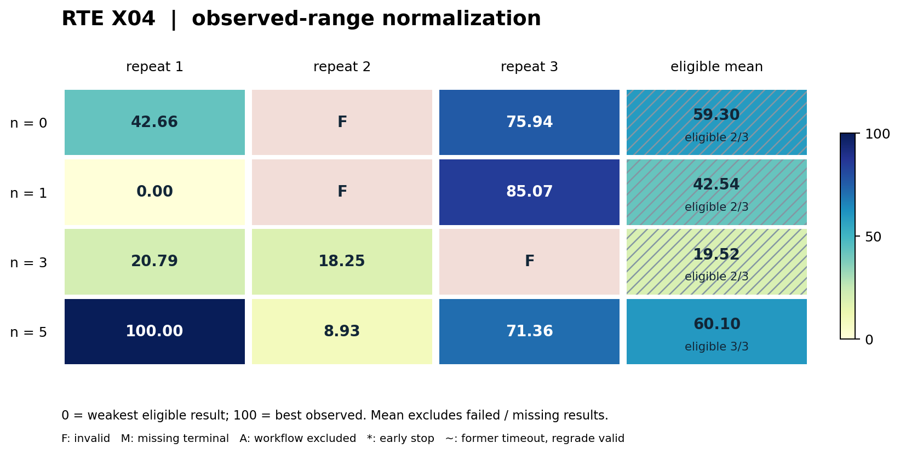
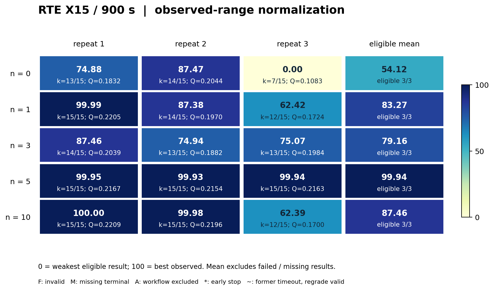

# RTE：情景风险下的电网检修排程

> V2 首稿。任务族包含两个独立子 case：**公开单实例 X04** 和 **ABC45 开放开发／X15 输入受保护面板**。X04 最新完整分析为 2026-10-18 15:32，ABC/X15 当前 v2 的只读结果核对为 2026-10-19 13:44（均为北京时间）。两者共享原问题，但权限、评分和资源不同，结果分别报告。[可移植证据摘要](evidence/rte.json)

## 1. 任务概览与来源

**任务族 ID：`rte-maintenance`。** 来源为 ROADEF/EURO 2020 Challenge、法国输电运营商 RTE 的检修排程题。为每个检修干预选择整数开始时段，在资源上下界和季节互斥约束下，最小化情景风险目标。

这是一项组合优化与算法工程任务，考察可行解构造、MILP、情景风险建模、局部搜索、内存管理与有限时间内的可靠输出。它不要求重新求解电网潮流，也不要求训练 RL 模型。

官方来源：[题目、数据和 checker](https://github.com/rte-france/challenge-roadef-2020)、[原赛最终结果](https://roadef.org/challenge/2020/en/finalresult.php)。两个子 case 均保留原始工业实例的资源、时段、干预、风险情景和目标语义，不缩小为人工玩具实例。

## 2. 两个子 case 的精确定义与选择依据

| 项目 | RTE-X04 | RTE-ABC/X15 v2 |
|---|---|---|
| 协议 ID | `rte2020-x04-900-in-sample-v1` | `rte2020-abc-x15-v2` |
| 目标实例 | 官方 `X_04.json` | 官方 `X_01` 至 `X_15`，完整 15 例 |
| 开发数据 | X04 原始输入公开，可自测 | A/B/C 各 15 例，共 45 例及官方 checker 开放 |
| 输入保护 | 无；开发和评分为同一公开实例 | X15 输入只进入隔离评分器 |
| 正式反馈预算 | `n=0/1/3/5` | `n=0/1/3/5/10` |
| 独立开发重复 | 每档 3 次，共 12 次 | 每档 3 次，全新 15 次 |
| 主终评 | 同一公开 X04，900 秒 | 同一 X15，900 秒／例 |
| 5400 秒补充档 | 本批未完成独立复评 | 同一截止源码，已执行，不回流开发 |

**X04 选择依据。** 原赛 X 组工作簿中，13 支队伍在 X04 的 900 秒档仅 6 支有效，5400 秒档 7 支有效；按“900 秒有效数、5400 秒有效数、实例 ID”的透明历史可行性排序，它位于最困难一端。同时已有 starter 能产出有效解，适合研究有限预算下的改进。

X04 包含 426 个干预、25 个时段，各时段 175–203 个情景；实例 SHA256 为 `088ef4973e8c518644a1ac0dbc97f51b91fb5065e263d4757c2185e5852d900e`。历史失败也可能来自接口、程序或资源，不能据此称它在所有难度定义下最难。

**ABC/X15 选择依据。** 保留完整官方 ABC45 与 X15，考察从多个公开实例开发、到输入受保护面板上反馈驱动演化的表现。X15 为固定完整面板，不按本批结果选择容易或容易改进的实例。

当前 ABC/X15 v2 的 15 次均为重新开发。旧 `formal-20261016-v6` 及其中缺失槽位保留在历史记录中，不拼接为当前三次重复，也不把旧 v1 的全可行才有分规则用于本卡结果。

## 3. 共同问题定义、目标与硬约束

每个干预 `i` 选择整数开始时间 `s_i`；持续时间、workload 与情景风险依赖开始时段。输入包括 `Resources`、`Seasons`、`Interventions`、`Exclusions`、`T`、`Scenarios_number`、`Quantile` 和 `Alpha`。

硬约束为：每个干预恰好排一次，合法开始且在 `T` 内完成；每个资源／时段的总使用同时满足上下界；指定季节中互斥干预不能重叠。输出还需通过完整性、重复项、整数格式和结束时间检查。官方资源容差为 1e−5。

先在同一情景上累加所有正在进行的干预风险，得到 `R[t,s]`；再计算时段均值 `m[t]` 和官方分位值 `q[t]`：

```text
q[t] = sorted(R[t,:])[ceil(S[t] × Quantile) − 1]
F = Alpha × mean_t(m[t])
    + (1 − Alpha) × mean_t(max(0, q[t] − m[t]))
```

**官方目标 `F` 越低越好。** 分位超额是“分位值减均值的正部”，不是 CVaR；不能把各干预各自的分位数相加代替总风险的分位数。缺失 workload 按官方语义处理，情景顺序保持一致。

硬约束不满足时没有有效 `F`。求解器内部可以使用代理目标或近似搜索，但最终可行性与目标由锁定官方 checker 计算，自报 objective 不采信。

## 4. 智能体开发任务、starter 与执行接口

共同起点使用 SciPy/HiGHS MILP 优化均值风险，再按真实分位风险进行可行邻域改进。它提供可运行起点，但不能预先假定在完整 ABC45／X15 上全可行。

智能体演化实例解析、建模、初始化、可行性修复、风险计算、搜索邻域和时间分配，最终提交一个自包含 `solver.py`：

```text
python solver.py --instance INPUT.json --output schedule.txt --time-limit SECONDS --seed 2020
```

输出每行 `intervention_name start_time`，每项恰好一次。最终镜像支持标准库、NumPy 2.2.6 与 SciPy 1.15.3；不能依赖终评时临时安装其他求解器。

外部墙钟包含启动、导入、解析、建模、求解和写出；内部 time-limit 通常预留约 2 秒。每例独立启动，终评重新执行截止源码，而非直接评分开发环境内保存的解文件。

截止产物是工作区最后版本；框架不自动回滚至过程最好版本。算法内部维护可行 incumbent／checkpoint 与开发框架选终态是两件不同的事。

## 5. 信息权限、本地自测与反馈含义

### 5.1 X04：公开单实例演化

完整 X04 在开发端可见，允许本地调试和自测，包括使用公开目标／checker。`n` 只限制受保护正式评分接口的次数，**不等于全部评测信息次数**。

因此 `n=0` 仍可针对公开 X04 优化和调参，允许保存本地求出的排程作为 solution seed。本 case 应解释为公开单实例的样本内算法开发。

### 5.2 ABC/X15 v2：开放开发与受保护完整面板反馈

ABC45 和官方 checker 可以不限次数本地评分，但计入开发墙钟和资源。X15 输入、参考解、排行榜答案、旧实验产物及评分环境禁止读取或检索。

**一次 `n` 对应完整 X15 的一次受理评分**：15 个独立进程，每例 900 秒，面板完整结束后一次性返回结构化 JSON。它不是一次单实例评分，也不是一个模型请求。

当前 v2 反馈包含 15 个稳定实例 ID 的逐例诊断：AC／WA／RE／TLE、可行性、官方 `F` 及分项、质量值、约束分类计数、退出码、候选墙钟、峰值 RSS 与单位，以及候选 SHA256 和面板汇总。无效例的目标字段为 null；不返回原始输入、排程、stdout／stderr、checker 原文或主机路径。

这比历史 v1 的仅聚合反馈更丰富，且允许部分可行面板获得分数。不同反馈版本不能混合分析。基础设施失败须标记 `evaluation_completed=false`，不能伪装成 15 个算法失败。

两子 case 当前正 `n` 角色均领取了设置的全部反馈；ABC/X15 合计 57 次，X04 合计 27 次。无反馈档均为零次受保护过程反馈。最终评分不占 `n`、不回流。

## 6. 开发预算与算法执行预算

| 参数 | X04 | ABC/X15 v2 |
|---|---|---|
| 固定模型 | `bedrock/gpt-5.6-sol` | `bedrock/gpt-5.6-sol` |
| 开发墙钟上限 | 43200 秒 | 43200 秒，原生持久会话保留终验余量，实际时钟另记 |
| 累计 token cap | 无 | 无 |
| 开发容器 | 2 CPU／16 GiB | 2 CPU／32 GiB |
| 候选评分资源 | 2 CPU／16 GiB | 每例单核、16 GiB 地址空间 |
| 并行面板评分器 | 单实例 | 15 CPU／256 GiB，15 例并行 |
| 主求解墙钟 | 900 秒 | 900 秒／例 |
| 补充求解墙钟 | 5400 秒待执行 | 5400 秒／例，截止后另行执行 |
| 执行 seed | 2020 | 2020 |

X04 外层作业 4 CPU／32 GiB；ABC/X15 外层为 21 CPU／296 GiB。外层资源包含评分、运行及基础设施，不等于开发容器或每例求解器资源。16 GiB 地址空间上限也不是实测 RSS。

三次重复是独立开发会话，不是将同一冻结程序的三次执行当作三次演化。单次模型服务限制与实际用量仍记录，但不额外引入累计 token 预算或 token 触发终止。

## 7. 子 case 评分、冻结与失败处理

### 7.1 X04 主指标

主成绩为有效候选的官方 `F900`，越低越好。框架质量映射为 `0.5 − atan(F/scale)/π`，X04 的输入固定 scale 为 13620.914630185966；它不是历史竞赛积分。

无效候选 reward 为 0，`F900` 缺失，仍占一次开发重复。表中的有效样本均值只描述有效候选，必须连同有效数阅读，不能冒充完整三次均值。

### 7.2 ABC/X15 v2 主指标

对每个可行例 `i`，`q_i = 0.5 − atan(F_i/scale_i)/π`；scale 只由输入计算并冻结，无效例质量贡献 0。主排行是**可行例数 `k` 优先，相同 `k` 再比较 `Q`**：

```text
k = Σ 1[例 i 可行]
Q = Σ q_i / 15                 固定完整面板分母
reward900 = (k + Q) / 16       越高越好
```

部分可行是具有定义成绩的正常实验结果，不属于整次基础设施失败。`all_cases_feasible=false` 不能解释成整次无可用结果；均值与标准差可保留全部完成面板的 reward，同时单列全 15 例可行率和覆盖率。

原生截止后 900 秒是主结果。5400 秒对同一 SHA256 截止源码独立运行，只作补充；不是 900 秒同轨迹续跑、不用于选终态、不改变主排行，也不把过程最好源码拼接到终评。

### 7.3 实验完整性与资源异常

X04 的 12 次都有终态，其中 3 份最终程序无效；新增十个作业均成功退出。作业成功和候选可行性分别判定。

ABC/X15 v2 的 15 次均已完成并通过当前生命周期审计。其中 n3-r3 开发容器有 OOM 记录（7 个 oom 事件、2 个 oom_kill），原审计失败后按已记录 `developer-oom-completed-native-v1` 窄例外通过；verifier 未记录 OOM。保留资源事件，不把它包装成零 OOM 运行。

## 8. 基线、逐次结果和代表性演化算法

<a id="baseline-anchors"></a>

### 8.0 传统求解器、竞赛参照与论文方法复现状态

本卡使用四类锚点：同合同 starter 实测、原赛同实例成绩、原赛源码在本合同的重放，以及论文方法的复现。后两类尚无本卡可引用的完成结果；下表保留空缺，不将历史目标值写成已重跑成绩。

| 方法 | X04 的当前证据 | ABC/X15 v2 的当前证据 | 用途与限制 |
|---|---|---|---|
| HiGHS 均值风险 MILP + 真实分位风险局部搜索 starter | **同合同实测**：`F900=11560.512`，可行 | **未完成同合同完整基线** | 传统优化起点；X04 最好终态降低 233.656（2.0212%），不能推及 X15 |
| 仅均值风险 MILP、纯可行 MILP | 实现路线明确，未有本卡独立同合同数值 | 同左 | 拆分“先得到可行解”与真实分位风险优化；均值目标不能冒充官方 `F` |
| 原赛 S34 场景惩罚 matheuristic | **历史实测**：X04 `F900=11315.946`；本轮重放未完成 | 原赛 30 例总冠军 291 分；当前 X15 的 `k/Q/reward` 未重跑 | 有[作者代码](https://github.com/mbmv7/rc)，须核对 revision、许可与 Gurobi；291 分属于 C+X 总榜 |
| 原赛 S56 混合优化程序 | 代码已公开，本轮未重放 | 同左；原赛 C+X 总榜第 3、225 分 | [作者代码](https://github.com/FranciscoParrenoTorres/Roadef2020)，C++ / OpenMP / Gurobi 依赖需单列，不能直接放入当前 SciPy 镜像 |
| Vasquez、Buljubasic、Hanafi（2023）场景惩罚 matheuristic | **论文方法待复现** | 同左 | 结合数学规划与局部搜索，是 S34 竞赛强方法的论文锚点，不另外计一次已完成实验 |
| Gouvine，arXiv:2111.01047v2，分位数 MIP / cutting planes / constraint generation | **该 X04 上未复现** | **该 X15 上未复现** | 论文报告 ABC 实例，CPLEX 12.9、4 核 / 10 GB、1 小时且不计建模时间；不是本卡 900 秒含启动 / 建模的实测基线 |

队伍成绩和源码入口据[原赛最终结果](https://roadef.org/challenge/2020/en/finalresult.php)。S34 的[构建说明](https://raw.githubusercontent.com/mbmv7/rc/master/README.md)明确依赖 g++ / Gurobi，示例为 9.1.1；这与当前仅标准库、NumPy 和 SciPy 的提交环境不同。论文核验来源：[场景惩罚方法，Journal of Heuristics 29:383–408](https://link.springer.com/article/10.1007/s10732-023-09513-y)，[Gouvine 论文 §6](https://arxiv.org/html/2111.01047v2#S6)。论文里的证明、作者数值实验和本项目从源码重跑是三种证据；本卡不把前两者标为第三种。

**X15 的逐例历史质量参照。** 以下是官方公布的各实例最佳可行目标值，不是某一队伍或某一可执行程序的整面板结果；两个时间档独立取最佳，也不一定来自同一队。本轮对照固定为主终评最好的**同一份 n10-r1 程序**，15 例均 AC，不跨重复挑选逐例最好。`历史相对差 = (本轮 F900 / 原赛最佳 F900 − 1) × 100%`，越小越好；它不是对最优解的 gap。为便于阅读统一保留三位小数，精确历史值以[官方逐例表](https://roadef.org/challenge/2020/en/finalresult.php)和[X 组工作簿](https://roadef.org/challenge/2020/en/compiler_X.xlsx)为准，本轮原值见[证据中的 n10-r1 / primary_900](evidence/rte.json)。

| 实例 | 原赛最佳 F900 ↓ | 原赛最佳 F5400 ↓ | 本轮 n10-r1 F900 ↓ | 历史相对差 |
|---|---:|---:|---:|---:|
| X01 | 4014.371 | 4011.376 | 4127.840 | +2.827% |
| X02 | 32231.439 | 32228.637 | 33543.752 | +4.072% |
| X03 | 8104.538 | 8102.590 | 8285.194 | +2.229% |
| X04 | 11315.946 | 11303.400 | 11554.780 | +2.111% |
| X05 | 22858.115 | 22837.421 | 23162.596 | +1.332% |
| X06 | 47032.956 | 47032.164 | 49672.987 | +5.613% |
| X07 | 13221.618 | 13221.358 | 13264.392 | +0.324% |
| X08 | 13717.370 | 13707.285 | 13811.257 | +0.684% |
| X09 | 20195.405 | 20180.450 | 20939.828 | +3.686% |
| X10 | 17289.316 | 17267.819 | 17868.166 | +3.348% |
| X11 | 39121.524 | 39115.265 | 39241.352 | +0.306% |
| X12 | 47502.810 | 47441.369 | 48249.463 | +1.572% |
| X13 | 15784.251 | 15784.169 | 15855.747 | +0.453% |
| X14 | 79417.028 | 79416.865 | 79513.120 | +0.121% |
| X15 | 45491.807 | 45422.290 | 45869.758 | +0.831% |

这些参照可逐例显示“距历史最佳还有多少”，不提供最优性证明，也不能拼成某个方法已实现的 15/15 基线。历史竞赛使用两档 `0.8 F900 + 0.2 F5400` 和依赖参赛队伍的积分，本卡 X15 的覆盖优先 `reward900` 另有定义，禁止直接换算原赛名次。原赛声明 2 CPU / 16 GB，本卡 X04 为 2 CPU / 16 GiB，X15 为每例单核 / 16 GiB 地址空间；相同时限也没有消除硬件、线程和权限差异。[官方规则 §§2.4–2.6](https://github.com/rte-france/challenge-roadef-2020/blob/master/Challenge_Rules.pdf)

**下一步可执行复现目标。** 先把现有 starter 在当前 v2 的全部 X15 独立运行，补齐逐例 AC/WA/RE/TLE、原始 `F`、`k/Q/reward`、总墙钟、峰值内存和源码 SHA；再考虑 S34 与一个论文 MIP / 场景生成方法。任何同合同候选均使用原始 X04 / X15、同一 checker 和 seed 2020、900 秒外部墙钟含启动 / 导入 / 建模 / 写出；5400 秒对同一源码独立启动。X04 允许公开实例播种，而 X15 适配与参数选择仅使用 ABC45，不可内嵌 X15 参考排程或按 X15 历史值逐例选程序。原生 S34 / CPLEX 若需扩展镜像或商业求解器，先作为明确注明环境差异的外部对照；在现有允许库内重实现并通过同合同验收前，不称公平直接比较。本次没有新增数值实验。

### 8.1 X04：基线、12 次终态与可靠性

当前同合同 starter 实际验收 `F900=11560.512`。12 次中包含旧 n0-r1、n3-r1，另补十次；82 个冻结 task/runtime 文件及私有对应配置哈希相同，来源关系已记录。

| `n` | r1 F900 | r2 F900 | r3 F900 | 有效数 | 有效样本均值 ± 样本标准差 | 最好有效 F900 |
|---:|---:|---:|---:|---:|---:|---:|
| 0 | 11458.856 | 无效 | 11382.248 | 2/3 | 11420.552 ± 54.170 | 11382.248 |
| 1 | 11557.078 | 无效 | 11361.220 | 2/3 | 11459.149 ± 138.493 | 11361.220 |
| 3 | 11509.226 | 11515.054 | 无效 | 2/3 | 11512.140 ± 4.121 | 11509.226 |
| 5 | **11326.856** | 11536.508 | 11392.784 | 3/3 | **11418.716 ± 107.205** | **11326.856** |

共 9/12 有效。n0-r2 约 10 秒后没有可行 incumbent；n1-r2 接近 900 秒仍没有可行 incumbent；n3-r3 调用了沙箱禁止的 `os.fork()`。它们是候选失效，不能统一归为基础设施失败或 OOM。

最好候选 n5-r1 相对 starter 降低 233.656（2.0212%）。它的五次正式反馈从 11710.666 改善到 11326.856，终态保持该最好值。

但其他终态有退步：n3-r2 从过程 11498.058 到 11515.054；n5-r2 从 11484.846 到 11536.508；n5-r3 从 11362.466 到 11392.784。n3-r3 过程曾为 11434.458，终态却失效。正式表保留截止版本，不能用过程最好替换。

原赛 X04 历史 F900：S34 为 11315.946，S58 为 11359.052，S19 为 11379.544。当前最好比 S34 高 10.910，但开发时 X04 已公开且允许定制，硬件与环境也不同，只能作目标值参照。

原赛还独立运行 5400 秒，以 `0.8×F900+0.2×F5400` 合并，并进入 30 实例总榜。本批 X04 尚无该独立双档复评，不能据单档结果给出正式比赛积分或排名。

### 8.2 ABC/X15 v2：完整 15 次主终评

| `n` | 重复 | 900 秒可行数 `k/15` | `Q900` | 主 reward900 |
|---:|---:|---:|---:|---:|
| 0 | r1 | 13/15 | 0.183156213 | 0.823947263 |
| 0 | r2 | 14/15 | 0.204420082 | 0.887776255 |
| 0 | r3 | 7/15 | 0.108325483 | 0.444270343 |
| 1 | r1 | 15/15 | 0.220526742 | 0.951282921 |
| 1 | r2 | 14/15 | 0.197012554 | 0.887313285 |
| 1 | r3 | 12/15 | 0.172352424 | 0.760772026 |
| 3 | r1 | 14/15 | 0.203895308 | 0.887743457 |
| 3 | r2 | 13/15 | 0.188243359 | 0.824265210 |
| 3 | r3 | 13/15 | 0.198432705 | 0.824902044 |
| 5 | r1 | 15/15 | 0.216681105 | 0.951042569 |
| 5 | r2 | 15/15 | 0.215365189 | 0.950960324 |
| 5 | r3 | 15/15 | 0.216277109 | 0.951017319 |
| 10 | r1 | 15/15 | **0.220941270** | **0.951308829** |
| 10 | r2 | 15/15 | 0.219575685 | 0.951223480 |
| 10 | r3 | 12/15 | 0.169972740 | 0.760623296 |

| `n` | 终评完整率 | 全 15 例可行的开发重复 | 平均单例覆盖率 | 全重复 reward 均值 ± 样本标准差 |
|---:|---:|---:|---:|---:|
| 0 | 3/3 | 0/3 | 75.56% | 0.718664620 ± 0.239765927 |
| 1 | 3/3 | 1/3 | 91.11% | 0.866456077 ± 0.096952914 |
| 3 | 3/3 | 0/3 | 88.89% | 0.845636904 ± 0.036466735 |
| 5 | 3/3 | 3/3 | 100.00% | 0.951006738 ± 0.000042131 |
| 10 | 3/3 | 2/3 | 93.33% | 0.887718535 ± 0.110067714 |

全部主面板中 202/225 个实例有效、12 个 RE、11 个 TLE；6/15 份截止程序在整个 X15 上全可行。n5 的三次全可行且分数稳定，n10 产生最好单次但仍有覆盖下降的一次。当前三次重复不支持“反馈越多越好”的单调结论。

此 v2 starter 未有本卡可引用的同合同完整数值基线；历史 v1 资源门禁的 8 AC／2 RE／5 TLE 属不同评分版本和验收任务，不能充当当前正式基线。

### 8.3 ABC/X15：5400 秒补充结果

以下对同一截止源码独立执行，不能覆盖上面的 900 秒主结果。全部 15 份完整补充报告已与原回执 SHA256、主评截止源码逐项核对；下表直接采用报告中的 `k`／`Q`，逐例 F 与状态另存证据摘要。

| `n` | r1 `k/15；Q` | r2 `k/15；Q` | r3 `k/15；Q` |
|---:|---|---|---|
| 0 | 14/15；0.202749932 | 15/15；0.220798868 | 10/15；0.150569331 |
| 1 | 15/15；0.220224477 | 15/15；0.216544953 | 15/15；0.220147735 |
| 3 | 15/15；0.213417659 | 15/15；0.220343638 | 15/15；0.221740620 |
| 5 | 15/15；0.216757024 | 15/15；0.215139102 | 15/15；0.216444986 |
| 10 | 15/15；0.221324179 | 15/15；0.219628280 | 15/15；0.217199991 |

更长预算下 13/15 份程序全可行，n0-r1/r3 仍部分可行；最好补充质量来自 n3-r3。独立启动和时间分配可能改变轨迹，部分全可行程序的 Q 也未必随预算增加；不能将这张表解释为每个程序的单调改善。

### 8.4 代表性算法与改进机制

这里将共同 starter 与已读取终态源码对照。ABC/X15 三份源码 SHA 与主／补充截止摘要相同；以下描述算法结构，有待完整编辑轨迹和消融验证其独立贡献。

**X04 n5-r1：先保存实例解，再留时间精修。**

原分析记录的终态源码内嵌一条经验证的 X04 排程（426 个开始时间）。干预数量和起点域匹配时直接作为 seed，跳过起始 HiGHS MILP，把 900 秒留给邻域精修；否则回退原算法。匹配没有绑定实例哈希，存在跨实例误匹配风险。这说明最好成绩包含公开实例 solution seeding，不能称为未见实例通用求解器提升；本次 v2 整理依据原分析，没有重新读取全部 12 份 X04 源码。

**ABC/X15 n10-r1：覆盖优先的构造／修复与分规模求解。**

初始均值风险 MILP → 加入紧凑纯可行 MILP、平衡顺序构造、过载定向 tabu 修复和末段精确 LNS → 根据规模、时域、资源数与分位结构选择路线，先保存可行排程，再对适合的小模型做精确分位改进。源码保留紧急可行解与失败回退，写出后绕过大 JSON 清理开销。

它针对主指标先覆盖后质量的结构，同时减少大场景输入与 HiGHS 同时占内存的压力。终态 15/15、Q900=0.220941270 是本批最好；没有同合同去掉修复或分流的消融，不能量化其单独贡献。

**ABC/X15 n1-r1：大输入压缩与容量可行性兜底。**

起点 → 增加按输入大小切换的大实例策略、分块／压缩风险结构、独立大实例可行构造和均值 MILP → 为较大的输入保留重读、精确比较少量可行候选的时间，小实例保留精确风险与局部搜索。最终 15/15、Q900=0.220526742，只使用一次正式 X15 反馈。

机制上，它将“找到可行解”和“在大场景数组上精确优化风险”的成本拆开，并主动预留最终输出时间。它是低反馈下的强方案，但 ABC45 本地评分开放，不能解释为仅凭一次总评就无其他信息地学出算法。

**ABC/X15 n0-r2：把可靠输出纳入求解器设计。**

起点 → 加入数值／可行性复核、量化风险引导和增量邻域 → 通过原子 checkpoint 保存已验证排程，watchdog 在外部硬截止前保留可用输出，后续改进异常时回退。900 秒 14/15，5400 秒 15/15；没有正式过程 X15 反馈。

这里的改进面向有界时间内实际交付。它仍在一个主终评实例上 TLE，说明存在 checkpoint 并不保证全覆盖。上述终态源码静态检查未发现与 X04 最好程序相同的显式长排程常量，但这不是完整泄漏审计或模型记忆排除证明。

<!-- normalized-v1:start -->
### 8.5 归一化可视化对照

按本子 case 全部 `n` 的有效终态范围映射到 0–100，越高越好；0 是本批最弱有效结果，100 是本批最好有效结果。每档 `n` 使用相同锚点。该分数用于显示相对位置，不代表理论最优或跨任务同等能力。详见[统一方法和横向总览](README.md#normalized-results)。

本表均值／样本标准差只对纳入的有效结果计算，是新增的**可视化条件统计**，不替代上文的原始主统计。必须结合“纳入 / 计划”阅读；仅 1 次纳入时不估计标准差。图中斜线表示该组存在未纳入结果。

`F`＝候选无效；`M`＝缺失终评（开发 OOM）；`A`＝流程收尾审计失败；`NS`＝该档未设置。`†`＝已记录的开发提前结束（图中 `*`）；`§`＝原超时、本次统一补评有效（图中 `~`）。这些符号与数值 0 不同，均保留原始结果表。

X04 的 n10 未设置。ABC/X15 仅使用 900 秒主终评的覆盖优先 reward；部分可行面板有定义成绩，正常纳入，并逐次保留 `k/15` 与 `Q`。5400 秒补充结果不混入本表。X04 最好方案的公开实例解播种边界仍按上文说明。

#### RTE X04



| n | r1 | r2 | r3 | 有效样本归一化均值 ± 样本标准差 | 纳入 / 计划 | 补充状态 |
|---|---|---|---|---|---|---|
| 0 | 42.66 | F | 75.94 | 59.30 ± 23.53 | 2/3 | — |
| 1 | 0.00 | F | 85.07 | 42.54 ± 60.16 | 2/3 | — |
| 3 | 20.79 | 18.25 | F | 19.52 ± 1.79 | 2/3 | — |
| 5 | 100.00 | 8.93 | 71.36 | 60.10 ± 46.57 | 3/3 | — |

[矢量图](assets/normalized-v1/rte-x04.svg)。

#### RTE X15 / 900 s



| n | r1 | r2 | r3 | 有效样本归一化均值 ± 样本标准差 | 纳入 / 计划 | 补充状态 |
|---|---|---|---|---|---|---|
| 0 | 74.88<br>k=13/15；Q=0.183156 | 87.47<br>k=14/15；Q=0.204420 | 0.00<br>k=7/15；Q=0.108325 | 54.12 ± 47.29 | 3/3 | 全 15 例可行 0/3 |
| 1 | 99.99<br>k=15/15；Q=0.220527 | 87.38<br>k=14/15；Q=0.197013 | 62.42<br>k=12/15；Q=0.172352 | 83.27 ± 19.12 | 3/3 | 全 15 例可行 1/3 |
| 3 | 87.46<br>k=14/15；Q=0.203895 | 74.94<br>k=13/15；Q=0.188243 | 75.07<br>k=13/15；Q=0.198433 | 79.16 ± 7.19 | 3/3 | 全 15 例可行 0/3 |
| 5 | 99.95<br>k=15/15；Q=0.216681 | 99.93<br>k=15/15；Q=0.215365 | 99.94<br>k=15/15；Q=0.216277 | 99.94 ± 0.01 | 3/3 | 全 15 例可行 3/3 |
| 10 | 100.00<br>k=15/15；Q=0.220941 | 99.98<br>k=15/15；Q=0.219576 | 62.39<br>k=12/15；Q=0.169973 | 87.46 ± 21.71 | 3/3 | 全 15 例可行 2/3 |

[矢量图](assets/normalized-v1/rte-x15.svg)。
<!-- normalized-v1:end -->

## 9. 结论范围、复现入口与版本来源

X04 衡量公开单实例上的定制与演化；ABC/X15 衡量 ABC 开放开发、输入受保护且可自适应反馈的同面板表现。两者均不构成未见实例泛化测试，X15 历史公开及潜在预训练接触也需披露。

复现应锁定官方 source commit `052def4d47271f913f89a68169083059732360f3`、原始实例 SHA、输入 scale、checker、镜像／依赖、模型 profile、资源、反馈版本、截止源码及每档独立时间预算。

| 版本 | 冻结源码清单 SHA256 |
|---|---|
| X04 保留两次原运行 | `c84ec170d178ac0457aa2ce7f5d657d7ab9e13182320577f99f95c7af96a1801` |
| X04 新增十次 | `ad80f2e2511cf4a093835b2bb0d1b52845bfd0d4b8fc425b95e0fcc303d27e49` |
| ABC/X15 当前 v2，156 文件 | `75d9b480cc2105b6831991a8fd65249af5f26f13f90dd8b20f4597bca59fcd1b` |

[当前证据摘要](evidence/rte.json)保留两子 case 全部重复、ABC/X15 主终评逐例原始 F／状态、反馈使用、源码摘要和完整补充报告。公开可运行 [历史 ABC/X15 v1 任务包](../../task-packages/rte-maintenance-abc-x15-v1/README.md)只用于追溯；当前 v2 的反馈和排名合同有变化，不能直接把 v1 当作本卡复现包。

待补的复现材料为当前 v2 可公开执行绑定、同合同强基线重跑、完整反馈／编辑时间线及机制消融。私有路径、网络入口、凭证和原始操作日志不进入本卡；保留旧版本有助于追溯，不能以历史启动快照代替本次已完成结果。
