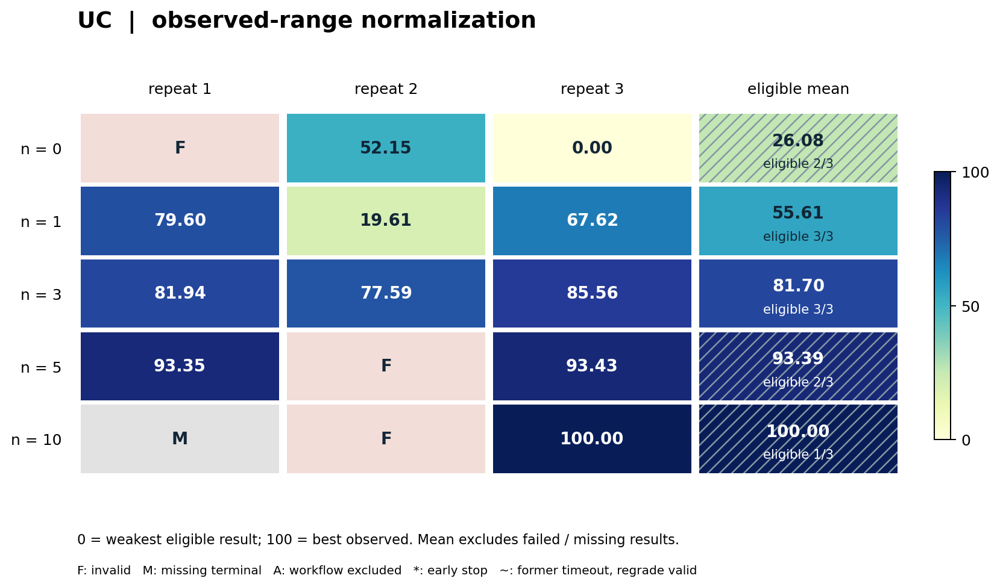

# UC：达到参考质量的求解速度

> 第一版整理：2026-10-19，北京时间。n0/1/3 结果核对至 2026-10-18 15:30；n5/10 补充核对至 2026-10-19 13:39。15 次开发中 14 次形成终评，11 次排程有效；1 次开发 OOM 后未形成合格终态产物。固定基线完成结果更新核对至 **2026-10-20 14:48，北京时间**。

## 1. 任务概览与来源

**任务族 ID：unit-commitment；当前 case：完整 RTS-GMLC 48 时段 UC。**
任务来自 PGLib-UC 的混合整数机组组合问题。
智能体开发可执行 Julia 求解器，读取完整实例并输出启停、出力、备用和可再生发电排程。

本轮主指标是**尽快输出达到固定参考质量的可行解**。
发电成本构成质量门槛；在达到门槛后，更早被可信监督器接收的完整快照得分更高。
这与旧先导中仅比较短时限成本或静态排程的任务不同。

本卡描述已经执行的单实例工作流实验，不代表完成了高难多实例主研究的校准和发布。
SCUC、线路安全约束与 N−1 扩展不在本轮 case 中。
来源：[PGLib-UC 官方仓库](https://github.com/power-grid-lib/pglib-uc)及其公开 MILP 公式，许可为 MIT。

## 2. 具体 case 与选择依据

| 项目 | 当前设置 |
|---|---|
| 上游实例 | rts_gmlc/2020-07-06.json |
| 时域 | 原始完整 48 时段 |
| 火电 / 可再生机组数 | 73 / 81 |
| 网络表示 | 铜板 UC，保留原始负荷、备用、爬坡、启停及成本参数 |
| 冻结输入 SHA256 | 2e68998a3c7849df2307780ab10de2147f21e71bf152d049015315c2b5ff7091 |
| 数据用途 | 同一固定 case 的受保护过程反馈与独立源码重执行 |
| 科学阶段 | 完整工作流重复实验；多 case 主研究尚未发布 |

输入 JSON 与上游该日期实例在解析后逐项相等；字节重排使归档文件 SHA 不同，不表示缩短或改变数学问题。
该实例沿用完整 RTS 工作流验收输入，用于检查源码执行、反馈计数、截止冻结与三 seed 终评。
目前没有“此例为 PGLib-UC 最难实例”的校准证据，也不能将它代表整个 UC 库。
已测过的历史日期与静态排程先导不作为本轮独立重复。

开发端仅获得数学模型、接口、小型示例及 starter；目标完整输入和参考判定仅在可信评测端出现。
固定 case 的含义是所有预算组评分同一个实例，不意味着开发容器直接挂载完整实例。

## 3. 问题定义与约束

内部优化保留原始总运行成本：

$$
C(u,p)=\sum_{t,g}\left[C_g^{\mathrm{production}}(p_{g,t})
 + C_g^{\mathrm{startup}}(u_{g,1:t})\right].
$$

变量包含火电启停状态 on、有功 power、旋转备用 reserve，以及可再生机组全时域出力。
输出没有可信的 solver 自报成本或自报下界；评分器独立重算。

| 保留的原始约束 | 评分要求 |
|---|---|
| 每时段功率平衡 | 火电与可再生总出力等于负荷 |
| 备用需求 | 全部火电备用不低于原始要求 |
| 出力、备用及启停容量 | 含启动 / 停机时的能力限制 |
| 跨期爬坡 | 含初始状态、启动与停机约束 |
| 最小开机 / 停机时长 | 含初始剩余义务与完整时域边界 |
| must-run 与可再生上下界 | 按原始实例逐项验证 |
| 分段生产成本与启动类别 | 依据原始 PGLib 方程独立重构 |

参考来自 2026-10-12 的完整原始 MILP / 固定 HiGHS 运行：
有效上界 U=3729194.9208988217，共同下界 L=3728826.449349424。
这是有依据的参考上下界，不称已证明的最优值。
本轮要求相对共同下界达到 0.1% 质量；不能删约束或降低成本定义来更快过线。

## 4. 智能体任务、starter 与产物接口

starter 是完整原始 PGLib MILP 的 Julia / JuMP / HiGHS 实现，提供 solver.jl 和 pglib_model.jl。
它构建全模型、求解后输出完整排程；智能体可改变建模、搜索、初始化、回调、输出时机和启动开销。
静态解、实例查表与跨 replay 状态不允许。

冻结产物为平面源码目录，至多 32 个文件、总计 2 MiB。
可信调用接口为：

~~~text
julia --startup-file=no --threads=1 solver.jl ABSOLUTE_INSTANCE OUTPUT_DIRECTORY SECONDS SEED
~~~

输出使用 uc-schedule-v1：所有火电的 on / power / reserve 数组及所有可再生出力数组覆盖完整时域。
候选可发布至多 64 个完整 JSON 快照，每个不超过 16 MiB。
每个快照先写新临时文件再原子 rename；接收时间由监督器记录。
评分不信任候选自报时间、可行性、成本、最优状态或界。

执行端禁止联网、向指定输出目录之外写文件、滥用子进程及跨 replay 缓存。
Julia 与 HiGHS 依赖随镜像锁定，候选声明不能扩张执行资源。

## 5. 信息权限、本地测试与反馈 n

开发端可查看 starter、公开数学定义、输出 schema 和小型示例，进行语法、建模、合成例与局部数值测试。
完整目标输入、共同参考与独立 checker 不挂载给开发端。
**目标 case 的完整参考质量评测通过计数接口获得**；不能用其他重复的评分、产物或私有路径绕过计数。
这里的信息合同与允许 GOC 自建全量本地估分的合同不同，不能跨题把 n 解释为相同信息量。

n 是接受的不同候选官方过程反馈上限；相同内容的传输重试保持幂等，不重复收费。
超过预算的内容被拒绝；截止后反馈不能延长开发或重新选择终态源码。
n=0 不提供 judge bridge 和提交入口；仍可在公开模型与合成输入上开发。

每次过程反馈使用 solver seed=0。
终评对同一冻结源码使用 seeds=0/1/2；它们是求解器重放，不是三次独立智能体开发。
最终独立终评不占过程 n，不把终评分数返给开发。

## 6. 演化预算与执行预算

| 项目 | 本轮设置 |
|---|---|
| 开发模型 | bedrock/gpt-5.6-sol |
| Agent | 原生持续开发与工具流程，固定客户端身份 |
| 开发墙钟 | 43200 秒，即 12 小时 |
| 冻结预留 | 15 秒，包含在 43200 秒内 |
| 过程预算 | n=0/1/3：v6；n=5/10：v8 |
| 独立开发重复 | 每档 3 次，共 15 次 |
| 累计 token cap | 无；不设累计预留或 token 终止 |
| 开发容器 | 3 CPU / 8 GiB，无 GPU |
| 求解器 / scorer | 1 CPU、1 solver thread、8 GiB |
| 每个 replay 上限 | 300 秒，包含启动、加载、建模、求解与输出 |
| 过程反馈 transport timeout | 480 秒，不等于增加候选求解限额 |
| 终评 | 三个 solver seed，各自 300 秒，独立于开发墙钟 |

v8 沿用 v6 的全部 62 个冻结数值 / runtime 依赖文件、同一输入和运行镜像。
v7 是 n5/10 guard 未更新而失败的准备版本，没有进入正式开发重复。
本轮所有正式开发均为新身份；历史 canary 或失败准备不算额外重复。

## 7. 评分、冻结与失败规则

对每个 seed，由独立 checker 验证监督器收到的快照，得到可信成本 c 与接收时间 t。
保守数值 guard 为 g=max(0.01, 10⁻⁶|U|)；质量命中须满足：

$$
\frac{c+g-L}{\max(1,|c+g|)}\leq 0.001.
$$

该 seed 的惩罚时间 τ 等于首个有效质量命中快照的接收时间；没有命中则为 600 秒。
正常到时可以保留之前的有效 incumbent；崩溃、资源违规或无有效快照按失败处理。
仅有可行解而未过质量门槛，与完全无效分别记录。

三个 seed 均有有效排程时：

$$
R=\max\left(0,1-\frac{(\tau_0+\tau_1+\tau_2)/3}{600}\right).
$$

若任一 seed 无效，整次终评 reward=0。
valid=true 不要求三个 seed 都质量命中；部分命中可产生正分，全部未命中仍可 valid=true 且 R=0。
因此结果同时报告有效率、全 seed 命中率、惩罚时间与 reward，不能相互替代。
过程投递值有显示舍入；统计使用终评完整精度 ranking 字段。

截止机制先认证停止前冻结源码，再通过只读产物路径发布，接收端逐文件比对哈希。
未认证的冻结即使有残留文件也不进行正式终评。
n10/r1 的开发容器记录 oom_killed=true，冻结资格失败，没有终评分数；保留为缺失值，不补成候选 0 分。

## 8. 基线、最新结果与代表性算法

**2026-10-19 固定基线实验已完成，2026-10-20 回收核对。** 新增 18 次交错校准及 EGRET v5 三种 formulation、9 次 seed 重放均有效达标。程序、实际 Job 身份、完整精度结果及保留的失败版本见[本轮基线复现记录](baseline-reproductions-20261019.md)和[机器可读证据](evidence/baseline-reproductions-20261019.json)。这些是固定算法重执行，不增加下表独立智能体开发重复数。

### 8.1 基线与统计口径

#### 8.1.1 已实测的传统 MILP 起点

完整原始 PGLib MILP / JuMP / HiGHS 是传统优化起点。下表先保留已保存的 **v6 原生 Linux 验收**，其数值来自历史记录；随后另列新增校准和论文方法重执行。三列依次为 solver seeds=0/1/2 的首次达标快照接收时间，均包含启动、加载、建模和输出，使用本卡同一输入、共同下界、1 CPU / 8 GiB 与每 seed 300 秒限额。

| 方法／记录 | seed0 / seed1 / seed2 达标时间 s ↓ | 平均惩罚时间 s ↓ | reward ↑ | 复现状态 |
|---|---|---:|---:|---|
| 未修改完整 MILP starter；native n0 | 210.013 / 237.225 / 225.839 | 224.359 | 0.626068 | 当前原 case、同评分合同实跑；3/3 有效且达标 |
| 同一算法，仅追加 Julia 注释；native n1 | 68.559 / 70.788 / 67.527 | 68.958 | 0.885070 | 计数／冻结验收样本，非新算法 |
| 同一算法，仅追加 Julia 注释；native n3 | 65.656 / 69.734 / 67.793 | 67.728 | 0.887120 | 计数／冻结验收样本，非新算法 |
| 参考界运行：完整原始 MILP / HiGHS | 不作计时基线 | — | — | U=3729194.9208988217；L=3728826.449349424 |

验收 transport 源码和 manifest 哈希匹配：n0 不改 starter，正 n 仅追加注释以生成不同内容指纹。完整精度、逐 seed 达标时间／gap、源码与来源摘要见 [UC 基线证据 v1](evidence/uc-baseline-v1.json)。上述 n 是基础设施验收角色，不属于下表 15 次独立开发，也不向正式开发提供额外反馈。

同一算法在这些历史验收样本间有明显时间差，记录没有分离 JIT／依赖缓存、节点负载或执行次序的影响。**2026-10-19 新增交错校准已完成**：3 blocks × starter／注释控制 × seeds0/1/2，共 18/18 有效达标；starter 9 次均值约 **58.458 s**、注释控制 9 次约 **59.351 s**，各新容器、原 1 CPU／8 GiB／300 s。旧 224.359 s 未在新校准复现；宿主缓存仍未受控，正式 n10/r3 的 43.361 s 也来自另一批执行，故不发布固定加速倍数。逐 seed 接收时间与完整收到的源码清单见[本轮复现 §3](baseline-reproductions-20261019.md#3-uc校准完成论文-formulation-已启动)。历史 macOS 功能验收约 52.05 秒另属不同环境，不作分母；参考 U/L 也不意味着已经证明最优。

#### 8.1.2 竞赛与论文方法的复现状态

本例来自开放 benchmark 库，当前材料没有对应竞赛榜单；不用其他 UC／SCUC 竞赛的成本或名次替代本 case 基线。

| 方法与可核验来源 | 当前复现结果 | 比较限制 |
|---|---|---|
| [PGLib-UC 原始数学模型](https://github.com/power-grid-lib/pglib-uc/blob/39a7f38cf4703de92f0291f0c873c2e98c789301/README.md) + 完整 MILP / HiGHS | 已实现并在上表同 case 实跑；新增交错校准 18/18 seed 有效达标 | 宿主缓存／节点负载仍未分离，不把新旧时间差归因于算法 |
| Knueven、Ostrowski、Watson，*On Mixed-Integer Programming Formulations for the Unit Commitment Problem*（INFORMS Journal on Computing，2020，[DOI](https://doi.org/10.1287/ijoc.2019.0944)、[作者全文](https://optimization-online.org/wp-content/uploads/2018/11/6930.pdf)）；[EGRET 官方模型](https://github.com/grid-parity-exchange/Egret/blob/main/egret/models/unit_commitment.py)中的 Tight / Compact / Random1 | **v5 完整 case 的三种方法各 3/3 seed 有效达标**，共 9/9；逐 seed 时间及 reward 如下 | 原 checker、1 CPU／8 GiB、每 seed 300 s；Python／Pyomo 接口扩展，不能直接与 Julia／JuMP 作纯 formulation 加速归因 |

EGRET 已固定作者 commit `28c324f9bf4fb3913b0a60dba3dd732b46084c3b`，显式关闭 demand slack 和 reserve shortfall。v4 完整 case 发现上游 `relax_balance=False` 被误处理为“发电≥需求”，造成适配合同失败：三种方法的 9 次 seed 重放均无有效快照、reward=0，全部旧证据保留，不作论文方法质量结论。v5 在适配器显式绑定等式，作者文件与原物理 checker 不改；三种 formulation 的过发电拒绝、可再生能源削减、已知成本及原沙箱 native 验收通过后，才提交三份新固定数值 Job，现已全部成功完成。

| EGRET v5 方法 | seed0 首次达标 s ↓ | seed1 首次达标 s ↓ | seed2 首次达标 s ↓ | 平均惩罚时间 s ↓ | reward ↑ | 有效且达标 |
|---|---:|---:|---:|---:|---:|---:|
| Tight | 71.877536 | 70.484365 | 67.395412 | 69.919104 | 0.883468160 | 3/3 |
| Compact | 95.064006 | 63.803503 | 83.069477 | 80.645662 | 0.865590563 | 3/3 |
| Random1 | 45.342455 | 15.983200 | 14.450795 | 25.258817 | 0.957901972 | 3/3 |

时间采用原监督器收到首个达标快照的记录，不是 solver 自报时间或整个求解进程退出时间；三次 seed 独立启动，所有完整排程由原 checker 验证，共同下界相对 gap 约 `9.8807×10⁻⁵`。v5 冻结闭包 SHA256 为 `aaec66575bac354f9972b6005ea6f19a45381229692137a1fdc25a46563579f2`，三份完成回执、原始精度及 v4 失败记录均见[机器可读证据](evidence/baseline-reproductions-20261019.json)。

两种接口的 HiGHS 后端同为 1.15.1，但 Python／Pyomo 与 Julia／JuMP 启动／建模不同；宿主缓存、节点负载及执行批次也没有被配对控制。Random1 在本次重放中较早达标，是当前 case 的已测锚点，不据此发布相对 starter 或演化程序的稳定加速倍数。论文原实验的求解器、实例集合和计时条件也不同，不直接搬其时间到当前合同。

#### 8.1.3 正式开发结果的统计口径

各完整组 reward 均值与样本标准差包含有效评分的 0 分，无效终评不会被筛掉。
n10/r1 无终评分数，因此不计算完整三重复组均值。
下表“有效 / 计划”以 3 次计划重复为分母，另列已形成终评数。

| n | 已形成终评 | 有效 / 计划 | 三 seed 全命中 / 计划 | 全三次 reward 均值 ± 样本标准差 | 最好已评分 reward |
|---:|---:|---:|---:|---:|---:|
| 0 | 3/3 | 2/3 | 0/3 | 0.161282 ± 0.279349 | 0.483846 |
| 1 | 3/3 | 3/3 | 2/3 | 0.515902 ± 0.294553 | 0.738471 |
| 3 | 3/3 | 3/3 | 3/3 | 0.757935 ± 0.037028 | 0.793770 |
| 5 | 3/3 | 2/3 | 2/3 | 0.577620 ± 0.500234 | 0.866811 |
| 10 | 2/3 | 1/3 | 1/3 | 不计算（缺 1 次） | 0.927732 |

### 8.2 逐次最终成绩

| n | 重复 | reward ↑ | 惩罚时间 s ↓ | 终评有效 | 全 seed 命中 | 实际反馈 |
|---:|---:|---:|---:|---|---|---:|
| 0 | r1 | 0.000000000 | 600.000 | 否 | 否 | 0 |
| 0 | r2 | 0.483845886 | 309.692 | 是 | 否 | 0 |
| 0 | r3 | 0.000000000 | 600.000 | 是 | 否 | 0 |
| 1 | r1 | 0.738471395 | 156.917 | 是 | 是 | 1 |
| 1 | r2 | 0.181887174 | 490.868 | 是 | 否 | 1 |
| 1 | r3 | 0.627347131 | 223.592 | 是 | 是 | 1 |
| 3 | r1 | 0.760214265 | 143.871 | 是 | 是 | 3 |
| 3 | r2 | 0.719819818 | 168.108 | 是 | 是 | 3 |
| 3 | r3 | 0.793769924 | 123.738 | 是 | 是 | 3 |
| 5 | r1 | 0.866049572 | 80.370 | 是 | 是 | 5 |
| 5 | r2 | 0.000000000 | 457.532 | 否 | 否 | 5 |
| 5 | r3 | 0.866810629 | 79.914 | 是 | 是 | 5 |
| 10 | r1 | —（开发 OOM，未终评） | — | — | — | 10 |
| 10 | r2 | 0.000000000 | 600.000 | 否 | 否 | 10 |
| 10 | r3 | 0.927731942 | 43.361 | 是 | 是 | 10 |

14 次已评分中 11 次有效、8 次三个 seed 全部质量命中。
n0/r2 在三个 seed 中命中两次，故 reward>0，但全 seed 命中为否。
n5/r2 仅 seed1 有效且命中，其他两个 seed 无有效快照，整次 reward=0。
n10/r2 三个 seed 均无有效快照；n10/r1 则是开发 OOM 导致冻结资格失败，二者不能合为同一种候选错误。

完整组中 n3 均值最高且三次均有效、全命中；n5 的两次高分被一次无效拉低。
单次最好来自 n10/r3（0.927731942），但 n10 组缺一次，不能据此宣称高预算组平均最好。
每档 3 次且跨种子波动、开发失败存在，不做显著性或普适预算结论。

### 8.3 代表性算法与改进机制

**n3/r3：完整 MILP、改善解回调与固定启停 LP 清理。**
starter 主要在求解结束后写一次排程；终态降低 Julia 一次性编译开销，保留 JuMP / HiGHS 完整模型，并绑定 improving-solution callback。
出现首个解、较大改善或接近质量门槛时便发布完整快照；结束后固定启停，利用剩余时间做 LP 出力清理。
对应源码 solver.jl（443afe60…）、pglib_model.jl（6a904e5e…）与终评清单一致。
其机制直接针对“可信接收首个达标解”：早输出可能比等待最终最优解更有效。
终态三 seed 命中时间为 120.655 / 127.780 / 122.779 秒，reward=0.793769924。
三次过程 reward 为 0.914415 → 0.899472 → 0.887012；与终态不同，不能用过程最好值替代冻结结果。

**n10/r3：原始 MILP 矩阵直接进入 HiGHS C API。**
终态将解析后的输入转为具体类型记录，直接构建稀疏约束矩阵并调用原生 HiGHS，减少建模桥接与 Julia JIT 的一次性开销。
它保留完整问题，调整求解器 gap / 根节点启发式，利用改善解回调和轻量序列化原子发布完整排程。
已核对 solver.jl（f8fddc32…）、pglib_model.jl（08a9361a…）、highs_c_api.jl（8e297916…）及终评哈希。
三 seed 命中为 41.862 / 42.301 / 45.920 秒，reward=0.927731942。
10 次过程反馈最好 reward=0.940165，最后一次为 0.891623；终态三 seed 均分独立计算。
这些观察支持其启动和输出策略值得分析，但尚无分离 JIT、建模和搜索贡献的消融测量。

**n5/r2：同型机组缩减模型暖启动与完整模型回退，跨 seed 可靠性不足。**
源码实现了同型机组结构检测与缩减求解路径：符合条件时求 quotient 模型，将排程提升到完整机组，用作原始完整 MILP 的暖启动；保留完整模型回退和本地可行性检查。
该思路试图先取得廉价 incumbent，再优化完整问题，源码 solver.jl（740ea581…）与冻结清单匹配。
过程五次反馈均有效、最好 reward=0.925723；终评却仅一个 seed 有有效排程，整次记 0。
因此本轮反馈 seed0 的有效记录不能保证后来冻结源码在三个 seed 上稳定有效。
现有证据还不能把失败归因于 quotient、重构、最终修改或数值误差，需要逐快照诊断；不把代码意图写成已证实的提速。

上述链条描述 starter 与终态的可核验结构变化，结合计数日志展示过程表现；没有逐模块消融时不声称单项改动导致全部收益。

<!-- normalized-v1:start -->
### 8.4 归一化可视化对照

按本子 case 全部 `n` 的有效终态范围映射到 0–100，越高越好；0 是本批最弱有效结果，100 是本批最好有效结果。每档 `n` 使用相同锚点。该分数用于显示相对位置，不代表理论最优或跨任务同等能力。详见[统一方法和横向总览](README.md#normalized-results)。

本表均值／样本标准差只对纳入的有效结果计算，是新增的**可视化条件统计**，不替代上文的原始主统计。必须结合“纳入 / 计划”阅读；仅 1 次纳入时不估计标准差。图中斜线表示该组存在未纳入结果。

`F`＝候选无效；`M`＝缺失终评（开发 OOM）；`A`＝流程收尾审计失败；`NS`＝该档未设置。`†`＝已记录的开发提前结束（图中 `*`）；`§`＝原超时、本次统一补评有效（图中 `~`）。这些符号与数值 0 不同，均保留原始结果表。

有效但未达到全部 seed 质量门槛的候选仍纳入，包括 n0/r3 的有效 0 分。n10 的均值 100 只来自 1/3 个有效重复，不能解释为该档整体优于其他档；另 1 次候选无效、1 次因开发 OOM 未形成终评。

#### UC

| n | r1 | r2 | r3 | 有效样本归一化均值 ± 样本标准差 | 纳入 / 计划 | 补充状态 |
|---|---|---|---|---|---|---|
| 0 | F | 52.15 | 0.00 | 26.08 ± 36.88 | 2/3 | 全 seed 达标 0/3 |
| 1 | 79.60 | 19.61 | 67.62 | 55.61 ± 31.75 | 3/3 | 全 seed 达标 2/3 |
| 3 | 81.94 | 77.59 | 85.56 | 81.70 ± 3.99 | 3/3 | 全 seed 达标 3/3 |
| 5 | 93.35 | F | 93.43 | 93.39 ± 0.06 | 2/3 | 全 seed 达标 2/3 |
| 10 | M | F | 100.00 | 100.00（仅 1 次） | 1/3 | 全 seed 达标 1/3 |

[矢量图](assets/normalized-v1/uc.svg)。
<!-- normalized-v1:end -->

## 9. 结论边界、复现与证据

当前结果展示同一完整 RTS case 上，反馈预算、求解速度和冻结算法可靠性的共同变化。
它不证明跨日期或跨系统泛化，也不构成已校准的多 case UC 主榜；本轮没有 SCUC 安全评测。
开发 OOM、终评无可行快照、仅质量未达标和源码冻结失败分别保留。

便携 [UC 证据摘要](evidence/uc.json)包含 15 个逻辑身份、14 份最终 score、每 seed 结果、反馈用量、组统计、源码哈希及来源哈希。
公开摘要不包含私有路径、模型服务地址或凭证；它不是完整重现包。
重现仍需冻结 Julia / HiGHS 镜像、输入许可、独立 checker、参考下界证明与原始候选源码闭包。

| 证据版本 | 标识 / SHA256 前缀 | 范围 |
|---|---|---|
| n0/1/3：v6 | 9669c73c2f8b1cd3… | 9 次新独立开发，均完成终评流程 |
| n5/10：v8 | 42217a80e99c2e0c… | 6 次新独立开发，5 次形成终评 |
| 数值闭包 | v6/v8 的 62 个冻结依赖逐字节相同 | 输入、评分与运行时一致性 |
| 终态记录 | status-20261018-153010.json / remote-missing-results.json | 完整原始值与缺失说明 |
| 冻结源码 | remote-supplemental-evidence.json | 代表性算法的终评哈希匹配 |

上游来源：[PGLib-UC 固定版本说明](https://github.com/power-grid-lib/pglib-uc/blob/39a7f38cf4703de92f0291f0c873c2e98c789301/README.md)、[UnitCommitment.jl 的 PGLib 实例目录](https://anl-ceeesa.github.io/UnitCommitment.jl/0.4/guides/instances/#PGLIB-UC-Instances)。
旧版 [任务卡](../task-cards/unit-commitment.md)保留历史 UC / SCUC 设计；本卡描述最新实际执行的速度工作流 case。
